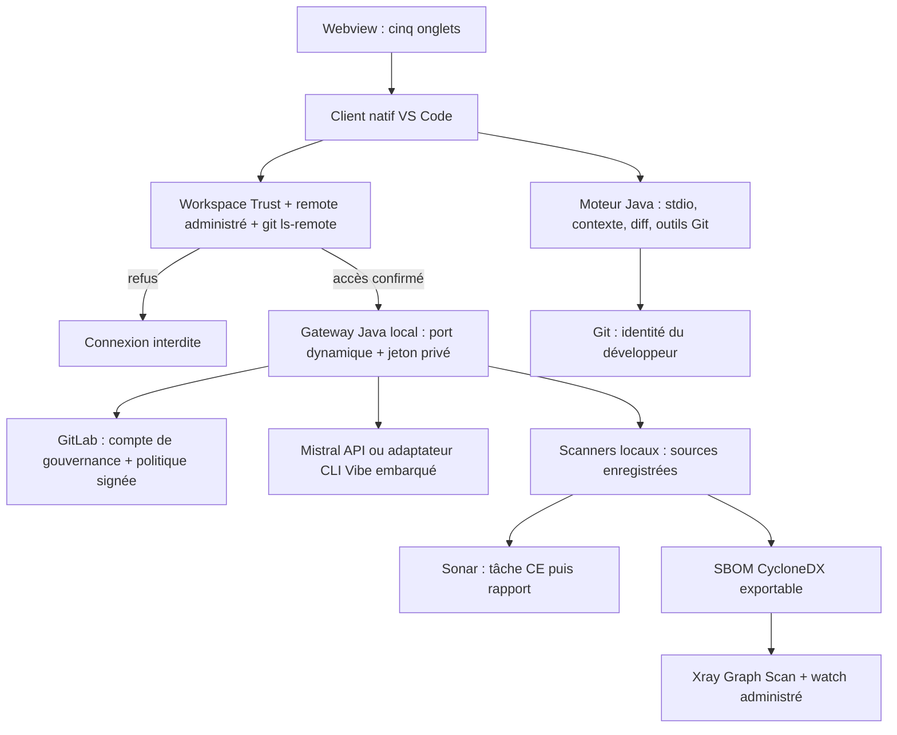

# Architecture 0.3.0

Le contrôle Git précède le lancement du gateway. Le dépôt vérifié et sa racine sont transmis par le lancement natif, jamais par la webview. Le gateway refuse les autres projets même si son compte de service peut les lire. La boucle locale exige le jeton aléatoire du lancement ; elle n’utilise ni SSO ni token GitLab de service pour une publication GitFlow.

La configuration organisationnelle se trouve dans `runtime/deployment.json`, avec empreinte, gateway et adaptateurs. Vibe 3.0.3 est embarqué avec ses dépendances et licences. Le bridge CLI Python utilise son backend officiel, sans interface interactive, outils directs, hooks ni configuration personnelle. Les outils du LLM restent typés, filtrés et soumis aux approbations ODS. Les secrets sont transmis aux processus appropriés via environnement privé ou stdin, jamais dans les arguments ni le DOM.

Les analyses locales utilisent un fingerprint SHA-256 des sources Git suivies et non suivies non ignorées, hors sorties générées et fichiers sensibles exclus. Un changement pendant le scan invalide son résultat. Xray reçoit le graphe CycloneDX ; Sonar reçoit les données produites par son scanner. Le rapport Sonar doit correspondre au ceTaskId soumis et rester l’analyse courante pendant la lecture. Les remédiations exigent la même empreinte que le rapport.

Les données persistées sont chiffrées dans le stockage de l’extension par workspace. Une clé stable vient du profil ou de SecretStorage. La fermeture du canal parent arrête le gateway et ses descendants ; aucun processus externe préexistant n’est arrêté. Les quotas et signatures locaux restent soumis au contrôle du propriétaire du poste : l’autonomie acceptée ne fournit pas une autorité centrale inviolable.

Le code serveur séparé historique conserve son authentification OIDC et ses runners pour non-régression. Le VSIX ne l’utilise pas. Les tests de ce mode restent distincts des tests de la nouvelle connexion Git locale. Voir [EVOLUTION](EVOLUTION-0.3.0.md) pour les exigences et [VALIDATION](VALIDATION.md) pour les preuves.
