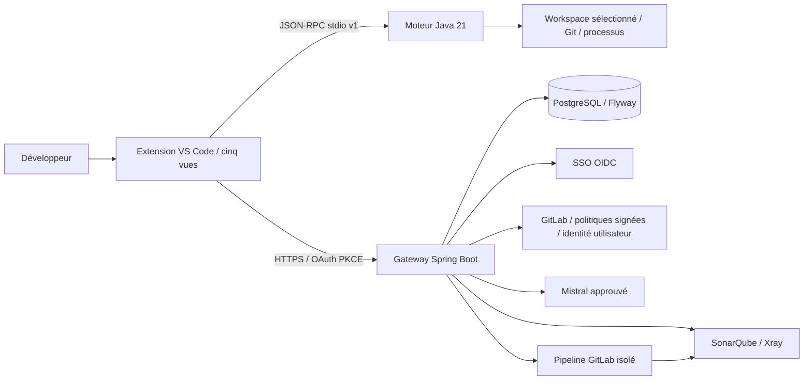
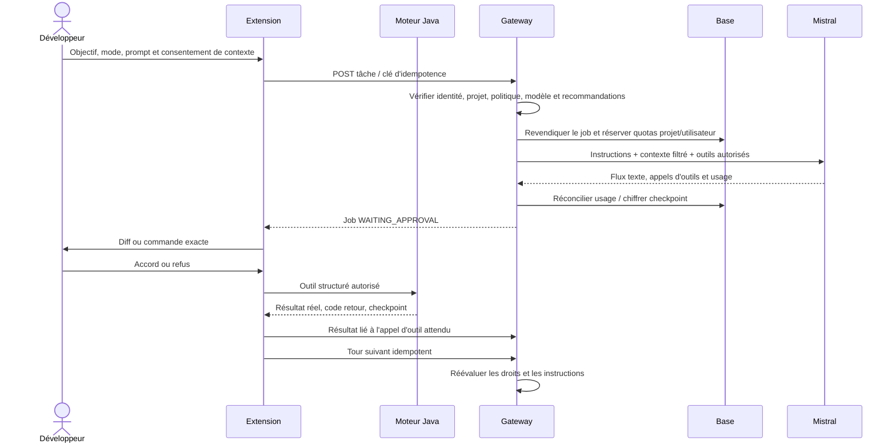

# Architecture livrée — ODS 0.1.0

Référentiel : DEVAI-001 à DEVAI-166 dans `specification.md`. La matrice `CONFORMITE.md` distingue réalisation, qualification externe et écarts. Ce document décrit le code livré.

L'extension porte les interactions natives, le stockage des jetons utilisateur et la boucle de présentation des outils. Le moteur Java exécute les outils locaux, valide les chemins et applique les changements. La gateway compose les instructions, décide des droits et appelle les services. **Écart architectural explicite** : le transport gateway et une partie de la boucle d'outils résident actuellement dans l'extension ; le référentiel cible une orchestration locale plus largement Java. Le protocole permet cette extraction ultérieure sans modifier les cinq vues.

## Décisions et contrats de confiance

- Aucun fournisseur autre que Mistral n'est activable. Le port `ModelProvider` autorise une extension future contrôlée côté serveur. L'alias, le modèle exact et sa capacité outils sont approuvés dans la politique signée.
- Les secrets techniques restent sur la gateway ou dans les jobs de scan dédiés. Les jetons développeur OIDC/GitLab restent dans SecretStorage. Le modèle ne reçoit jamais une autorité issue de ses propres sorties.
- L'IPC utilise une ligne JSON-RPC 2.0 par requête/réponse, avec version de protocole 1 et limite de 8 Mio. Une expiration ne rejoue pas l'effet. L'extension vérifie l'empreinte de son JAR avant démarrage.
- L'intégrité du JAR détecte les modifications du fichier relativement au manifeste livré. Un attaquant capable de remplacer tout le VSIX impose une distribution organisationnelle approuvée : un hash voisin n'est pas une racine de confiance indépendante.
- `PathGuard` borne la racine réelle, exclut secrets, métadonnées Git, sorties générées et dépôts imbriqués. Un build approuvé exécute du code du projet : l'exécuteur local n'est pas une sandbox du système d'exploitation.
- Les politiques, prompts et starters organisationnels utilisent des signatures Ed25519 sur les octets exacts. Le serveur conserve les versions anti-rejeu des politiques et prompts dans PostgreSQL. Les starters vérifient signature/dates/empreintes ; leur watermark local durable reste à compléter.

## Tour d'agent

Les appels modèle ne disposent pas d'un shell libre. Les propositions sont des changements structurés avec empreintes de base. Le moteur prépare des copies récupérables et refuse une base périmée ; l'extension refuse un buffer non enregistré. Les commandes ont une échéance et une sortie bornée. Un résultat d'outil inexistant n'est pas une preuve de réussite.

## Persistance et concurrence

Flyway crée `watermark`, `audit`, `job`, `quota`, `reservation`, `conversation`, `execution_guard` et `subject_quota`. Les compteurs utilisent des transactions et des verrous de lignes ; les insertions concurrentes gèrent les collisions d'unicité. L'ordre des verrous de quota est projet puis utilisateur. La réconciliation verrouille la réservation et ne la consomme qu'une fois.

Les contenus de conversations et résultats sont chiffrés en AES-256-GCM avec contexte authentifié et nonce aléatoire. Les jobs possèdent un bail de cinq minutes. Une perte de worker suspend le job ; la reprise explicite marque les effets interrompus comme incertains. Le système ne promet pas une transaction distribuée exactement une fois chez GitLab ou Mistral : un résultat externe perdu doit être vérifié avant toute répétition.

## Analyse de qualité et sécurité

Le connecteur déclenche un pipeline dans un projet runner dédié sur une révision administrée. Celui-ci récupère le commit cible exact, compile dans un job isolé, puis utilise les scanners réels. Les tâches de scan ne nécessitent aucun droit IA. Les corrections utilisent les actions séparées `SONAR_REMEDIATION` et `XRAY_REMEDIATION` et une sélection native d'issues. Un nouveau scan est nécessaire pour constater la résolution.

Les contrats Sonar proviennent des [exemples officiels de l'API](https://github.com/SonarSource/sonarqube/tree/master/server/sonar-webserver-webapi/src/main/resources/org/sonar/server). La lecture Xray utilise [Build Summary v2](https://docs.jfrog.com/security/reference/build-summary_artifacts-v2-openapi). Les licences, versions et formats de l'organisation doivent encore être qualifiés.

## Personnalisation et tests d’intégration 0.2.0

Le template de présentation est séparé du contrôleur natif et testé dans Chromium avec les mêmes fichiers HTML/JS/CSS. Le profil organisationnel n’affecte que le staging de distribution et la configuration externe ; il ne désactive pas les contrôles serveur. Les tests HTTPS exercent les adaptateurs réels contre un serveur local de fixtures, un issuer OIDC et une politique signée éphémères. Aucun serveur de mocks n’est embarqué dans le JAR ou activable en production.
