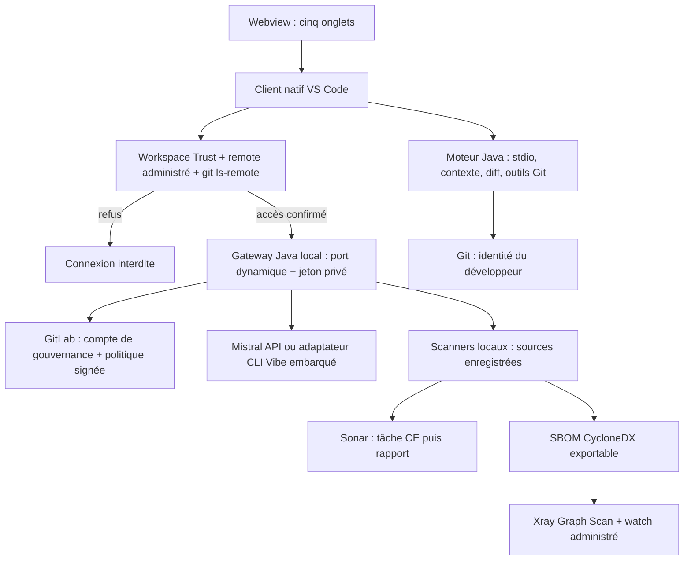

# Architecture 0.7.0

La pré-revue GitFlow utilise `GET /api/v1/git/mr-context` : contrôle d’accès GitLab, résolution des deux branches en SHA immuables, puis comparaison avec leur base commune. Seuls chemins, statuts et diffs sont conservés ; les métadonnées personnelles des commits ne sont pas transmises. Les limites et contrôles de secrets s’appliquent avant l’appel au modèle. Le client lance la tâche gouvernée `gitlab-mr-description` en mode Question, valide une réponse structurée couvrant exactement les fichiers et produit un aperçu Markdown. Le POST de création transmet aussi les SHA source/cible, vérifiés à nouveau avant publication. Un changement distant après cette dernière vérification reste possible : les SHA figurent donc explicitement dans la description. Le contrat de comparaison suit l’[API officielle GitLab](https://docs.gitlab.com/api/repositories/#compare-branches-tags-or-commits). Exigences : DEVAI-037, DEVAI-112, DEVAI-113.

Le contrôle Git précède le lancement du gateway. Le dépôt vérifié et sa racine sont transmis par le lancement natif, jamais par la webview. Le gateway refuse les autres projets même si son compte de service peut les lire. La boucle locale exige le jeton aléatoire du lancement ; elle n’utilise ni SSO ni token GitLab de service pour une publication GitFlow.

La configuration organisationnelle se trouve dans `runtime/deployment.json`, avec empreinte, gateway et adaptateurs. Vibe 3.0.3 est embarqué avec ses dépendances et licences. Le bridge CLI Python utilise son backend officiel, sans interface interactive, outils directs, hooks ni configuration personnelle. Les outils du LLM restent typés, filtrés et soumis aux approbations ODS. Les secrets sont transmis aux processus appropriés via environnement privé ou stdin, jamais dans les arguments ni le DOM.

Les analyses locales utilisent un fingerprint SHA-256 des sources Git suivies et non suivies non ignorées, hors sorties générées et fichiers sensibles exclus. Un changement pendant le scan invalide son résultat. Xray reçoit le graphe CycloneDX ; Sonar reçoit les données produites par son scanner. Le rapport Sonar doit correspondre au ceTaskId soumis et rester l’analyse courante pendant la lecture. Les remédiations exigent la même empreinte que le rapport.

Depuis 0.5.0, le clic de correction autorise la création d’une branche dédiée et l’application des propositions avec checkpoints. Le contrôleur conserve le rapport initial, lance le job local VALIDATE puis un nouveau scan, et transmet les diagnostics au modèle en cas d’échec. Le nombre maximal de tentatives est choisi et mémorisé par l’utilisateur. Le diff est différé jusqu’à la validation ; le bilan par anomalie distingue les preuves du scanner des explications du modèle. Le parcours de couverture utilise les métriques Sonar agrégées et par fichier, avec contrôle du périmètre initial. Le rapport PDF est généré localement sans ressource distante.

Les données persistées sont chiffrées dans le stockage de l’extension par workspace. Une clé stable vient du profil ou de SecretStorage. La fermeture du canal parent arrête le gateway et ses descendants ; aucun processus externe préexistant n’est arrêté. Les quotas et signatures locaux restent soumis au contrôle du propriétaire du poste : l’autonomie acceptée ne fournit pas une autorité centrale inviolable.

Le code serveur séparé historique conserve son authentification OIDC et ses runners pour non-régression. Le VSIX ne l’utilise pas. Les tests de ce mode restent distincts des tests de la nouvelle connexion Git locale. Voir [EVOLUTION](EVOLUTION-0.3.0.md) pour les exigences et [VALIDATION](VALIDATION.md) pour les preuves.

## Mapping Sonar dynamique (0.6.0)

DEVAI-188 : `PolicyService.sonarProjectKey` résout le champ facultatif `projects[].sonarProjectKey` depuis le snapshot signé et validé, avant le repli `ods.sonar-project-<ID_GITLAB>`. Les services d’analyse locale et de lecture Sonar utilisent cette même résolution. L’accès Git reste vérifié indépendamment des droits IA ; un projet interdit à l’IA peut être analysé. Le cache de politique dure 60 secondes, sans repli sur une politique expirée ou invalide.

## Fournisseurs IA et isolation des JDK (0.7.0)

Le fournisseur reste résolu côté gateway en croisant le catalogue de modèles de la politique Ed25519 et `ODS_PROVIDER_REGISTRY` du package. Le profil standard reste Mistral. Le profil `mistral-openai` ajoute le backend générique OpenAI Chat Completions de Vibe 3.0.3, avec endpoint et hôte HTTPS fixes et credential distinct. Les modèles exacts, capacités et budgets optionnels restent contrôlés par la politique signée ; chaque réservation et événement d'audit garde le fournisseur, l'alias et le modèle. Une panne ne change pas de fournisseur.

Le build du projet ODS peut utiliser Java 21 via `ods.javaPath`. Les processus de commandes workspace héritent séparément du `PATH` et de `JAVA_HOME` du poste, après filtrage des secrets ODS. Maven, son wrapper et les toolchains du projet gardent donc la possibilité de sélectionner Java 25 selon le POM ; aucune option Java 21 n'est ajoutée par la gateway.
