# Spécification complète — Organisation Development Standard (ODS)

**Version documentaire : 1.1 — 29 octobre 2026**  
**Statut : référentiel cible ; une implémentation 0.1.0 est présente. Voir `docs/CONFORMITE.md` pour la couverture et les écarts, et `docs/VALIDATION.md` pour les preuves. La conformité complète n’est pas encore prononcée.**
**Public : architecture, tech leads, développeurs, sécurité, exploitation et recette.**

## Sommaire

- [1. Référentiel, portée et règles de lecture](#section-1)
- [2. Cadrage et architecture — DEVAI-001 à DEVAI-012](#section-2)
- [3. Extension, IPC et identité — DEVAI-013 à DEVAI-024](#section-3)
- [4. Ségrégation, intégrité et confidentialité — DEVAI-025 à DEVAI-044](#section-4)
- [5. Project Initializer et starters — DEVAI-045 à DEVAI-062](#section-5)
- [6. IA, prompts, agents et consommation — DEVAI-063 à DEVAI-083](#section-6)
- [7. Quality / SonarQube — DEVAI-084 à DEVAI-094](#section-7)
- [8. Application Security / JFrog Xray — DEVAI-095 à DEVAI-105](#section-8)
- [9. GitFlow et merge requests — DEVAI-106 à DEVAI-116](#section-9)
- [10. Contrats, données et exploitation — DEVAI-117 à DEVAI-132](#section-10)
- [11. Développement, tests et livraison — DEVAI-133 à DEVAI-150](#section-11)
- [12. Agent de développement intégré — DEVAI-151 à DEVAI-160](#section-12)
- [12 bis. Prompts système et recommandations organisationnelles — DEVAI-161 à DEVAI-166](#section-12bis)
- [13. Architecture détaillée et contrats associés](#section-13)
- [14. Exemples de politiques et configurations](#section-14)
- [15. Exemples de code commentés et traçables](#section-15)
- [16. Plan de réalisation, matrice de couverture et recette](#section-16)
- [17. Références techniques et statut documentaire](#section-17)

<a id="section-1"></a>

## 1. Référentiel, portée et règles de lecture

### 1.1. Sources et priorité

Cette spécification est construite à partir des 13 pages de `Organisation_Development_Standard_Architecture_avec_Interface.pdf`, dossier d'architecture V1.0 du 28 octobre 2026. Empreinte SHA-256 du PDF analysé : `d2ef94333ac3df6d394ad23ec3d0ddf61b40052df2fedd5ef81217a96901639a`. La maquette de la page 3 et le schéma d'architecture de la page 4 font partie du référentiel.

Ordre de priorité : demandes explicites de l'utilisateur, exigences de ce document qui les déclinent, prescriptions du PDF, puis compléments de conception explicitement identifiés. Les contraintes de développement du dépôt s'appliquent en complément. Aucun exemple de domaine, de quota, de projet GitLab ou de version du PDF ne représente une configuration réelle.

Trois origines sont utilisées dans les exigences : **PDF p. N** pour une prescription issue du document ; **Utilisateur** pour Maven, les starters standards substituables, les commentaires traçables, l'autorisation initiale limitée aux modèles Mistral et l'agent IDE de développement complet ; **Conception** pour une précision nécessaire à l'implémentation. Une exigence peut combiner ces origines. Les choix de conception constituent la base proposée pour développer ; les paramètres dépendant de l'organisation restent explicitement à renseigner avant production.

Chaque exigence possède un identifiant stable `DEVAI-001` à `DEVAI-166`, une prescription vérifiable, un responsable technique et un critère de recette. Les identifiants ne seront jamais réaffectés après suppression d'une exigence. Les exemples, tableaux et diagrammes précisent les exigences qu'ils citent ; ils ne constituent pas de nouvelles exigences sans identifiant. **Toutes les exigences sont obligatoires pour la version complète**, sauf variantes explicitement optionnelles. Le découpage en lots ordonne le développement, sans réduire le périmètre final. Les exigences DEVAI-151 à DEVAI-160 intègrent la précision utilisateur : l'onglet IA Code Generator offre une expérience d'agent de développement comparable, dans ses parcours, à Codex, Continue ou Copilot, et ne se limite pas à un chatbot.

Le terme **DOIT** exprime une obligation, **NE DOIT PAS** une interdiction et **PEUT** une variante facultative. Les diagrammes sont écrits en Mermaid et peuvent être visualisés dans un lecteur Markdown compatible. Les classes, chemins de code, contrats et tables présentés sont **des éléments à créer**, pas des éléments supposés exister dans le dossier actuel.

### 1.2. Cadrage général

ODS est une extension VS Code Desktop permettant de créer des projets conformes, utiliser une IA gouvernée, consulter la qualité et la sécurité applicative, proposer des corrections contrôlées et réaliser les opérations Git/GitLab. Sa valeur repose sur une gouvernance cohérente du poste au serveur : l'interface facilite les actions, le moteur Java prépare et orchestre, la gateway applique les autorisations effectives.

Les objectifs de résultat sont : rendre opérationnels les cinq onglets ; livrer les quatre familles de starters Java, Python, .NET et Angular ; empêcher un accès IA serveur sans droits valides ; tracer les opérations, les consommations et les exigences ; produire une installation reproductible et une recette vérifiable.

| Acteur | Responsabilités | Limite de pouvoir |
|---|---|---|
| Développeur | Créer, analyser, demander une assistance, relire les diff, gérer ses branches et MR | Ne modifie pas les politiques ni les comptes techniques |
| Responsable des standards | Publier les catalogues de versions et starters | Ne s'attribue pas implicitement les droits IA |
| Responsable IA / sécurité | Approuver politiques, modèles, prompts et permissions d'agents | Publication gouvernée et auditée |
| Exploitant | Déployer gateway, base, runners, certificats et rotation des secrets | Pas d'accès par défaut aux contenus de code |
| Auditeur | Consulter les décisions, preuves et consommations autorisées | Lecture limitée au périmètre attribué |
| Services tiers | GitLab, fournisseur IA approuvé, SonarQube, JFrog Xray, IdP, coffre | Accès par contrats et droits minimaux |

### 1.3. Périmètre et exclusions

Inclus : VS Code Desktop Windows et Linux ; extension TypeScript ; moteur local Java 21 ; gateway Java 21 / Spring Boot ; Maven pour tous les composants et starters Java ; GitLab API v4 ; OIDC ; PostgreSQL en production ; intégrations Mistral, SonarQube et JFrog Xray ; configuration signée ; distribution VSIX et package `suiteInstall`. **État actuel de l'organisation : seuls les modèles Mistral explicitement approuvés sont autorisés.** Le contrat de connecteur permet une extension future à d'autres fournisseurs, tous désactivés tant qu'une nouvelle décision organisationnelle ne les autorise pas.

Exclus de la première version complète : VS Code Web, prise en charge garantie de macOS, Remote SSH/WSL/Dev Containers non qualifiés, console web d'administration dédiée, entraînement de modèles, marketplace publique d'agents, mise à jour autonome des postes, exécution de commandes arbitraires et promesse de sécurité absolue d'un poste compromis. L'administration initiale passe par des dépôts GitLab protégés et les outils d'exploitation. Un connecteur de publication GitHub peut servir au dépôt de développement de l'application sans remplacer les fonctions GitLab du produit.

Angular et Python sont des **cibles de génération de projets** ; ils ne remplacent pas Java dans le moteur et la gateway. L'interface ODS utilise TypeScript et les API VS Code ; aucune application Angular supplémentaire n'est imposée pour cette interface.

### 1.4. Décisions structurantes

| Décision | Base de réalisation | Justification et références |
|---|---|---|
| Répartition | Extension mince, moteur Java, gateway modulaire | DEVAI-002 à DEVAI-004 |
| Build Java | Maven exclusivement, wrapper et versions fixées | DEVAI-005, DEVAI-048, DEVAI-133 |
| IPC | JSON-RPC 2.0 sur stdio pour V1 | DEVAI-014 ; pas de port local ouvert par défaut |
| Bootstrap | Spring Initializr, Angular CLI, modèle Python conforme PyPA, templates .NET SDK | DEVAI-048 à DEVAI-051 |
| Surcharge | Catalogue signé, remplacement ou overlay contrôlé | DEVAI-052 à DEVAI-054 |
| Autorité IA | Gateway, refus par défaut et décision par action | DEVAI-025 à DEVAI-039 |
| Exécution des scans | Runners organisationnels isolés par défaut | DEVAI-085, DEVAI-096 ; aucun secret technique livré au poste |
| Contexte | Mode local gouverné et mode renforcé vérifié côté serveur | DEVAI-040 à DEVAI-042 |
| Asynchronisme | Jobs persistés PostgreSQL, workers et baux de traitement | DEVAI-119, DEVAI-120 |
| Administration | GitLab protégé, signature et publication CI | DEVAI-031, DEVAI-044 |

### 1.5. Paramètres d'environnement à renseigner

| Paramètre | Valeur de conception | Condition avant production |
|---|---|---|
| GitLab | `<GITLAB_BASE_URL>`, IDs des dépôts de gouvernance | Instance, certificats, permissions et projets de qualification confirmés |
| Identité | `<OIDC_ISSUER>`, `<OIDC_CLIENT_ID>` | Audience, claims, mapping GitLab et flux natif testés |
| Versions | Java 21 ; Spring Boot 4.x ; Maven 3.9.x | Versions correctives exactes et matrice de compatibilité verrouillées |
| IA | Alias organisationnel ; fournisseur initial `MISTRAL` uniquement | Modèles Mistral exacts, limites, rétention et transfert de sources approuvés ; autre fournisseur interdit par défaut |
| Sonar / JFrog | URLs et versions administrées | Licences, API, scanners, droits et runners disponibles |
| Quotas | Mensuels par projet et éventuels plafonds utilisateur | Montants, fuseau UTC et budget de coût validés |
| Conservation | Proposition : audit 90 jours, jobs 30 jours, chat non conservé | Politique de conservation de l'organisation appliquée |
| Objectifs d'exploitation | Cibles de DEVAI-126 et DEVAI-130 | Dimensionnement et validation en qualification |
| Distribution | Dépôt privé configuré et registre VSIX interne | Destination de release et droits réellement disponibles |

Ces inconnues n'empêchent pas le développement et les tests avec des doubles explicites. Elles empêchent de déclarer l'intégration réelle ou la mise en production validée.

<a id="section-2"></a>

## 2. Cadrage et architecture — DEVAI-001 à DEVAI-012

### DEVAI-001 — Périmètre fonctionnel complet

**Origine :** PDF p. 2–6. **Responsable :** produit / extension / moteur.

ODS DOIT exposer les cinq onglets Project Initializer, IA Code Generator, Quality, Application Security et GitFlow. Les fonctions non IA restent disponibles selon leurs propres droits quand l'IA est interdite. La version complète inclut les quatre lignes Java, Python, .NET et Angular ; un lot initial ne vaut pas livraison complète.

**Recette :** un projet non éligible à l'IA peut accéder au catalogue, à ses analyses et aux opérations Git autorisées ; tous les chemins d'appel IA sont refusés.

### DEVAI-002 — Architecture globale à trois niveaux

**Origine :** PDF p. 4, 10–12 ; Conception. **Responsable :** architecture.

L'extension TypeScript DOIT porter la présentation et l'intégration éditeur ; le moteur Java local DOIT porter l'orchestration métier locale ; la gateway Spring Boot DOIT porter l'autorisation distante, les connecteurs, quotas et audits. Le moteur ne détient aucun secret de service. La gateway peut être déployée comme un monolithe modulaire avec workers isolés ; des microservices séparés ne sont pas nécessaires en V1.

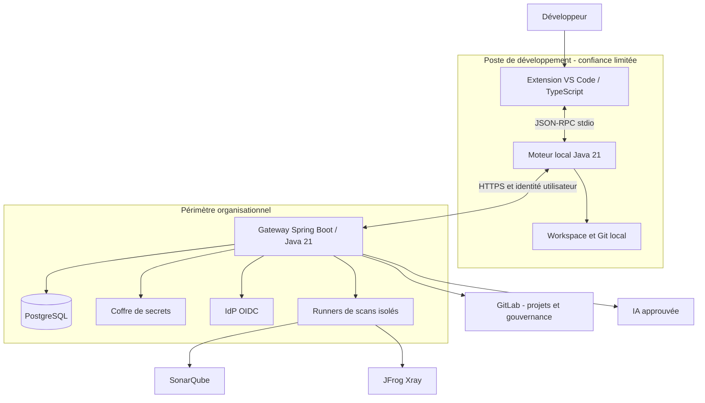

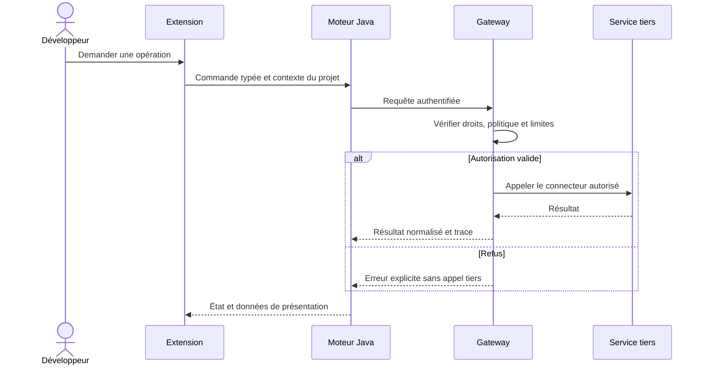

**Recette :** les tests de dépendances et de contrat montrent qu'aucune vue TypeScript ne calcule une autorisation métier définitive ni n'appelle directement l'IA avec une clé fournisseur.

### DEVAI-003 — Frontières de confiance

**Origine :** PDF p. 4, 7–8, 12 ; Conception. **Responsable :** sécurité / gateway.

La gateway DOIT traiter l'extension, le moteur, le remote déclaré, les chemins et les résultats locaux comme des entrées non fiables. Aucun booléen `aiEnabled`, rôle, utilisateur ou quota envoyé par le client n'est une preuve d'autorisation. Le serveur déduit l'identité du jeton validé et recalcule les droits. Les restrictions d'interface et les signatures locales sont une défense complémentaire, pas une barrière suffisante contre le propriétaire du poste.

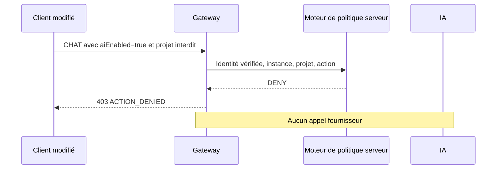

**Recette :** un appel HTTP direct et une falsification du message IPC échouent de la même façon qu'une action UI interdite.

### DEVAI-004 — Modularité et dépendances

**Origine :** PDF p. 10 ; Conception. **Responsable :** tech lead Java.

Le domaine DOIT être indépendant des clients HTTP et du transport IPC. Les modules sécurité, configuration, starters, contexte IA, qualité, Xray et GitFlow utilisent des ports typés et des adaptateurs testables. Les règles communes de signature et de décision peuvent être partagées entre moteur et serveur, mais la gateway charge elle-même les données officielles. Les DTO publics ne révèlent pas les modèles de persistance.

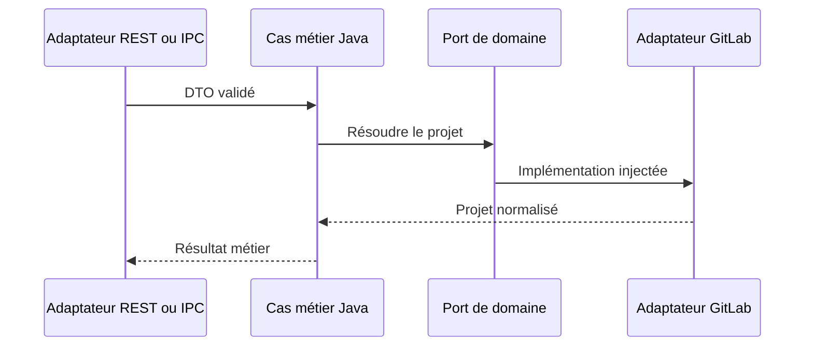

**Recette :** un connecteur GitLab de test remplace le connecteur réel sans modifier le domaine ; aucune dépendance circulaire entre modules n'est acceptée.

### DEVAI-005 — Socle Java et Maven

**Origine :** PDF p. 11 ; Utilisateur. **Responsable :** build Java.

Le moteur et la gateway DOIVENT cibler Java 21 et être construits par Maven. Le dépôt DOIT fournir `pom.xml`, `mvnw`, `mvnw.cmd` et les métadonnées du wrapper avec version et empreinte de distribution. Spring Boot 4.x est la famille cible de la gateway ; la version exacte compatible est choisie, documentée et figée à l'implémentation. Gradle n'est pas proposé pour un nouveau starter Java. Un projet existant Gradle peut être détecté sans conversion silencieuse ni promesse de prise en charge non qualifiée.

**Recette :** un checkout propre compile et teste les modules Java avec le wrapper en Windows et Linux ; aucun module Java ne dépend d'un build Gradle.

### DEVAI-006 — Plateformes et prérequis

**Origine :** PDF p. 11 ; Conception. **Responsable :** extension / packaging.

Le support V1 DOIT couvrir VS Code Desktop Windows et Linux. L'extension vérifie Java 21 et Git avant leur utilisation, ainsi que les SDK nécessaires au starter demandé. Elle affiche une erreur exploitable si un runtime manque, sans installation silencieuse. Les environnements distants non qualifiés sont détectés et déclarés non pris en charge. Un JRE fourni séparément reste une option soumise aux licences et à la qualification.

**Recette :** absence de Java, mauvaise version, absence de Python et environnement distant produisent des diagnostics distincts ; les vues statiques restent consultables.

### DEVAI-007 — Séparation produit et hébergement du code

**Origine :** PDF p. 6–7 ; règles de développement utilisateur ; Conception. **Responsable :** architecture / livraison.

Le produit DOIT utiliser GitLab pour l'identité de projet, les politiques, les starters organisationnels et les MR. Le dépôt qui contient le code d'ODS peut être hébergé sur GitHub privé conformément aux règles du développeur. Cette différence n'autorise ni à remplacer GitLab par GitHub dans les fonctionnalités ni à inventer une infrastructure disponible. La CI et la publication utilisent le fournisseur réellement configuré.

**Recette :** les configurations distinguent clairement dépôt de développement, GitLab métier et dépôt de gouvernance ; aucun endpoint GitHub ne remplace une MR GitLab.

### DEVAI-008 — Catalogue et versions externalisés

**Origine :** PDF p. 5, 9–11. **Responsable :** configuration / gouvernance.

Les versions des starters, modèles IA, prompts, scanners et SDK DOIVENT provenir de manifestes administrés, signés et versionnés. Les versions de construction d'ODS sont fixées dans ses fichiers de build. Une version de manifeste n'est ni la version de l'application ni celle du schéma. Aucun `latest` implicite ne doit affecter une génération reproductible.

**Recette :** changer un alias de modèle ou une version autorisée de starter n'impose pas une nouvelle publication du VSIX ; le résultat conserve les versions effectivement résolues.

### DEVAI-009 — Administration gouvernée

**Origine :** PDF p. 6–9, 12. **Responsable :** administrateurs / CI gouvernance.

Les politiques, catalogues et prompts de production DOIVENT être gérés dans des dépôts GitLab privés protégés, séparés des exemples du code applicatif. Les changements passent par revue, validation de schéma, tests et signature. La gestion des rôles et la séparation auteur / approbateur sont appliquées selon les capacités de GitLab et les règles organisationnelles.

**Recette :** un développeur ordinaire ne peut publier une politique ; une donnée non validée ou non signée ne devient pas active.

### DEVAI-010 — Responsabilité humaine

**Origine :** PDF p. 5–6, 9 ; Conception. **Responsable :** moteur / extension.

Un résultat IA DOIT être présenté comme une proposition. Les écritures, commandes, installations, suppressions, push et créations de MR passent par une décision d'exécution explicite ou une autorisation de session précise, limitée et journalisée prévue par politique. Un simple consentement au chat ne vaut pas consentement à ces effets de bord. Aucun résultat d'analyse ne peut être déclaré corrigé avant vérification.

**Recette :** la demande « explique ce code » ne modifie aucun fichier et ne lance aucune commande.

### DEVAI-011 — Terminologie et erreurs compréhensibles

**Origine :** PDF p. 3 ; Conception. **Responsable :** UX / contrats.

L'interface DOIT distinguer « IA interdite », « authentification requise », « politique invalide », « service indisponible », « quota atteint », « rapport obsolète » et « fonctionnalité non prise en charge ». Les messages affichent un identifiant de corrélation et une action de résolution sans exposer secrets, chemins absolus ou détails internes sensibles.

**Recette :** chaque code d'erreur du contrat possède un libellé et un comportement de reprise testés.

### DEVAI-012 — Définition de livraison complète

**Origine :** PDF p. 11–12 ; Utilisateur ; Conception. **Responsable :** tech lead / recette.

Une livraison complète DOIT associer chaque exigence à une implémentation, des tests et une preuve. Les connecteurs réels, quatre starters, cinq vues, paquet d'installation, documentation et limites connues font partie de la livraison. Un mode démonstration à données simulées doit être étiqueté et ne satisfait pas les validations d'intégration réelle.

**Recette :** la matrice de traçabilité ne contient aucun « réussi » sans preuve ; les contrôles impossibles sont marqués `NON VÉRIFIABLE` avec leur dépendance manquante.

<a id="section-3"></a>

## 3. Extension, IPC et identité — DEVAI-013 à DEVAI-024

### DEVAI-013 — Bandeau et navigation

**Origine :** PDF p. 3 et maquette. **Responsable :** extension.

Le bandeau DOIT afficher le projet GitLab actif, sa branche, sa stack, l'état de connexion, le statut IA, l'alias du modèle autorisé et le quota restant. Les cinq onglets partagent ce contexte. L'interface différencie chargement, vide, erreur, déconnecté et accès refusé. Les changements de projet invalident immédiatement les propositions devenues étrangères au contexte.

**Recette :** une bascule de racine met à jour le bandeau et les commandes sans afficher un quota ou une permission provenant de la racine précédente.

### DEVAI-014 — Contrat JSON-RPC local

**Origine :** PDF p. 4, 11 ; Conception. **Responsable :** extension / moteur.

Le transport local DOIT utiliser JSON-RPC 2.0 sur les flux stdio d'un processus enfant appartenant à l'extension. Le framing ODS est un objet JSON UTF-8 par ligne, avec retours à la ligne des chaînes échappés ; taille maximale initiale de 8 Mio par message et refus des lots JSON-RPC en V1. `stdout` est réservé au protocole, `stderr` aux logs filtrés. L'initialisation négocie version de protocole, version moteur et capacités ; les contrats sont validés des deux côtés. Les annulations et notifications sont des méthodes ODS documentées, pas des mécanismes implicites de JSON-RPC. Référence : [JSON-RPC 2.0](https://www.jsonrpc.org/specification).

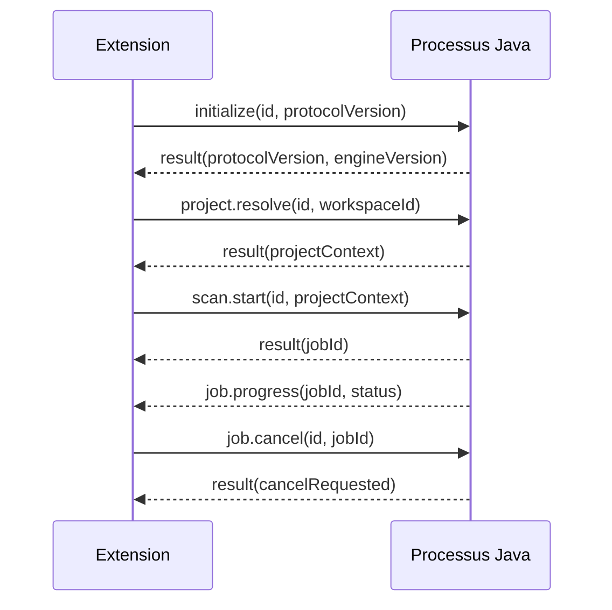

**Recette :** messages fragmentés, UTF-8, requête inconnue, dépassement de taille et désaccord de version sont testés sans blocage de l'extension.

### DEVAI-015 — Cycle de vie du moteur

**Origine :** Conception. **Responsable :** extension / moteur.

L'extension DOIT démarrer un seul moteur par fenêtre VS Code, avec le chemin absolu du JAR installé résolu par ses API, sans commande shell assemblée. Elle négocie le protocole avant usage et termine proprement le processus à la désactivation. Après crash, au plus trois redémarrages avec délai progressif sont tentés ; les actions non idempotentes ne sont jamais rejouées automatiquement.

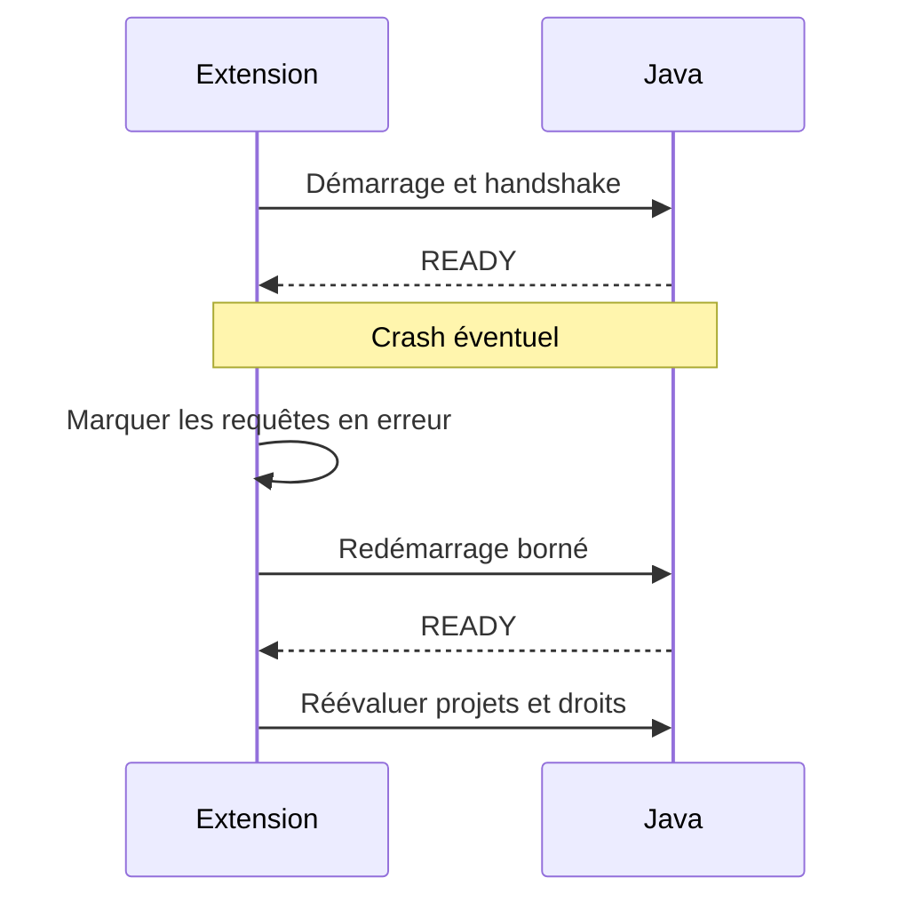

**Recette :** un crash pendant une génération ne double ni écriture ni appel IA ; les processus enfants ne restent pas orphelins après fermeture.

### DEVAI-016 — Workspace Trust

**Origine :** PDF p. 8–9 ; Conception. **Responsable :** extension / moteur.

Dans un workspace non approuvé, ODS DOIT désactiver lecture de contexte destinée à l'IA, exécution de scripts, génération dans ce workspace et commandes Git à effet de bord. Il peut afficher aide et catalogue sans exécuter le contenu du projet. Le changement de confiance déclenche une réévaluation. Cette information locale ne constitue pas une attestation serveur d'intégrité du poste. Référence : [VS Code Workspace Trust](https://code.visualstudio.com/api/extension-guides/workspace-trust).

**Recette :** l'ouverture d'un dépôt contenant des scripts de build n'en exécute aucun avant approbation du workspace.

### DEVAI-017 — Isolation des racines et dépôts imbriqués

**Origine :** PDF p. 7, 12 ; Conception. **Responsable :** moteur.

Chaque racine et dépôt imbriqué DOIT être résolu séparément. La sélection active détermine un contexte de projet explicite ; tout fichier d'un autre dépôt, sous-module ou worktree est réévalué. La clé de contexte inclut racine canonique locale, instance, project ID, branche et commit ; seuls les identifiants nécessaires quittent le poste.

**Recette :** avec deux racines autorisée / interdite, les conversations, sélections, propositions et quotas ne se mélangent pas.

### DEVAI-018 — Sécurité des webviews

**Origine :** Conception. **Responsable :** extension.

Les webviews DOIVENT utiliser une CSP restrictive, des ressources locales autorisées explicitement et des messages validés par schéma. Le HTML généré par le modèle ou un rapport est neutralisé ; les liens externes demandent une action utilisateur. Les jetons et secrets ne transitent pas dans le DOM, les URI ou l'état persistant des vues. Référence : [API Webview VS Code](https://code.visualstudio.com/api/extension-guides/webview).

**Recette :** un rapport contenant du script ou un lien de commande ne peut exécuter de code ni appeler une commande privilégiée.

### DEVAI-019 — Accessibilité et expérience native

**Origine :** PDF p. 3 ; Conception. **Responsable :** extension.

Les vues DOIVENT respecter les thèmes VS Code, le clavier, l'ordre de focus, les noms accessibles et les états compréhensibles sans couleur seule. Les résultats ouvrent fichier et ligne avec les API éditeur ; une référence invalide affiche un diagnostic. L'interface initiale est en français, avec libellés métier des cinq onglets conservés et textes externalisés.

**Recette :** un parcours initialisation / chat / rapport / diff fonctionne au clavier en thème clair et sombre ; les raisons de refus sont lisibles par lecteur d'écran.

### DEVAI-020 — Authentification OIDC native

**Origine :** PDF p. 8 ; Conception. **Responsable :** identité / gateway / extension.

L'authentification DOIT utiliser un flux OIDC adapté à un client public : Authorization Code avec PKCE via navigateur et redirection enregistrée, sans secret client distribué. Un flux Device Authorization n'est une variante que si l'IdP le prend en charge et l'organisation l'autorise. La gateway vérifie signature, issuer, audience, dates et scopes de l'access token ; un ID token n'est pas accepté comme jeton d'accès API.

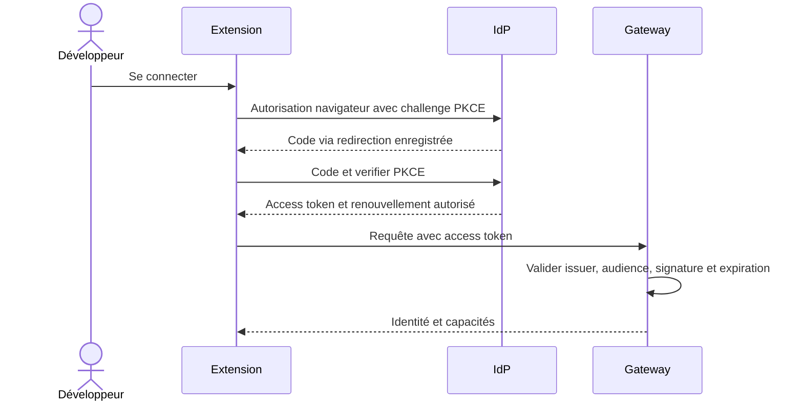

**Recette :** mauvais issuer, audience incorrecte, jeton expiré et rejeu d'un code d'autorisation sont refusés.

### DEVAI-021 — Conservation et rotation de session

**Origine :** PDF p. 8 ; Conception. **Responsable :** extension / identité.

Les secrets utilisateur persistants DOIVENT utiliser le stockage sécurisé fourni par VS Code ou un mécanisme organisationnel équivalent ; aucun token dans `settings.json`, logs ou Git. L'access token transmis au moteur reste en mémoire. Le renouvellement est synchronisé, borné et révoqué à la déconnexion ; un échec demande une reconnexion sans utiliser une identité de service de secours.

**Recette :** la déconnexion efface les données d'authentification ODS et interdit les nouveaux appels sans fermer VS Code.

### DEVAI-022 — Correspondance identité et droits GitLab

**Origine :** PDF p. 6–8 ; Conception. **Responsable :** gateway / connecteur GitLab.

La gateway DOIT associer le sujet OIDC à une identité GitLab vérifiée et vérifier les permissions réelles du développeur sur chaque projet demandé. Une adresse email déclarée par le client n'établit pas cette correspondance. Un compte technique de lecture de politiques ne donne jamais au développeur accès aux projets lisibles par ce compte. Les refus d'accès ne révèlent pas l'existence d'autres projets privés.

**Recette :** un utilisateur authentifié sans accès au projet ne peut lire ses capacités détaillées, rapports, jobs ou consommation.

### DEVAI-023 — Identité utilisateur pour Git et MR

**Origine :** PDF p. 6, 8. **Responsable :** GitFlow / gateway.

Les opérations Git distantes DOIVENT utiliser le credential helper ou l'agent SSH du développeur ; les MR utilisent une autorisation GitLab utilisateur déléguée et limitée. Le jeton OIDC de la gateway n'est pas présumé utilisable directement par GitLab. Les scopes minimaux et l'association entre les deux sessions sont documentés ; aucun compte de service privilégié ne réalise push ou MR à la place de l'utilisateur.

**Recette :** l'auteur observé dans GitLab correspond au développeur ; une permission GitLab retirée bloque l'opération malgré une session OIDC valide.

### DEVAI-024 — Déconnexion et annulation contextuelle

**Origine :** PDF p. 7, 12 ; Conception. **Responsable :** extension / moteur / gateway.

Une déconnexion, fermeture de racine ou perte de confiance DOIT interrompre les nouveaux appels IA et invalider les actions en attente. Les travaux serveur déjà lancés reçoivent une annulation au mieux et restent consultables selon les droits après reconnexion. L'interface distingue annulation demandée et annulation confirmée ; les tokens déjà consommés restent comptabilisés.

**Recette :** une réponse tardive d'une ancienne session ne s'applique pas au nouveau workspace et n'autorise pas un patch.

<a id="section-4"></a>

## 4. Ségrégation, intégrité et confidentialité — DEVAI-025 à DEVAI-044

### DEVAI-025 — Identité canonique du projet

**Origine :** PDF p. 6–7. **Responsable :** moteur / gateway.

L'autorisation DOIT utiliser le couple instance GitLab normalisée et `projectId` numérique vérifié auprès de cette instance. Le nom du dossier, le slug ou un remote fourni par le client ne suffit pas. Les URL SSH et HTTPS sont résolues par un adaptateur borné aux instances administrées ; les redirections et hôtes inattendus sont refusés.

**Recette :** deux instances ayant le même ID numérique restent distinctes ; renommer un projet ne transfère pas les droits à un autre ID.

### DEVAI-026 — Refus par défaut et droits par action

**Origine :** PDF p. 6–7. **Responsable :** politique serveur.

Le défaut DOIT être `DENY`. Une autorisation exige : utilisateur actif, accès au projet, politique valide, `aiEnabled=true`, action explicitement permise, modèle autorisé, contexte conforme et quota disponible. Les actions de base sont `CHAT`, `CODE_GENERATION`, `SONAR_REMEDIATION`, `XRAY_REMEDIATION`, `MR_DESCRIPTION` ; `AGENT_RUN` est ajoutée explicitement pour éviter qu'un droit de chat autorise tous les agents. Une action inconnue est refusée.

**Recette :** une politique permettant uniquement `CHAT` refuse un agent et une remédiation même si le fournisseur IA est identique.

### DEVAI-027 — Matrice IA / non-IA

**Origine :** PDF p. 3, 6. **Responsable :** politique / extension.

Le système DOIT appliquer la matrice ci-dessous indépendamment du grisement visuel. « Selon droits » inclut droits de projet, santé du service et prérequis ; il ne signifie pas accès universel.

| Fonction | IA autorisée pour l'action | IA interdite |
|---|---|---|
| Catalogue / génération de starter | Selon droits | Selon droits |
| Chat / génération IA / agents | Selon permissions distinctes | Refus |
| Scan Sonar / lecture de rapport | Selon droits | Selon droits |
| Remédiation Sonar IA | Selon permissions | Refus |
| Scan Xray / lecture de rapport | Selon droits | Selon droits |
| Remédiation Xray IA | Selon permissions | Refus |
| Git / MR manuelle | Selon droits GitLab | Selon droits GitLab |
| Description de MR par IA | Selon permissions | Refus |

**Recette :** chaque cellule est couverte par au moins un test positif ou négatif.

### DEVAI-028 — Lecture officielle et atomique des politiques

**Origine :** PDF p. 7 ; Conception. **Responsable :** gateway / configuration.

La gateway DOIT lire politique et signature depuis un commit immuable du dépôt de gouvernance attendu, via GitLab Repository Files API. La référence protégée est résolue une fois en SHA ; tous les fichiers d'un bundle proviennent de ce SHA. Le client ne choisit ni dépôt, ni chemin, ni référence de politique. Référence : [GitLab Repository Files API](https://docs.gitlab.com/api/repository_files/).

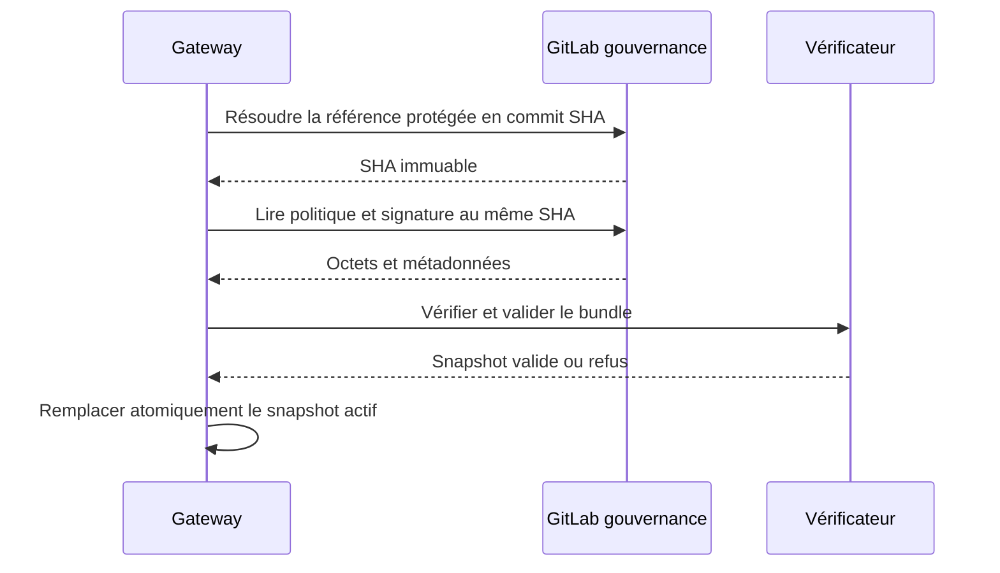

**Recette :** une modification de branche entre deux téléchargements ne produit jamais un mélange de versions.

### DEVAI-029 — Signature Ed25519 sur octets exacts

**Origine :** PDF p. 7–9 ; Conception. **Responsable :** sécurité Java.

La signature détachée Ed25519 DOIT couvrir exactement les octets UTF-8 distribués, sans reformatage JSON préalable. L'enveloppe contient `keyId`, algorithme fixé à `Ed25519`, signature Base64 et empreinte SHA-256 informative. La clé est recherchée dans le magasin de confiance administré ; un fichier de politique ne peut fournir sa propre clé de confiance. L'intégrité est vérifiée avant le parsing métier ; taille et formats sont bornés avant toute allocation importante.

**Recette :** changer un octet, utiliser une clé inconnue, une signature tronquée ou un algorithme différent conduit au refus ; le hash seul n'autorise rien.

### DEVAI-030 — Schéma, dates et sémantique

**Origine :** PDF p. 6–9 ; Conception. **Responsable :** sécurité / configuration.

Le parseur DOIT rejeter champs critiques inconnus, doublons de clés JSON, IDs dupliqués, version de schéma inconnue, quota négatif, dates invalides et règle contradictoire. `issuedAt < expiresAt`, une émission future hors tolérance de 60 secondes est refusée, et `now >= expiresAt` interdit l'IA. Les durées maximales de validité sont gouvernées ; la base proposée est 24 heures. L'heure serveur de référence est UTC et surveillée.

**Recette :** les tests couvrent précisément les bornes de validité, les doublons et un schéma de version future.

### DEVAI-031 — Anti-rejeu et rotation des clés

**Origine :** PDF p. 7 ; Conception. **Responsable :** gateway / exploitation.

La gateway DOIT persister le plus haut `policyVersion` accepté par périmètre de gouvernance, y compris après redémarrage. Une version inférieure est refusée ; une même version avec une empreinte différente est refusée. Un rollback métier se publie sous une version plus élevée. La rotation utilise une période de coexistence bornée et un canal d'administration de confiance ; une clé compromise est révoquée indépendamment de la signature d'un ancien bundle.

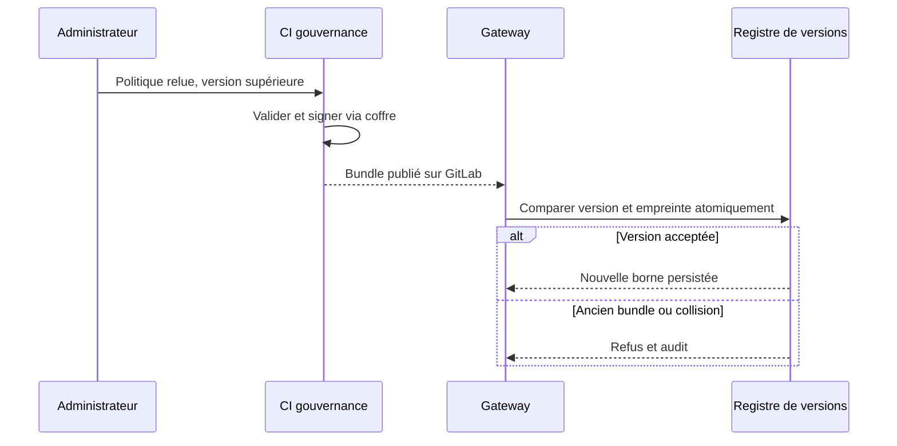

**Recette :** rejouer une politique précédemment valide après redémarrage ne rétablit aucun droit retiré.

### DEVAI-032 — Cache, révocation et mode dégradé

**Origine :** PDF p. 7, 12 ; Conception. **Responsable :** gateway.

Le cache DOIT contenir uniquement des snapshots signés valides. Une décision réévalue droits et expiration à chaque requête ; le cache de droits a une fraîcheur maximale proposée de 60 secondes. Une notification authentifiée de révocation invalide immédiatement les entrées concernées, avec rafraîchissement périodique en secours. En panne de gouvernance, seul un cache encore valide et suffisamment frais peut servir ; passé ce délai, aucun nouvel appel IA. Ce délai borné est la latence maximale de révocation annoncée, pas une révocation instantanée universelle.

**Recette :** au-delà de 60 secondes sans revalidation, l'IA est refusée ; une révocation reçue est effective à la prochaine vérification sans attendre l'expiration générale.

### DEVAI-033 — Cycle de décision complet

**Origine :** PDF p. 7. **Responsable :** moteur / gateway.

L'ouverture du workspace, un changement de remote, branche, confiance ou identité, une expiration et chaque requête IA DOIVENT déclencher les vérifications adaptées. Le résultat expose capacités, version de politique, durée de validité et motif de refus. Un cache UI n'est jamais un titre d'accès.

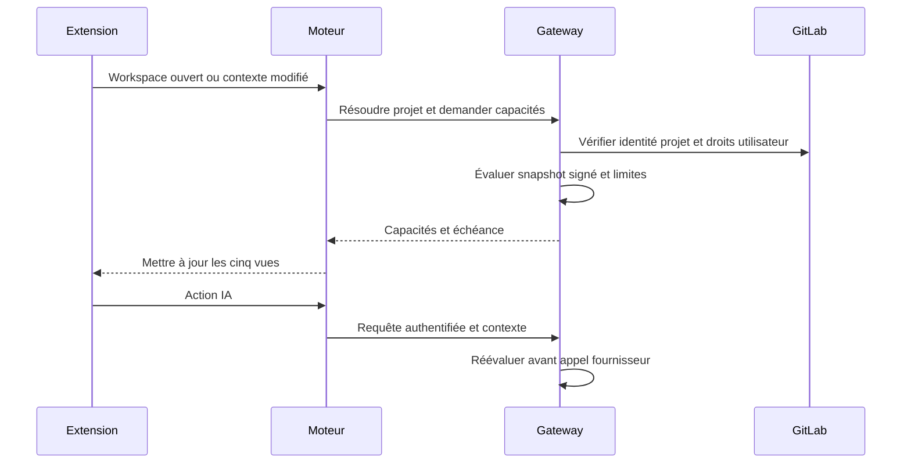

**Recette :** un changement de remote entre affichage des capacités et envoi ne permet pas d'utiliser l'autorisation précédente.

### DEVAI-034 — Intégrité des ressources embarquées

**Origine :** PDF p. 7. **Responsable :** moteur / packaging.

Le VSIX et les ressources statiques sensibles DOIVENT être accompagnés d'un manifeste signé avec empreintes SHA-256. Le moteur vérifie les ressources au démarrage et avant utilisation sensible. Une altération bloque la ressource et produit un diagnostic ; elle ne peut être résolue par un simple attribut lecture seule ou une clé AES livrée dans le même paquet.

**Recette :** une modification du catalogue embarqué est détectée ; l'absence de vérification côté client ne contourne pas les règles serveur.

### DEVAI-035 — Coffre et secrets techniques

**Origine :** PDF p. 7–8, 12. **Responsable :** gateway / exploitation.

Les comptes de lecture de gouvernance, Sonar, JFrog et la clé fournisseur IA DOIVENT rester dans le coffre ou l'infrastructure serveur. Ils sont distincts, limités par fonction, renouvelables et absents du VSIX, JAR client, repository, image et archives de livraison. Les exemples utilisent des références de secrets ; les certificats publics de confiance ne sont pas assimilés à des secrets privés.

**Recette :** analyse du VSIX, des JAR, logs, images et archives sans secret technique ; rotation testée sans republication de l'extension.

### DEVAI-036 — TLS et destinations autorisées

**Origine :** PDF p. 4, 11 ; Conception. **Responsable :** réseau / gateway / moteur.

Les appels distants DOIVENT vérifier certificats et noms d'hôte, utiliser le truststore organisationnel et limiter les destinations à celles administrées. Les redirections vers une autre origine, URL arbitraires de rapports, accès aux métadonnées cloud et résolutions privées inattendues sont bloqués côté connecteurs. Aucun mode de production ne désactive TLS pour contourner un certificat invalide.

**Recette :** certificat non approuvé et URL de rapport dirigée vers un service interne non autorisé sont refusés.

### DEVAI-037 — Filtrage des secrets et exclusions de contexte

**Origine :** PDF p. 5, 9, 12 ; Conception. **Responsable :** contexte Java / gateway.

Le contexte DOIT exclure fichiers de secrets, credentials, clés privées, historiques sensibles, répertoires générés et motifs administrés. Le filtrage combine chemins, types, contenu et limites de taille, puis s'exécute à nouveau côté gateway sur les données reçues. Une exclusion organisationnelle ne peut être levée localement. La détection n'est pas présentée comme exhaustive : un faux négatif reste un risque à réduire par politique et contrôle d'accès.

**Recette :** `.env`, clé privée de test, token synthétique et secret inclus dans une sélection ou un rapport sont bloqués ou masqués avant appel au fournisseur ; les valeurs ne sont pas loggées.

### DEVAI-038 — Protection contre les instructions injectées

**Origine :** PDF p. 9, 12 ; Conception. **Responsable :** IA / agents.

Les fichiers, commentaires, rapports Sonar/Xray, sorties de commandes et messages utilisateur DOIVENT être traités comme données non fiables. Ils ne peuvent modifier instructions système signées, permissions, endpoints ou outils autorisés. Les sorties du modèle passent par validation de schéma et d'autorisation avant tout effet ; une consigne dans un fichier ne déclenche pas de transfert, installation ou exécution.

**Recette :** un rapport demandant d'ignorer les règles et d'envoyer des credentials n'obtient ni contexte supplémentaire ni capacité réseau.

### DEVAI-039 — Autorisation uniforme de tous les chemins IA

**Origine :** PDF p. 12. **Responsable :** gateway.

Chaque chemin vers le fournisseur IA DOIT passer par le même point de décision, y compris chat, agent, remédiations, descriptions de MR et tentatives de reprise. Les routes métiers déterminent elles-mêmes l'action ; le client ne peut étiqueter une remédiation comme simple chat pour obtenir des privilèges supplémentaires. Chaque étape d'agent sensible réévalue les droits.

**Recette :** des tests de contrat prouvent l'absence d'appel fournisseur pour toutes les routes lorsque l'action correspondante est interdite.

### DEVAI-040 — Provenance du contexte local

**Origine :** PDF p. 7, 12 ; Conception. **Responsable :** moteur de contexte.

En mode `LOCAL_GOVERNED`, chaque fichier DOIT être rattaché au dépôt autorisé par chemin réel, racine, état Git, commit de base et empreinte. Traversées de chemin, liens symboliques sortants, junctions Windows et dépôts imbriqués non autorisés sont refusés. Les modifications non commitées sont identifiées comme telles et soumises à la politique de transfert. Le mode ne prouve pas cryptographiquement l'origine d'un contenu arbitraire sur un poste compromis.

**Recette :** une sélection provenant d'une racine interdite ou d'un lien vers cette racine ne rejoint pas le contexte d'un projet autorisé.

### DEVAI-041 — Mode renforcé de contexte serveur

**Origine :** Conception pour traiter la limite du PDF p. 7. **Responsable :** gateway / sécurité.

Une politique DOIT pouvoir imposer `SERVER_VERIFIED`. Dans ce mode, le client transmet des références de fichiers et commit ; la gateway récupère elle-même les blobs autorisés dans GitLab, vérifie les droits et n'accepte pas de source locale arbitraire ou non commitée. Les prompts signés et paramètres typés restent possibles. Le texte libre demeure filtré, mais s'il faut garantir qu'aucune source locale arbitraire n'est transférée, la politique désactive aussi le texte libre et limite les entrées aux prompts approuvés et références serveur. Le produit doit afficher cette restriction explicitement.

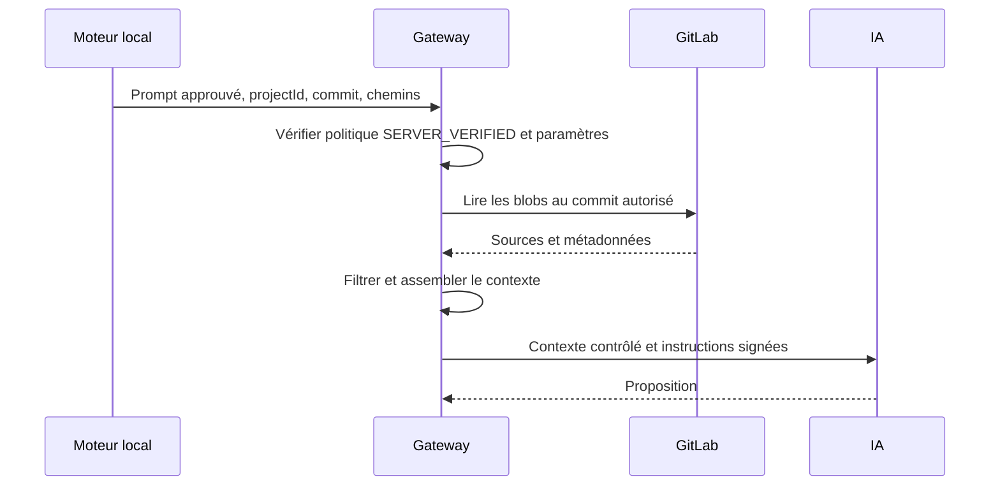

**Recette :** des octets de code injectés dans la requête client sont refusés dans ce mode ; un commit hors périmètre lisible est rejeté.

### DEVAI-042 — Prévisualisation et consentement au transfert

**Origine :** PDF p. 3, 5 ; Conception. **Responsable :** extension / contexte.

Avant un transfert de sources, l'interface DOIT montrer fichiers et extraits retenus, exclusions, mode de provenance, alias de modèle et estimation de taille. Le consentement de session est borné au projet et à la politique ; élargir les fichiers ou les destinations exige une nouvelle décision. Une demande de transfert interdite ne peut être autorisée par consentement utilisateur.

**Recette :** l'utilisateur peut retirer un fichier facultatif ; les données réellement envoyées correspondent au manifeste de contexte affiché et audité par empreinte.

### DEVAI-043 — Traçabilité des décisions de sécurité

**Origine :** PDF p. 8–10 ; Conception. **Responsable :** audit.

Chaque autorisation ou refus sensible DOIT produire un événement corrélé contenant sujet pseudonymisé, projet, action, version et empreinte de politique, motif, instant UTC et résultat. Le contenu brut des sources, prompts utilisateur et tokens n'est pas journalisé par défaut. Les événements sont protégés contre modification par les rôles applicatifs ordinaires.

**Recette :** un auditeur autorisé peut expliquer un refus à partir de son identifiant de corrélation sans accéder au code source envoyé.

### DEVAI-044 — Validation et publication de gouvernance

**Origine :** PDF p. 7–9 ; Conception. **Responsable :** CI gouvernance.

La chaîne d'administration DOIT tester schémas, collisions de versions, droits, prompts, catalogues et signatures avant publication. Les clés privées de signature restent côté coffre/CI. Une politique d'exemple ne peut être chargée comme production sans configuration explicite du dépôt officiel. Les changements sont accompagnés d'un historique et d'une procédure de rollback à numéro de version croissant.

**Recette :** un bundle invalide ne peut être publié par le pipeline ; une restauration de droits passe par une nouvelle version et reste auditée.

<a id="section-5"></a>

## 5. Project Initializer et starters — DEVAI-045 à DEVAI-062

### DEVAI-045 — Parcours de création

**Origine :** PDF p. 4–5 ; Utilisateur. **Responsable :** starter / extension.

L'assistant DOIT proposer stack, variante, version autorisée, nom, coordonnées propres à la stack et destination. Il présente prérequis, origine du starter, options résolues, fichiers créés, commandes et éventuels accès réseau avant exécution. Il fonctionne sans IA. La création d'un dépôt distant est une action distincte explicitement choisie.

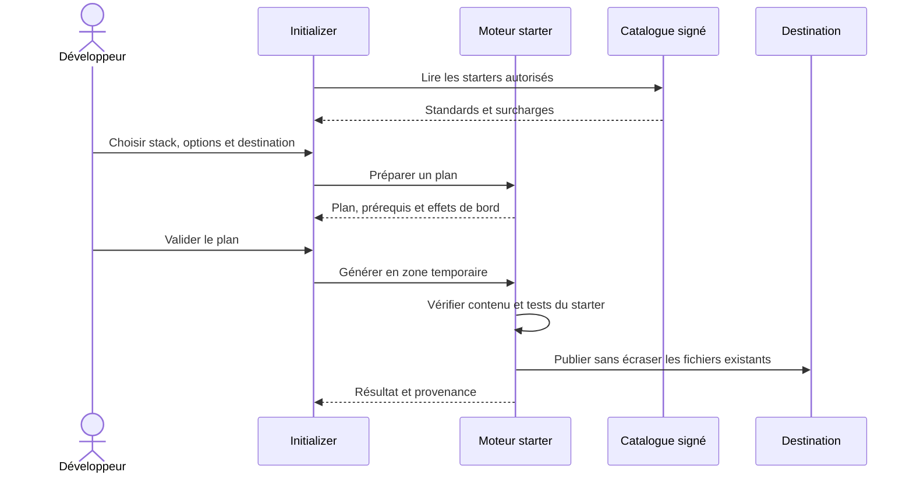

**Recette :** les quatre familles sont créables depuis un dossier vide ; une annulation avant validation ne crée aucun projet cible.

### DEVAI-046 — Catalogue de starters standards

**Origine :** Utilisateur ; Conception. **Responsable :** starter / configuration.

La première version DOIT fonctionner avec un catalogue standard signé distribué avec ODS, sans exiger de templates organisationnels préexistants. Ses fournisseurs sont Spring Initializr, Angular CLI, un squelette Python minimal fondé sur les standards PyPA et les templates du SDK .NET. Le catalogue indique ID, version, stack, fournisseur, prérequis, paramètres, sources, empreintes et commandes de validation.

**Recette :** avec le catalogue organisationnel absent mais le catalogue standard autorisé, la création reste possible ; l'absence de réseau ou de SDK produit une erreur précise.

### DEVAI-047 — Abstraction des fournisseurs de starter

**Origine :** Utilisateur ; Conception. **Responsable :** module starter.

Le moteur DOIT offrir un contrat de fournisseur pour valider les paramètres, préparer un plan, matérialiser les fichiers et vérifier le résultat. Les implémentations standards et organisationnelles partagent ce contrat. Le manifeste référence un fournisseur connu et une source autorisée ; il ne peut injecter une classe Java, du code exécutable ou une commande shell arbitraire. Ajouter un nouveau type de fournisseur requiert un développement revu ; substituer un template de type existant n'en requiert pas.

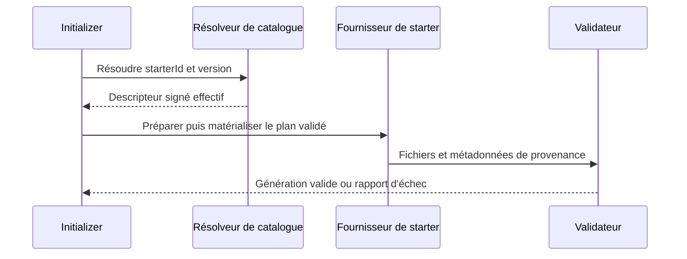

**Recette :** substituer un template GitLab signé à un starter standard ne modifie pas le code de l'extension.

### DEVAI-048 — Starter Java Spring Boot avec Maven

**Origine :** PDF p. 5, 11 ; Utilisateur. **Responsable :** fournisseur Java.

Le starter Java DOIT utiliser Spring Initializr, service public approuvé ou instance miroir, avec projet Maven, Java 21, coordonnées validées et version Spring Boot autorisée. Spring Initializr est le mécanisme standard retenu : il ne faut pas inventer un « archetype Maven officiel Spring Boot ». Un archétype Maven interne réel pourra être ajouté comme fournisseur organisationnel si ses coordonnées et sa provenance sont vérifiées. Les métadonnées d'Initializr sont consultées pour vérifier versions et dépendances. Références : [Spring Initializr](https://docs.spring.io/initializr/docs/current/reference/html/), [compatibilité Spring Boot](https://docs.spring.io/spring-boot/system-requirements.html).

La sortie DOIT contenir `pom.xml`, wrapper Maven, classe d'entrée documentée, configuration sans secret, tests, `.gitignore` et README. Les dépendances sont sélectionnées explicitement ; aucun serveur web, accès base ou starter sécurité n'est ajouté sans nécessité du profil choisi. Les templates générés sont complétés par les commentaires et références exigés en DEVAI-137 et DEVAI-138.

**Recette :** le projet généré passe le build Maven complet ; aucune configuration Gradle n'est produite et les versions effectivement utilisées sont inscrites dans la provenance.

### DEVAI-049 — Starter Angular standard

**Origine :** PDF p. 5 ; Utilisateur. **Responsable :** fournisseur Angular.

Le starter Angular DOIT utiliser une version fixée et autorisée de la CLI officielle `@angular/cli` et la commande `ng new`, avec options explicites et mode non interactif. Le manifeste fixe les compatibilités Node, TypeScript et Angular. Le générateur conserve tests, configuration de build, lockfile npm et README ; les choix routing, styles et architecture de composants sont exposés lorsqu'ils sont pris en charge. Les schematics organisationnels restent une surcharge ultérieure. Référence : [Angular CLI — ng new](https://angular.dev/cli/new).

**Recette :** installation depuis le lockfile, compilation et tests non interactifs du starter réussissent sur les runtimes qualifiés ; aucune commande `ng lint` n'est annoncée si aucun target de lint n'a été configuré.

### DEVAI-050 — Starter Python conforme aux standards

**Origine :** PDF p. 5 ; Utilisateur ; Conception. **Responsable :** fournisseur Python.

Python n'ayant pas de générateur universel officiel équivalent à Initializr, ODS DOIT fournir un template minimal versionné conforme aux recommandations PyPA : `pyproject.toml`, package sous `src/`, tests, README et environnement virtuel isolé. Le backend de build, Python, outils de test et lint sont sélectionnés et verrouillés dans le catalogue. Le profil de base est un package Python ; un framework web reste une variante explicitement choisie. Référence : [Packaging Python Projects — PyPA](https://packaging.python.org/en/latest/tutorials/packaging-projects/).

Le profil initial utilise `venv`, `pip`, un backend standard tel que setuptools, `build`, pytest et un outil de lint qualifié. Les versions et contraintes de développement sont générées ; aucune installation globale ni mise à jour générale de pip n'est automatique.

**Recette :** le wheel est construit, installé dans un second environnement vierge et importé ; les tests passent sans dépendre du dossier source courant.

### DEVAI-051 — Maintien du starter .NET

**Origine :** PDF p. 3, 5, 11 ; Conception. **Responsable :** fournisseur .NET.

Le starter .NET DOIT utiliser les templates présents dans un SDK autorisé, via `dotnet new`, notamment un profil ASP.NET Core et un projet de tests compatible. Le SDK est fixé dans `global.json` ; les sources NuGet et options de restauration sont gouvernées. Le format de solution généré suit le SDK qualifié sans supposer une extension unique. Référence : [dotnet new](https://learn.microsoft.com/en-us/dotnet/core/tools/dotnet-new).

**Recette :** restauration, build, tests et démarrage minimal du profil ASP.NET Core passent ; les commentaires XML de documentation contiennent les références d'exigences applicables.

### DEVAI-052 — Priorité des surcharges organisationnelles

**Origine :** Utilisateur ; Conception. **Responsable :** catalogue / gouvernance.

La résolution DOIT appliquer : catalogue organisationnel valide et autorisé pour le périmètre, puis catalogue standard si la politique autorise ce repli. Une surcharge peut `REPLACE` le starter ou appliquer un `OVERLAY` versionné. Elle ne peut affaiblir les contraintes de sécurité, supprimer les tests obligatoires ni réactiver un fournisseur interdit. Une version organisationnelle invalide ne provoque pas un repli silencieux si la politique la rend obligatoire.

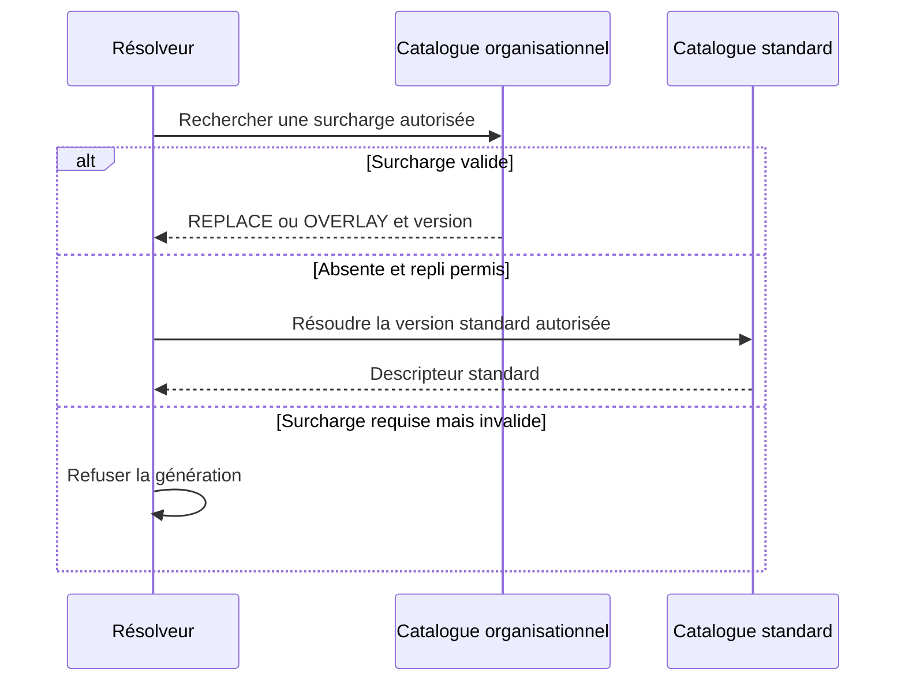

**Recette :** publier une surcharge change uniquement les générations futures ; les projets existants ne sont pas réécrits.

### DEVAI-053 — Overlay déterministe et conflits

**Origine :** Utilisateur ; Conception. **Responsable :** starter.

Un overlay DOIT déclarer sa version de base exacte, fichiers ajoutés ou remplacés et règles de fusion structurées. Les suppressions et remplacements sensibles sont explicités dans le plan. Les conflits bloquent la génération sans laisser un résultat partiel. Une fusion textuelle aveugle de `pom.xml`, JSON ou YAML n'est pas acceptable ; les formats sont parsés et revalidés.

**Recette :** deux overlays modifiant la même propriété incompatiblement produisent un conflit lisible ; réexécuter la même configuration produit les mêmes fichiers hors métadonnées explicitement non déterministes.

### DEVAI-054 — Sources, archives et chaîne d'approvisionnement

**Origine :** PDF p. 5, 7 ; Conception. **Responsable :** starter / sécurité.

Le téléchargement DOIT vérifier origine autorisée, signature de manifeste, empreinte d'archive, taille compressée et taille extraite. L'extraction refuse chemins absolus, `..`, liens sortants, collisions de casse et bombes de décompression. Un template Git est fixé par commit immuable. Les scripts fournis par le template sont inertes tant qu'ils ne figurent pas dans le plan autorisé.

**Recette :** une archive synthétique avec traversée de chemin ne crée aucun fichier hors de la zone temporaire ; une empreinte incorrecte bloque la génération.

### DEVAI-055 — Prévalidation des paramètres

**Origine :** Conception. **Responsable :** starter.

Les noms de projet, packages Java/Python, coordonnées Maven, noms npm et chemins DOIVENT être validés selon la stack. Les arguments sont transmis sous forme de liste, sans interpolation dans un shell. La destination réelle est vérifiée avant et après résolution de liens. Une destination non vide nécessite une stratégie de fusion explicitement prise en charge ; par défaut la génération y est refusée.

**Recette :** caractères de commande, chemins réservés Windows, séparateurs malveillants et nom npm invalide sont rejetés avant lancement du générateur.

### DEVAI-056 — Génération transactionnelle

**Origine :** Conception. **Responsable :** starter.

Le projet DOIT être généré dans une zone temporaire contrôlée, vérifié puis déplacé vers une destination toujours libre, sur le même volume lorsque possible. Une collision apparue pendant la génération provoque un arrêt. Le nettoyage ne supprime que les fichiers temporaires appartenant à l'opération, jamais des fichiers utilisateur ou un artefact non sauvegardé.

**Recette :** un arrêt du générateur et une collision tardive préservent intégralement le répertoire utilisateur.

### DEVAI-057 — Registres et dépendances

**Origine :** PDF p. 5 ; Utilisateur ; Conception. **Responsable :** starter / configuration.

Les starters standards DOIVENT pouvoir utiliser les registres publics approuvés lorsque l'organisation n'a pas de miroir. La configuration organisationnelle peut imposer Maven, npm, PyPI ou NuGet internes sans secret embarqué. Les URLs sont des paramètres administrés ; les credentials sont fournis par environnement, coffre ou mécanisme utilisateur prévu. Un accès public n'est pas utilisé en secours si le miroir obligatoire est indisponible.

**Recette :** le même fournisseur génère un projet avec registre standard ou interne ; le diff ne contient aucun identifiant réel.

### DEVAI-058 — Livrables de chaque starter

**Origine :** PDF p. 5 ; Utilisateur. **Responsable :** starter.

Chaque starter DOIT produire code minimal utile, tests, `.gitignore`, README, configuration de qualité et de sécurité, références de versions et pipeline adapté au fournisseur Git choisi. La CI GitLab est la valeur métier par défaut pour les projets ODS ; une variante GitHub explicitement configurée peut être fournie. La documentation donne les commandes réellement disponibles et les prérequis, sans chemins propres au poste.

**Recette :** un second développeur peut construire et tester le projet depuis les seuls fichiers générés et les runtimes indiqués.

### DEVAI-059 — Provenance et reproductibilité des starters

**Origine :** PDF p. 5 ; Conception. **Responsable :** starter.

Chaque génération DOIT créer `.ods/starter-lock.json` contenant ID/version du starter, fournisseur/version, commit ou empreinte source, version du catalogue, overlays, options résolues et exigences de génération applicables. Ce fichier ne contient ni secret, ni chemin absolu, ni identité privée. Les archives récupérées d'un service de génération sont conservées par empreinte dans un cache autorisé pour permettre leur reproduction lorsque le service amont change.

**Recette :** le rapport de génération permet de retrouver exactement les entrées et de vérifier que le résultat n'utilise pas une version implicite récente.

### DEVAI-060 — Validation des projets générés

**Origine :** Utilisateur ; Conception. **Responsable :** starter / CI.

Les commandes de build, tests et smoke tests DOIVENT être définies par profil et compatibles avec les outils générés. Elles sont présentées avant exécution. Une création de fichiers réussie et une validation échouée sont deux états distincts ; l'assistant ne prétend pas que le projet fonctionne si un SDK, réseau ou serveur manque.

**Recette :** les quatre profils standards passent leur pipeline dans des environnements propres ; une dépendance indisponible conserve le projet et affiche `VALIDATION_FAILED` ou `NON_VÉRIFIABLE` selon la cause.

### DEVAI-061 — Gestion du cache et absence de réseau

**Origine :** Conception. **Responsable :** starter / configuration.

Le mode hors ligne DOIT autoriser uniquement les bundles déjà vérifiés dont la politique autorise encore l'usage et dont les outils/dépendances nécessaires sont disponibles. Les signatures et empreintes restent vérifiées. Un catalogue périmé ou une dépendance absente n'est pas téléchargé depuis une destination improvisée.

**Recette :** hors ligne, un starter entièrement en cache fonctionne ou explique précisément les éléments manquants ; l'IA distante reste indisponible.

### DEVAI-062 — Évolution des starters existants

**Origine :** Utilisateur ; Conception. **Responsable :** produit / starter.

La substitution des starters organisationnels DOIT s'appliquer aux nouvelles créations. Une migration de projet existant reste une opération explicite, distincte de l'initialisation, qui peut être déclarée hors périmètre V1. Le fichier de provenance initiale reste conservé ; aucun lancement de VS Code ne réécrit automatiquement les projets à la dernière version de template.

**Recette :** mettre à jour le catalogue ne modifie aucun fichier d'un projet déjà ouvert.

<a id="section-6"></a>

## 6. IA, prompts, agents et consommation — DEVAI-063 à DEVAI-083

### DEVAI-063 — Conversation contextualisée

**Origine :** PDF p. 5. **Responsable :** IA / extension.

L'onglet IA DOIT permettre question, explication, génération, revue et refactoring sur un contexte autorisé. Il distingue requête en préparation, envoyée, réponse en cours, terminée, annulée et échouée. Le texte libre ne remplace pas le système organisationnel ; il peut être désactivé par la politique renforcée de contexte. L'absence d'autorisation affiche sa cause et empêche tous les envois.

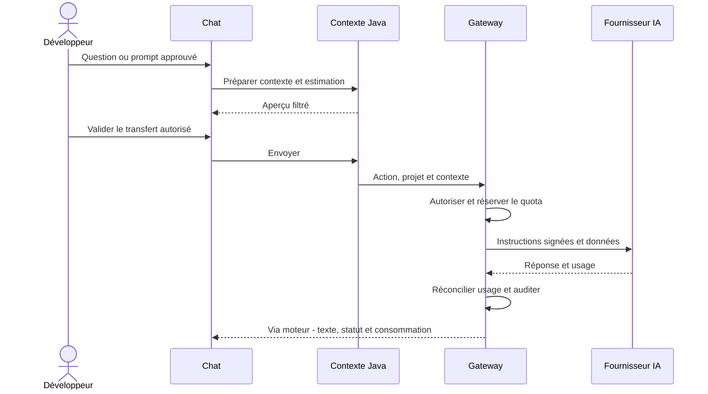

**Recette :** une session conserve l'ordre des échanges et ne réutilise pas silencieusement le contexte d'un autre projet.

### DEVAI-064 — Modèle par alias administré

**Origine :** PDF p. 5–6 ; Utilisateur. **Responsable :** gateway / connecteur IA.

Le client DOIT demander un alias autorisé ou accepter celui de la politique. La gateway résout fournisseur, modèle exact, limites, paramètres et credentials. **La liste organisationnelle initiale des fournisseurs autorisés contient exclusivement `MISTRAL`, et seuls les modèles Mistral explicitement listés sont utilisables.** La disponibilité d'un modèle chez Mistral ne vaut pas autorisation automatique. L'utilisateur ne peut saisir un endpoint, une clé personnelle ou un modèle hors catalogue dans les fonctions administrées. Le connecteur Mistral utilise une API officielle qualifiée ; les fonctionnalités preview ne sont pas supposées stables. Référence : [API Chat Mistral](https://docs.mistral.ai/api/endpoint/chat).

Le domaine DOIT définir un port de fournisseur IA indépendant de Mistral : capacités, génération/streaming, annulation si disponible et normalisation d'usage. V1 implémente le connecteur Mistral réel ; les autres fournisseurs ne sont ni installés par nécessité ni activés. Un ajout futur exige connecteur qualifié, secrets serveur, évaluation de confidentialité et activation dans un catalogue signé ainsi que dans les politiques concernées. Un nouveau connecteur peut nécessiter une nouvelle gateway, sans modifier les cinq vues ni le contrat de l'extension.

**Recette :** un modèle Mistral approuvé fonctionne ; un modèle Mistral non listé et tout fournisseur non Mistral sont refusés en configuration initiale, même via un appel direct. Changer d'alias Mistral approuvé conserve le contrat client et inscrit le modèle effectif dans l'audit. Un adaptateur factice de test démontre l'extensibilité sans être activable en production.

### DEVAI-065 — Construction bornée du contexte

**Origine :** PDF p. 5, 9 ; Conception. **Responsable :** module contexte.

Le moteur DOIT sélectionner fichier actif, sélection et fichiers explicitement pertinents, puis appliquer provenance, exclusions, déduplication et budget. Il réserve une capacité de sortie et priorise les extraits au lieu de tronquer silencieusement un fichier au milieu d'une information critique. Les limites initiales proposées sont 20 fichiers, 256 Kio par fichier et 2 Mio de contexte brut, abaissées si le modèle ou la politique l'exige. L'estimation de tokens indique son caractère estimatif.

**Recette :** un dépôt volumineux ne provoque pas un envoi intégral ; la liste des éléments retirés pour budget est visible.

### DEVAI-066 — Gouvernance des prompts

**Origine :** PDF p. 9. **Responsable :** prompts / gateway.

Les prompts approuvés DOIVENT inclure ID, version, actions autorisées, variables typées, instructions système, contraintes, exigences cibles et empreinte signée. Les catégories initiales sont `code-generation`, `code-review`, `sonar-remediation`, `xray-remediation` et `gitlab-mr-description`. La gateway compose les instructions officielles ; elle n'accepte pas un message `system` arbitraire envoyé par le client.

Le catalogue de prompts de tâches est distinct du socle système obligatoire : un prompt système global et les recommandations de chaque ligne de développement sont automatiquement composés selon DEVAI-161 à DEVAI-166. L'organisation peut ajouter des prompts de tâches et fournir ses vrais fichiers de règles ultérieurement, sans modifier l'extension.

**Recette :** une variable manquante, un prompt non approuvé ou un paramètre contenant une tentative de substitution système est refusé ou traité comme donnée.

### DEVAI-067 — Sessions et historique

**Origine :** PDF p. 10 ; Conception. **Responsable :** IA / persistance.

Une session DOIT être liée au sujet et au projet, avec ID opaque, timestamps et métriques. Le contenu conversationnel est en mémoire par défaut ; sa persistance nécessite une politique explicite de conservation, contrôle d'accès et effacement. Restaurer un historique ne rétablit pas les anciennes permissions ni les anciens quotas.

**Recette :** un utilisateur ne peut charger une session d'un autre sujet ; un historique ancien est réévalué avant réutilisation de son contexte.

### DEVAI-068 — Diff exploitable et validation du patch

**Origine :** PDF p. 5 ; Conception. **Responsable :** IA / moteur / extension.

Les changements proposés DOIVENT être normalisés en patch portant chemin relatif, contenu de base ou empreinte de base, modifications et références d'exigences. Les chemins sortants, fichiers secrets, binaires non prévus et écritures dans les métadonnées Git sont refusés. Le diff est ouvert dans VS Code avec choix accepter, rejeter ou sélectionner les fichiers ; aucun Markdown du modèle n'est exécuté.

**Recette :** un patch contenant `../` ou une modification non annoncée de CI est bloqué avant toute écriture.

### DEVAI-069 — Application sans perte de travail

**Origine :** PDF p. 5 ; règles utilisateur ; Conception. **Responsable :** moteur / extension.

Avant application, le moteur DOIT vérifier que les empreintes du workspace et des buffers correspondent à la base du patch. Un fichier modifié depuis la proposition déclenche un conflit. Le changement est appliqué via les mécanismes éditeur adaptés, avec sauvegarde récupérable du contenu préalable et conservation des buffers non enregistrés. Les règles de backup Git du dépôt sont respectées ; aucun reset destructif n'est utilisé pour « faciliter » l'application.

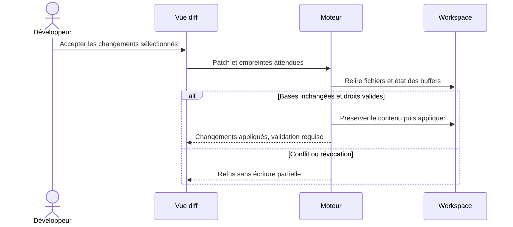

**Recette :** une édition manuelle entre génération et acceptation est conservée ; le patch ne s'applique pas silencieusement sur une base différente.

### DEVAI-070 — Vérification après génération

**Origine :** PDF p. 5 ; Utilisateur. **Responsable :** moteur / tests.

Après un patch accepté, ODS DOIT proposer et, après autorisation correspondante, exécuter le build et les tests pertinents existants. La stratégie et les commandes proviennent du projet détecté, pas d'une supposition du modèle. L'échec laisse le diff accessible, conserve les logs filtrés et marque la proposition non validée ; aucune suppression de test n'est autorisée pour obtenir un statut vert.

**Recette :** un patch qui casse un test est affiché comme échec de validation, même si le modèle affirme sa correction.

### DEVAI-071 — Registre des agents approuvés

**Origine :** PDF p. 5, 9 ; Conception. **Responsable :** agents / gouvernance.

Chaque agent DOIT être défini par un manifeste signé : ID/version, prompt, outils, actions IA, catégories de fichiers, commandes typées, destinations réseau, durée, nombre d'étapes et budget. Le droit `AGENT_RUN` seul ne donne accès qu'aux agents explicitement autorisés. Les limites initiales proposées sont 10 étapes et 10 minutes, réduites par la politique applicable.

**Recette :** un agent inconnu, une version non signée et un dépassement d'étapes sont rejetés sans élargissement automatique de permissions.

### DEVAI-072 — Plan et consentement des agents

**Origine :** PDF p. 9 ; Conception. **Responsable :** agents / extension.

L'agent DOIT présenter un plan distinguant lecture, écriture, exécution, installation, accès réseau et Git distant. Chaque effet sensible est soumis à l'autorisation exacte applicable, avec projet, commande/arguments, fichiers et durée. Un nouveau plan qui élargit le périmètre invalide le consentement antérieur. L'utilisateur peut arrêter l'agent et voir les actions déjà réalisées.

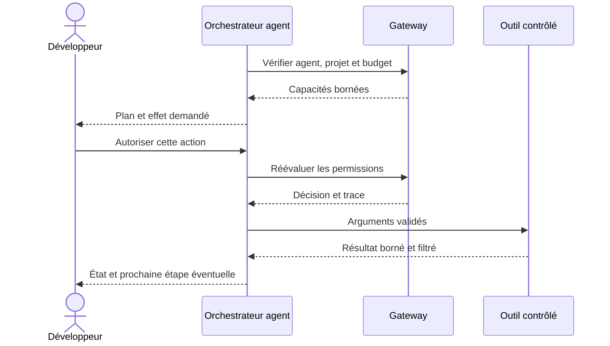

**Recette :** approuver un build n'autorise pas une installation supplémentaire ni un push.

### DEVAI-073 — Exécuteur d'outils borné

**Origine :** PDF p. 9, 12 ; Conception. **Responsable :** moteur / runners.

L'exécuteur DOIT utiliser des arguments structurés, répertoire de travail vérifié, environnement filtré, timeout, limite de sortie et arrêt de l'arbre de processus. Les commandes autorisées sont des outils identifiés ; aucune commande shell libre du LLM n'est exécutée. Un build peut exécuter du code du projet : il nécessite un workspace approuvé et, pour les traitements centraux, un runner isolé sans credentials de déploiement et avec sorties réseau bornées. Une liste blanche de noms de commandes ne constitue pas à elle seule une sandbox.

**Recette :** une tentative de lecture hors workspace, commande non déclarée et sous-processus persistant est bloquée ou arrêtée ; l'audit décrit la limite d'isolation utilisée.

### DEVAI-074 — Résultats d'agents et reprise

**Origine :** Conception. **Responsable :** agents / jobs.

Chaque étape DOIT produire statut, artefacts, empreintes et effets réellement réalisés. La reprise après interruption repart d'un état persistant validé, réévalue l'autorisation et ne répète pas automatiquement un effet non idempotent. Les erreurs de commande sont conservées ; l'agent n'interprète pas une sortie vide comme un succès.

**Recette :** un redémarrage après création d'une branche détecte cette branche et ne rejoue pas une création ou un push sans vérification.

### DEVAI-075 — Mesures de consommation

**Origine :** PDF p. 5, 10. **Responsable :** quotas / extension.

La consommation DOIT distinguer tokens d'entrée, de sortie et total, par requête, session, utilisateur et projet, ainsi que période mensuelle UTC et solde. Les métriques retournées par le fournisseur priment sur l'estimation locale. Les coûts restent séparés, avec devise, modèle et date du tarif ; une estimation monétaire n'est pas une facture. Sans métriques définitives, le statut est `ESTIMATED` ou `PENDING_RECONCILIATION`.

**Recette :** un appel avec estimation différente de l'usage fournisseur met à jour le registre sans compter deux fois la requête.

### DEVAI-076 — Réservation atomique des quotas

**Origine :** PDF p. 6, 10 ; Conception. **Responsable :** gateway / PostgreSQL.

Avant tout appel, la gateway DOIT réserver atomiquement un budget conservateur d'entrée plus sortie maximale. Les plafonds projet et utilisateur applicables sont vérifiés dans la même transaction. Les appels concurrents ne peuvent dépasser le solde disponible. Après réponse, la réservation est réconciliée avec l'usage ; si le fournisseur rapporte plus que réservé, l'écart est audité et le solde peut devenir débiteur, bloquant de nouveaux appels. Une réservation interrompue n'est libérée qu'après résolution de l'incertitude.

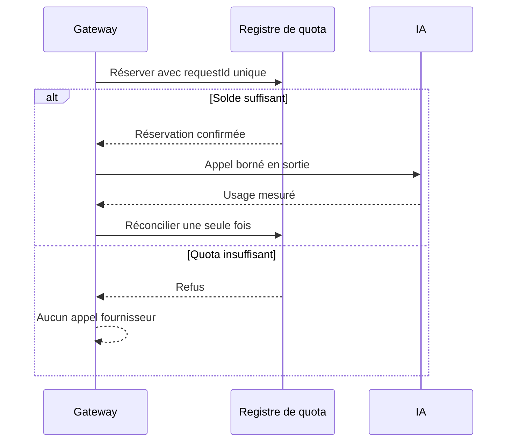

**Recette :** plusieurs requêtes simultanées consomment au maximum le budget réservé ; les réservations ne sont pas remises à zéro lors d'un redémarrage.

### DEVAI-077 — Idempotence des requêtes IA

**Origine :** Conception. **Responsable :** gateway / quotas.

Les requêtes facturables DOIVENT accepter une clé d'idempotence liée à utilisateur, projet, route et hash de payload. La même clé et le même payload renvoient l'opération existante ; la même clé avec un payload différent renvoie un conflit. Un timeout après envoi fournisseur n'est pas rejoué sans preuve d'absence d'exécution ou support d'idempotence du fournisseur.

**Recette :** deux clics rapprochés avec la même clé ne produisent qu'une réservation et au plus un déclenchement fournisseur ; un état incertain reste visible.

### DEVAI-078 — Streaming et annulation IA

**Origine :** Conception. **Responsable :** gateway / extension.

La réponse DOIT pouvoir être transmise par événements serveur avec IDs croissants, statut terminal et usage final. La reconnexion relit les événements disponibles sans régénérer la réponse. L'annulation arrête au mieux la production fournisseur et les prochains outils ; les tokens déjà produits sont comptabilisés. Aucun événement final d'usage reçu n'est remplacé par zéro.

**Recette :** couper la connexion puis reprendre n'engendre pas de second appel ; l'interface indique si l'annulation du fournisseur n'a pu être confirmée.

### DEVAI-079 — Limitation de débit et concurrence

**Origine :** Conception. **Responsable :** gateway.

Les appels DOIVENT être limités par utilisateur, projet et fournisseur, indépendamment du quota mensuel. Les paramètres initiaux de qualification sont deux générations IA concurrentes par utilisateur et une file bornée par projet, modifiables administrativement. Une surcharge renvoie une erreur exploitable avec délai de reprise ; aucune file non bornée en mémoire n'est admise.

**Recette :** un client insistant ne prive pas tous les projets de capacité et n'entraîne pas de croissance mémoire illimitée.

### DEVAI-080 — Pannes et indisponibilité IA

**Origine :** PDF p. 12 ; Conception. **Responsable :** connecteur IA.

Les timeouts, erreurs fournisseur, interruptions et réponses malformées DOIVENT être normalisés et audités. Les retries sont bornés aux opérations sûres ; un coupe-circuit limite les appels à un service défaillant. Aucun repli vers un modèle ou fournisseur non autorisé n'est possible. Les fonctions non IA restent utilisables selon leurs propres dépendances.

**Recette :** une panne Mistral n'empêche pas la lecture d'un rapport existant et ne transfère pas les sources à un autre fournisseur.

### DEVAI-081 — Traitement des réponses et obligations de code

**Origine :** Utilisateur ; PDF p. 5. **Responsable :** génération / qualité.

La génération DOIT demander du code compatible avec le projet et des commentaires explicatifs pour toutes classes et méthodes créées, avec références d'exigences. Le validateur de patch signale commentaires manquants, références inconnues et dépendances inventées avant acceptation. Les affirmations du modèle sur build, couverture ou compatibilité sont des hypothèses jusqu'à exécution des contrôles.

**Recette :** une classe sans référence d'exigence ne passe pas le contrôle de conformité ; un code non compilé ne porte jamais le statut « validé ».

### DEVAI-082 — Confidentialité et conservation chez le fournisseur

**Origine :** PDF p. 5, 9, 13 ; Conception. **Responsable :** sécurité / exploitation.

La configuration du fournisseur DOIT documenter catégories de données transférées, localisation autorisée, conditions de conservation et fonctions activées. La solution ne peut garantir par simple configuration locale qu'un fournisseur ne conserve rien : cette propriété doit être confirmée dans le service et son cadre organisationnel. Les données de projet ne servent pas à une mémoire interprojets ODS non autorisée.

**Recette :** l'ouverture de production est bloquée si le mode de transfert de sources applicable n'est pas renseigné ; aucun cache partagé de contexte ne mélange les projets.

### DEVAI-083 — Exemples de consommation et contrôles de coût

**Origine :** PDF p. 10 ; Conception. **Responsable :** quotas / UX.

L'interface DOIT expliquer l'unité et l'état des chiffres. Exemple fictif : 1 200 tokens d'entrée et 300 de sortie produisent 1 500 tokens, et non 1 500 unités monétaires. Un plafond mensuel de 100 000 et 42 500 tokens déjà débités laisse 57 500 avant réservations en cours. Les alertes de seuil sont administrables ; elles n'annulent pas rétroactivement une consommation déjà réalisée.

**Recette :** les totaux de l'écran concordent avec le registre et distinguent consommé, réservé et disponible.

<a id="section-7"></a>

## 7. Quality / SonarQube — DEVAI-084 à DEVAI-094

### DEVAI-084 — Détection du projet à analyser

**Origine :** PDF p. 5. **Responsable :** qualité / moteur.

Le module DOIT détecter manifests, modules et stack pour choisir un profil Sonar compatible : scanner Maven pour Java Maven, scanner .NET pour .NET, scanner adapté pour Python et Angular. Un monorepo présente les unités analysables ; une stack ambiguë demande une sélection explicite. Une absence de scanner compatible n'est pas interprétée comme absence d'anomalies. Référence : [SonarScanner for Maven](https://docs.sonarsource.com/sonarqube-server/analyzing-source-code/scanners/sonarscanner-for-maven).

**Recette :** les quatre projets de référence sélectionnent le bon profil et un projet inconnu est signalé comme non pris en charge.

### DEVAI-085 — Exécution réelle du scanner

**Origine :** PDF p. 5, 7–8, 11 ; Conception. **Responsable :** qualité / gateway / runner.

Une analyse DOIT réellement exécuter le scanner ; consulter la Web API Sonar ne remplace pas cette étape. Le mode V1 par défaut déclenche un runner organisationnel isolé sur un commit GitLab immuable lisible par l'utilisateur, avec token Sonar limité côté runner. Les sources non commitées sont explicitement hors du résultat de ce mode. Une variante locale n'est activable qu'après qualification d'un mécanisme d'identité éphémère limité, sans compte technique partagé livré au poste.

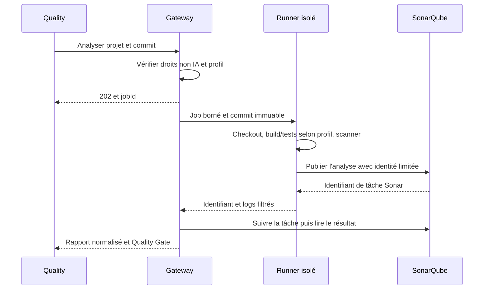

**Recette :** un scanner volontairement absent produit un échec de scan ; aucune réponse de l'API de lecture ne peut masquer cet échec.

### DEVAI-086 — Paramètres de scan gouvernés

**Origine :** PDF p. 5 ; Conception. **Responsable :** qualité / configuration.

Le mapping projet GitLab vers clé Sonar, organisation, branche et profil DOIT être administré ou résolu de façon validée. L'utilisateur peut choisir des options exposées par le profil, pas injecter une URL, token, exclusion de sécurité ou arguments libres. Les scanners et plugins sont versionnés ; les analyses de branches/MR suivent les capacités et licences réellement disponibles.

**Recette :** une fonction Sonar non licenciée est affichée comme indisponible, sans rapport inventé ni analyse assimilée à celle de la branche demandée.

### DEVAI-087 — Suivi asynchrone Sonar

**Origine :** PDF p. 11 ; Conception. **Responsable :** qualité / jobs.

Le scan DOIT exposer ID ODS, ID de tâche fournisseur, statut, progression disponible, timestamps, commit et erreurs. La gateway attend la fin du traitement Sonar avec polling borné ou événement validé. Fin du processus scanner ne signifie pas fin de calcul du serveur. Une annulation impossible côté fournisseur est annoncée comme telle.

**Recette :** un traitement serveur encore en cours ne déclenche ni rapport final ni faux Quality Gate vert.

### DEVAI-088 — Rapport de qualité normalisé

**Origine :** PDF p. 5. **Responsable :** qualité / extension.

Le rapport DOIT afficher identifiant, règle, message, type, sévérité d'origine et normalisée, fichier relatif, ligne si disponible, statut et lien validé vers Sonar. Les résultats sont paginés et filtrables. Une absence de ligne ou un fichier supprimé est traitée explicitement ; les données fournisseur ne sont pas interprétées comme HTML fiable.

**Recette :** un jeu de rapports avec pagination, ligne absente et chemins spéciaux reste navigable sans perte d'issues.

### DEVAI-089 — Quality Gate et fraîcheur

**Origine :** PDF p. 5 ; Conception. **Responsable :** qualité.

L'écran DOIT distinguer succès technique du scan, état du Quality Gate et obsolescence du rapport. Le Quality Gate est `PASSED`, `FAILED` ou `UNKNOWN`, selon les données effectives. Si le commit ou l'état local diffère de la cible analysée, le rapport est marqué obsolète ou partiel pour le workspace ; un rapport ancien ne valide pas de nouvelles modifications.

**Recette :** après édition locale, le résultat reste consultable mais n'est plus présenté comme validation exacte de ce code.

### DEVAI-090 — Sélection de remédiation Sonar

**Origine :** PDF p. 5. **Responsable :** qualité / IA.

L'utilisateur DOIT pouvoir choisir les issues à corriger, voir le code ciblé et le prompt approuvé. La gateway exige `SONAR_REMEDIATION`, des droits sur le rapport et la conformité du contexte. Le rapport fournisseur est une donnée non fiable ; aucun fichier non nécessaire n'est ajouté automatiquement.

**Recette :** le scan et la lecture fonctionnent sans IA ; demander un correctif sur le même projet retourne un refus si `SONAR_REMEDIATION` manque.

### DEVAI-091 — Boucle de correction Sonar

**Origine :** PDF p. 5 ; Conception. **Responsable :** qualité / moteur.

La remédiation DOIT produire un diff, obtenir l'acceptation, exécuter les validations autorisées puis lancer une nouvelle analyse sur la révision corrigée. En mode runner distant, les modifications doivent d'abord être commitées et rendues accessibles à GitLab avec autorisation du développeur ; ODS ne push pas implicitement pour rescan. Les issues ne sont marquées résolues qu'après nouveau résultat correspondant.

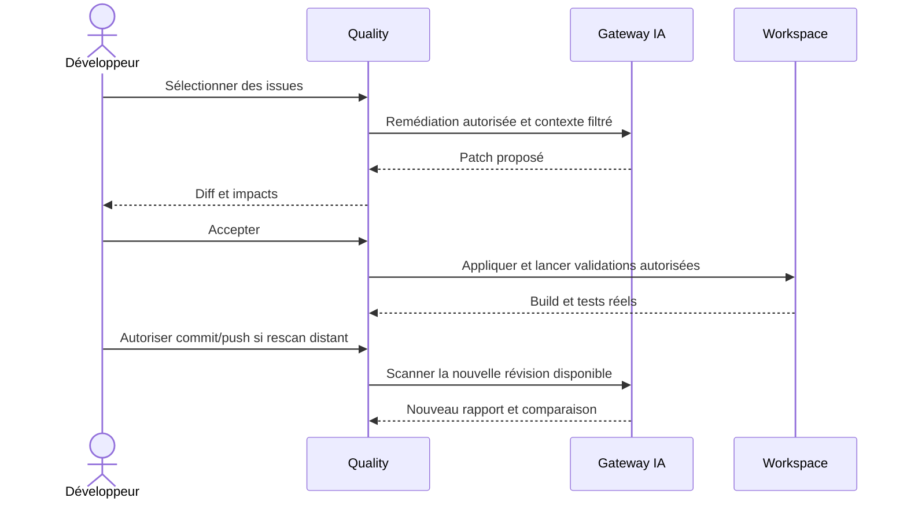

**Recette :** une correction locale sans nouveau scan est étiquetée « validation Sonar en attente », jamais « issue résolue ».

### DEVAI-092 — Non-régression de qualité

**Origine :** PDF p. 5 ; Conception. **Responsable :** qualité / tests.

La comparaison DOIT montrer issues ciblées résolues, persistantes, nouvelles et statut du gate. Elle conserve les identifiants fournisseur et les commits comparés. Une baisse du nombre d'issues due à l'exclusion d'un répertoire ou à une modification du profil qualité n'est pas automatiquement une correction du code.

**Recette :** une modification d'exclusions est signalée séparément et ne satisfait pas le critère de remédiation d'une issue.

### DEVAI-093 — Erreurs Sonar et permissions

**Origine :** PDF p. 5 ; Conception. **Responsable :** connecteur Sonar.

Token expiré, projet absent, accès interdit, scanner en échec, traitement serveur en échec et délai dépassé DOIVENT être distingués. Les retries concernent seulement les lectures et opérations explicitement idempotentes. Une erreur conserve le dernier rapport connu avec sa date, sans le présenter comme nouveau scan réussi.

**Recette :** un serveur indisponible affiche une erreur et un rapport précédent clairement daté, sans perte de traçabilité.

### DEVAI-094 — Qualification Sonar multistack

**Origine :** PDF p. 12. **Responsable :** QA / intégration.

La recette DOIT couvrir au moins un projet de chaque stack avec anomalies connues, processus scanner, fin de tâche, pagination, gate et droits. Des tests contractuels sur doubles sont requis en CI ; l'intégration contre l'instance de qualification est distincte et indispensable pour déclarer le connecteur validé dans l'organisation.

**Recette :** les preuves indiquent versions scanner/serveur, projet de test, commit et résultats ; sans instance réelle le statut reste `NON VÉRIFIABLE` pour cette intégration.

<a id="section-8"></a>

## 8. Application Security / JFrog Xray — DEVAI-095 à DEVAI-105

### DEVAI-095 — Inventaire des dépendances

**Origine :** PDF p. 5. **Responsable :** sécurité applicative / moteur.

Le module DOIT identifier dépendances directes et transitives, coordonnées, versions résolues, portée et chaînes de dépendance. Les fichiers de verrouillage et métadonnées de build sont utilisés lorsqu'ils existent. Une version déclarée différente de la version résolue est signalée. Les dépendances de développement sont distinguées sans être automatiquement ignorées.

**Recette :** une vulnérabilité transitive montre le chemin depuis la dépendance directe responsable.

### DEVAI-096 — Modes d'analyse Xray

**Origine :** PDF p. 5, 11 ; Conception. **Responsable :** Xray / gateway / runner.

ODS DOIT permettre la consultation d'un rapport d'un build publié identifié, et l'audit à la demande via une capacité JFrog réellement disponible. Le mode V1 déclenche un runner isolé au commit demandé ; les identités JFrog restent serveur. L'analyse peut utiliser `jf audit` avec le mode qualifié pour Maven, npm, pip ou NuGet ; les flags exacts sont vérifiés sur la version installée. Référence : [JFrog — Scan Your Source Code](https://docs.jfrog.com/security/docs/scan-your-source-code).

```mermaid
sequenceDiagram
    participant E as Application Security
    participant G as Gateway
    participant R as Runner
    participant X as JFrog Xray
    E->>G: Rapport de build ou audit d'un commit
    G->>G: Vérifier droits, build et profil
    G-->>E: jobId asynchrone
    alt Rapport publié
      G->>X: Lire le rapport du build identifié
    else Audit demandé
      G->>R: Résoudre dépendances dans l'environnement isolé
      R->>X: Audit pris en charge
      X-->>R: Résultat fournisseur
      R-->>G: Résultat et provenance
    end
    G-->>E: Rapport normalisé et fraîcheur
```

**Recette :** la vue indique clairement l'origine du résultat ; un rapport de build ancien n'est pas assimilé à un audit de l'état local courant.

### DEVAI-097 — Résultats de vulnérabilités

**Origine :** PDF p. 5. **Responsable :** Xray / extension.

Le rapport DOIT présenter identifiant fournisseur, CVE quand disponible, sévérité, score et version de score si fournis, composant/version, chemin transitif, état et versions corrigées annoncées. Les licences et violations de politiques sont montrées si l'instance les fournit, sans les confondre avec une CVE. Une donnée absente n'est pas inventée.

**Recette :** un composant sans CVE ou sans version corrigée reste affiché avec ces absences explicites.

### DEVAI-098 — Remédiation Xray autorisée

**Origine :** PDF p. 5–6. **Responsable :** Xray / IA.

La demande de correction DOIT exiger `XRAY_REMEDIATION` et limiter le contexte aux findings et manifestes nécessaires : `pom.xml`, `pyproject.toml`/requirements, projet .NET, `package.json` et locks pertinents. Les données fournisseur ne peuvent remplacer les contraintes de versions organisationnelles ni la validation métier.

**Recette :** la lecture Xray reste disponible pour un projet sans IA, tandis que le bouton et la route de remédiation sont refusés.

### DEVAI-099 — Sélection de versions compatibles

**Origine :** PDF p. 5 ; Conception. **Responsable :** dépendances / Xray.

Une version proposée DOIT être disponible dans le registre autorisé, compatible avec runtime et contraintes déclarées, et autorisée par le catalogue. Une montée majeure nécessite une explication des incompatibilités et une décision explicite. L'absence de correction connue produit une recommandation de mitigation documentée, pas une version inventée. La mise à jour générale ou `--force` n'est pas une stratégie par défaut.

**Recette :** une version corrigée absente du registre interne n'est pas proposée comme immédiatement installable.

### DEVAI-100 — Mise à jour cohérente des manifestes et locks

**Origine :** PDF p. 5 ; Conception. **Responsable :** remédiation / moteur.

Le patch DOIT mettre à jour les déclarations nécessaires et régénérer les fichiers de verrouillage avec les outils du projet après approbation. Les locks ne sont pas inventés par le LLM ni édités partiellement sans résolution réelle. Le diff expose changements directs et transitifs afin que l'utilisateur mesure la portée.

**Recette :** une installation à partir du lockfile reproduit les nouvelles versions et ne dépend pas d'une résolution implicite différente.

### DEVAI-101 — Validation de correction sécurité

**Origine :** PDF p. 5 ; Conception. **Responsable :** Xray / tests.

Après acceptation du patch, le système DOIT lancer build, tests et nouvel audit autorisés, puis comparer les résultats sur les versions réellement résolues. Les contraintes de commit/push du mode runner s'appliquent comme pour Sonar. Une compilation réussie ne prouve pas la disparition d'une vulnérabilité ; seul le nouveau rapport apporte cette preuve dans le périmètre de l'outil.

```mermaid
sequenceDiagram
    actor D as Développeur
    participant S as Security
    participant W as Workspace
    participant X as Scan Xray
    S-->>D: Versions candidates et diff
    D->>S: Accepter la mise à jour
    S->>W: Appliquer puis résoudre les locks
    S->>W: Exécuter build et tests autorisés
    W-->>S: Résultats
    D->>S: Autoriser publication de la révision si nécessaire
    S->>X: Auditer la révision corrigée
    X-->>S: Disparues, persistantes et nouvelles vulnérabilités
```

**Recette :** si une vulnérabilité reste présente, le résultat indique « correction insuffisante » même si le build passe.

### DEVAI-102 — Fraîcheur et correspondance des rapports

**Origine :** PDF p. 5 ; Conception. **Responsable :** Xray / persistance.

Un rapport DOIT être rattaché à son commit ou build, ses empreintes de manifestes/locks, sa date et sa configuration d'analyse. Une analyse partielle ou un échec de résolution est visible. Un rapport sans dépendances résolues ne vaut pas résultat « aucune vulnérabilité ».

**Recette :** changer un lockfile rend le rapport précédent obsolète et un échec réseau lors de la résolution ne produit pas un état vert.

### DEVAI-103 — Exemptions et décisions de risque

**Origine :** Conception. **Responsable :** sécurité / Xray.

ODS DOIT afficher les exceptions de sécurité fournies par la politique ou l'outil avec raison, auteur autorisé et expiration, lorsqu'elles sont accessibles. Un développeur ou un agent ne peut supprimer silencieusement une vulnérabilité de l'affichage pour valider le projet. Une demande d'exception suit le processus organisationnel ; sa création automatique est hors périmètre V1.

**Recette :** une exception expirée redevient visible comme non couverte et reste traçable.

### DEVAI-104 — Capacités et erreurs JFrog

**Origine :** PDF p. 5, 13 ; Conception. **Responsable :** connecteur JFrog.

Le connecteur DOIT qualifier les capacités de l'instance et distinguer outil absent, licence insuffisante, écosystème non pris en charge, accès refusé et scan échoué. L'API exacte est encapsulée par version ; aucune route proposée dans ce document n'est présentée comme route native universelle de Xray.

**Recette :** un audit non disponible sur l'instance est annoncé sans simuler une réponse Xray de production.

### DEVAI-105 — Qualification Xray multistack

**Origine :** PDF p. 12. **Responsable :** QA / intégration.

La recette DOIT couvrir Java Maven, Python, .NET et Angular avec dépendances directes/transitives, résolution, vulnérabilités connues, absence de correction et registre indisponible. Les contrats utilisent des fixtures sans secrets ; l'intégration réelle indique version CLI, version serveur, capacités et preuve d'audit.

**Recette :** les écarts entre fixtures et serveur réel sont documentés ; les tests réels non exécutés ne sont pas remplacés par le statut des doubles.

<a id="section-9"></a>

## 9. GitFlow et merge requests — DEVAI-106 à DEVAI-116

### DEVAI-106 — Diagnostic Git préalable

**Origine :** PDF p. 6 ; règles utilisateur. **Responsable :** GitFlow.

Avant toute mutation Git, le moteur DOIT lire dépôt réel, branche, état des fichiers, remotes, upstream, opérations en cours et éventuel HEAD détaché. Plusieurs remotes nécessitent une cible déterminée sans ambiguïté. Un dépôt absent active le parcours d'initialisation au lieu d'inventer une branche ou un remote.

**Recette :** un rebase en cours ou un HEAD détaché produit un diagnostic et empêche les opérations incompatibles.

### DEVAI-107 — Clone, fetch et pull guidés

**Origine :** PDF p. 6 ; Conception. **Responsable :** GitFlow.

ODS DOIT proposer clone, fetch et pull avec identité utilisateur, affichage de la destination/remote et stratégie de pull définie par le dépôt. Le clonage refuse une destination occupée. Avant pull, les modifications locales sont préservées ; aucune stratégie merge/rebase, acceptation de clé SSH ou désactivation TLS n'est choisie silencieusement.

**Recette :** un pull conflictuel conserve le travail et affiche les fichiers à résoudre, sans reset ni nettoyage destructif.

### DEVAI-108 — Branches et protections

**Origine :** PDF p. 6 ; règles utilisateur. **Responsable :** GitFlow.

Le produit DOIT appliquer les conventions administrées : `main` stable, `develop` courant, préfixes `feat/`, `fix/`, `chore/`, `docs/` lorsque ce GitFlow est retenu. Les protections réelles GitLab restent prioritaires. La création et la bascule vérifient base, collision et modifications non sauvegardées ; un projet suivant une autre convention validée n'est pas converti automatiquement.

**Recette :** un nom interdit est refusé avant Git et une branche protégée ne reçoit pas d'écriture contournant GitLab.

### DEVAI-109 — Préservation et backup

**Origine :** règles utilisateur ; Conception. **Responsable :** GitFlow / moteur.

Avant une modification de code régie par les règles du dépôt, ODS DOIT préserver l'état précédent et créer la branche `backup/<branche-source>-<version>-YYYYMMDDHHmmss`, avec `unversioned` si nécessaire. Les changements préexistants sont examinés et préservés sans écrasement ; un commit de sauvegarde n'inclut pas de secrets. Le push de backup suit la politique et l'identité utilisateur. Une obligation de sauvegarde distante non réalisable bloque l'action qui en dépend et est expliquée.

**Recette :** un état local sale peut être restauré ; aucun `reset --hard`, `clean -fdx` ou équivalent ne supprime le travail pour créer le backup.

### DEVAI-110 — Staging et commit explicites

**Origine :** PDF p. 6 ; règles utilisateur. **Responsable :** GitFlow.

La vue DOIT montrer fichiers, diff, éléments staged et contrôles de secrets avant commit. Le développeur choisit le périmètre ; un agent ne fait pas `add -A` sans analyse. Le message respecte les conventions du projet. L'identité Git reste celle configurée et autorisée ; aucune identité privée n'est inventée ou remplacée globalement.

**Recette :** un fichier de credentials non ignoré empêche le commit proposé et un fichier utilisateur non sélectionné n'y entre pas.

### DEVAI-111 — Push contrôlé

**Origine :** PDF p. 6 ; Conception. **Responsable :** GitFlow.

Avant push, ODS DOIT afficher remote, branche, commits et état des validations, vérifier les secrets et protections, puis utiliser les droits du développeur. Aucun force push n'est effectué par défaut. Un rejet distant reste un rejet ; la solution ne contourne ni protection ni divergence par écrasement.

**Recette :** une branche distante avancée provoque une résolution guidée ; l'historique distant n'est pas réécrit automatiquement.

### DEVAI-112 — Création de merge request

**Origine :** PDF p. 6, 10. **Responsable :** GitFlow / gateway.

L'utilisateur DOIT pouvoir préparer source, cible, titre, description, tickets et reviewers selon les droits disponibles, prévisualiser puis créer une MR via son identité GitLab. Une clé d'idempotence et une recherche de MR existante évitent les doublons ; un timeout n'entraîne pas une seconde création aveugle. Référence : [GitLab Merge Requests API](https://docs.gitlab.com/api/merge_requests/).

```mermaid
sequenceDiagram
    actor D as Développeur
    participant E as GitFlow
    participant G as Gateway
    participant L as GitLab
    D->>E: Préparer la MR
    E-->>D: Aperçu source, cible, titre et description
    D->>E: Publier la MR
    E->>G: Demande et clé d'idempotence
    G->>L: Vérifier droits et MR existante
    alt Nouvelle demande autorisée
      G->>L: Créer avec identité utilisateur
      L-->>G: ID et URL de MR
    else Déjà créée
      L-->>G: MR existante
    end
    G-->>E: Résultat vérifié
```

**Recette :** deux soumissions identiques renvoient la même MR et son auteur est le développeur.

### DEVAI-113 — Description de MR assistée par IA

**Origine :** PDF p. 6. **Responsable :** GitFlow / IA.

La génération DOIT exiger `MR_DESCRIPTION`, un diff borné et filtré, commits, résultats de tests réellement disponibles et rapports pertinents. La sortie propose titre, résumé, impacts, tests, tickets et points de revue, sans inventer de ticket ou test réussi. Le développeur peut modifier le texte avant publication ; la génération ne crée pas la MR.

**Recette :** si aucun test n'a été exécuté, la description indique « non exécuté » ; l'absence de droit IA laisse la rédaction manuelle possible.

### DEVAI-114 — Résolution des conflits et opérations risquées

**Origine :** règles utilisateur ; Conception. **Responsable :** GitFlow / extension.

Les conflits DOIVENT être présentés dans les outils éditeur natifs et nécessiter une résolution explicite. L'IA peut proposer une résolution si autorisée, mais elle ne choisit pas silencieusement « ours » ou « theirs ». Rebase, reset, suppression de branche et nettoyage restent hors du parcours simple V1 ou passent par une autorisation dédiée avec sauvegarde vérifiée.

**Recette :** un conflit ne déclenche aucune commande destructive ; les deux versions restent récupérables.

### DEVAI-115 — Suivi CI et merge protégé

**Origine :** PDF p. 6 ; règles utilisateur. **Responsable :** GitFlow / intégration.

ODS DOIT afficher l'état CI et les protections associés au commit exact de la MR. Une validation d'un ancien commit ne valide pas le dernier push. Le merge reste soumis aux approbations GitLab et aux règles du dépôt ; une éventuelle commande de merge explicite n'est activée qu'après contrôles et consentement, sans identité de service privilégiée.

**Recette :** pousser un nouveau commit invalide l'ancien statut local de validation et empêche un merge déclaré prêt tant que les checks applicables ne sont pas à jour.

### DEVAI-116 — Traçabilité Git et indépendance de l'IA

**Origine :** PDF p. 6 ; Conception. **Responsable :** GitFlow / audit.

Les opérations Git DOIVENT journaliser type, projet, branche, commit avant/après lorsque pertinent, identité logique et résultat sans credentials ni contenu complet de diff. GitFlow doit rester exploitable sans IA et sans serveur IA ; les actions Git locales peuvent fonctionner si la gateway est indisponible, sous réserve des règles locales et des droits Git distants.

**Recette :** désactiver Mistral n'empêche ni commit local ni MR manuelle avec les droits nécessaires ; les actions sensibles restent traçables.

<a id="section-10"></a>

## 10. Contrats, données et exploitation — DEVAI-117 à DEVAI-132

### DEVAI-117 — Contrat REST interne versionné

**Origine :** PDF p. 10–11 ; Conception. **Responsable :** API gateway.

La gateway DOIT publier un contrat OpenAPI versionné sous `/api/v1`, avec schémas, authentification, droits, exemples, pagination, erreurs et statuts asynchrones. Chaque route vérifie l'accès aux objets référencés ; un UUID opaque n'est pas une autorisation. Les routes ci-dessous sont des **contrats ODS à développer**, distincts des API natives GitLab, Sonar, JFrog et Mistral. Les extensions incompatibles nécessitent une nouvelle version majeure de contrat.

**Recette :** les clients et tests sont validés contre le contrat ; requêtes supplémentaires inattendues et accès croisés aux ressources sont refusés.

### DEVAI-118 — Erreurs, corrélation et pagination

**Origine :** Conception. **Responsable :** API / extension.

Les erreurs DOIVENT contenir `code`, message sûr, `correlationId`, caractère réessayable et détails non sensibles. Les conventions sont : 400 requête invalide ; 401 session requise ; 403 droit refusé ; 404 ressource absente ou non révélable ; 409 conflit/idempotence ; 413 trop volumineux ; 422 contexte sémantiquement invalide ; 429 quota/débit ; 503 dépendance indisponible. Les listes sont paginées par curseur opaque, taille par défaut 50 et maximum 200.

**Recette :** aucune exception Java, token ou chemin absolu n'apparaît dans une réponse publique ; les pages ne perdent ni ne dupliquent les résultats d'un snapshot stable.

### DEVAI-119 — Modèle de jobs persistants

**Origine :** PDF p. 11 ; Conception. **Responsable :** jobs / PostgreSQL.

Les scans, agents et remédiations longues DOIVENT retourner rapidement `202 Accepted` avec `jobId` et URL de suivi. États : `QUEUED`, `RUNNING`, `WAITING_APPROVAL`, `CANCEL_REQUESTED`, puis `SUCCEEDED`, `FAILED`, `CANCELLED` ou `TIMED_OUT`. Les transitions sont validées et persistées. `SUCCEEDED` décrit l'exécution du job, pas nécessairement un Quality Gate réussi ou l'absence de vulnérabilité.

```mermaid
stateDiagram-v2
    [*] --> QUEUED
    QUEUED --> RUNNING
    QUEUED --> CANCELLED
    RUNNING --> WAITING_APPROVAL
    WAITING_APPROVAL --> RUNNING
    RUNNING --> CANCEL_REQUESTED
    WAITING_APPROVAL --> CANCEL_REQUESTED
    CANCEL_REQUESTED --> CANCELLED
    CANCEL_REQUESTED --> SUCCEEDED
    CANCEL_REQUESTED --> FAILED
    CANCEL_REQUESTED --> TIMED_OUT
    RUNNING --> SUCCEEDED
    RUNNING --> FAILED
    RUNNING --> TIMED_OUT
    WAITING_APPROVAL --> TIMED_OUT
```

```mermaid
sequenceDiagram
    participant C as Client
    participant G as Gateway
    participant DB as PostgreSQL
    participant W as Worker
    C->>G: Créer un scan
    G->>DB: Insérer job et événement dans une transaction
    G-->>C: 202 et jobId
    W->>DB: Acquérir un bail de job
    W->>W: Exécuter l'adaptateur autorisé
    W->>DB: Enregistrer résultat et statut
    C->>G: Lire statut ou événements
    G-->>C: État persistant
```

**Recette :** un redémarrage gateway ne perd pas les jobs et une annulation tardive peut honnêtement retourner un résultat déjà terminé.

### DEVAI-120 — Concurrence, baux et reprise des jobs

**Origine :** Conception. **Responsable :** gateway / workers.

Les workers DOIVENT acquérir les jobs avec un bail et un mécanisme empêchant deux exécutants actifs d'écrire le même résultat. Un heartbeat renouvelle le bail ; les écritures vérifient le jeton de génération du bail. Après expiration, le job est réconcilié avec l'ID fournisseur avant reprise. Une livraison au moins une fois des événements est admise ; les consommateurs sont idempotents. Aucun engagement « exactly once » n'est présumé à travers les API tierces.

**Recette :** deux workers concurrents et un crash après envoi fournisseur ne créent pas un second effet non vérifié.

### DEVAI-121 — Modèle de données central

**Origine :** PDF p. 4, 10–11 ; Conception. **Responsable :** persistance.

PostgreSQL DOIT conserver projets référencés, sujets pseudonymisés, snapshots de gouvernance, versions anti-rejeu, jobs, événements, références de rapports, sessions de métadonnées, réservations et consommations, idempotence et audit. Les relations portent systématiquement le périmètre instance/projet. Les données longues de rapport peuvent utiliser un stockage objet administré si nécessaire ; aucun stockage objet n'est supposé déjà disponible.

```mermaid
sequenceDiagram
    participant API as Service métier
    participant DB as PostgreSQL
    participant AUD as Lecture audit
    API->>DB: Transaction job, quota et événement associé
    DB-->>API: Commit ou rollback cohérent
    AUD->>DB: Requête filtrée par droits et projet
    DB-->>AUD: Métadonnées sans sources brutes
```

**Recette :** les contraintes empêchent une consommation sans requête et une référence de rapport liée à un autre projet ; les requêtes de lecture vérifient le périmètre.

### DEVAI-122 — Migrations et intégrité des données

**Origine :** Conception. **Responsable :** persistance / exploitation.

Les changements de schéma DOIVENT être des migrations versionnées exécutées par un outil retenu et verrouillé, avec tests depuis la version précédente. Les modifications de données destructives nécessitent une stratégie de préservation. Les migrations sont compatibles avec le mode de déploiement choisi ; un rollback binaire n'est pas réputé annuler une migration irréversible.

**Recette :** création de base vierge et montée de version sur sauvegarde de qualification passent, avec procédure de restauration documentée.

### DEVAI-123 — Rétention et suppression

**Origine :** PDF p. 10 ; Conception. **Responsable :** données / exploitation.

Les catégories de données DOIVENT avoir une rétention administrée : proposition initiale de 90 jours pour audit et registre d'usage, 30 jours pour jobs/rapports, aucune conservation centrale des textes de chat par défaut. Une politique organisationnelle plus adaptée peut les remplacer. La suppression respecte les obligations applicables, les références comptables et les sauvegardes ; les versions anti-rejeu ne sont pas purgées comme un simple log.

**Recette :** une purge de qualification supprime les données arrivées à échéance sans permettre le rejeu d'une ancienne politique ni casser le calcul de quota actif.

### DEVAI-124 — Journaux, métriques et traces

**Origine :** PDF p. 8–10 ; Conception. **Responsable :** observabilité.

Les composants DOIVENT produire logs structurés filtrés et corrélés, métriques de latence/erreur, files de jobs, refus de politique, état des dépendances et consommation. Les métriques n'utilisent pas un chemin de fichier ou un prompt comme label. Les endpoints d'administration sont protégés et ne sont pas exposés par défaut au poste. L'audit de sécurité est distinct du log de diagnostic échantillonné.

**Recette :** une transaction peut être suivie extension/moteur/gateway/runner avec un identifiant sans retrouver de token dans les traces.

### DEVAI-125 — Résilience des dépendances

**Origine :** PDF p. 7, 12 ; Conception. **Responsable :** gateway.

Chaque connecteur DOIT définir timeouts de connexion et réponse, retry borné avec délai variable, coupe-circuit et limite de concurrence. Un retry n'est autorisé que s'il ne duplique pas un effet ou une facturation. L'indisponibilité de PostgreSQL empêche les opérations exigeant quota/audit transactionnel ; aucune consommation IA non suivie n'est autorisée en mode dégradé.

**Recette :** perte de base bloque les nouveaux appels IA et un service tiers lent ne bloque pas tous les threads de la gateway.

### DEVAI-126 — Objectifs mesurables de performance

**Origine :** Conception. **Responsable :** performance / QA.

La qualification DOIT mesurer les cibles suivantes sur un poste de référence 4 cœurs / 8 Gio et une gateway 4 vCPU / 8 Gio avec PostgreSQL dimensionné, 100 sessions connectées et 20 jobs simultanés : UI utilisable en moins de 2 s au p95 hors démarrage Java ; moteur prêt en moins de 5 s au p95 ; capacités en cache en moins de 500 ms au p95 ; acceptation de job en moins de 1 s au p95. Les temps LLM/scanner sont affichés séparément et ne sont pas garantis par ces cibles. La volumétrie de référence doit être consignée avec le résultat.

**Recette :** un rapport de charge reproductible mesure p50/p95, mémoire et erreurs ; les écarts sont exposés, sans annoncer ces objectifs comme performances déjà obtenues.

### DEVAI-127 — Configuration et profils

**Origine :** PDF p. 7, 10–11 ; Conception. **Responsable :** configuration.

Le système DOIT séparer profils développement, test, qualification et production. Les paramètres serveur validés incluent destinations, IdP, stockage, coffre, catalogues, limites et politiques de conservation. Le profil production refuse placeholders obligatoires, clés de test et connecteurs simulés. Les réglages utilisateur sont limités à l'ergonomie et aux options réellement déléguées.

**Recette :** une gateway production configurée avec un modèle non Mistral dans la politique initiale ou une clé de signature de démonstration refuse les opérations concernées et fournit un diagnostic sûr.

### DEVAI-128 — Séparation des privilèges d'exploitation

**Origine :** PDF p. 7–8 ; Conception. **Responsable :** exploitation / sécurité.

Les identités gateway, workers, migrations et administration DOIVENT disposer des seuls droits nécessaires. Les runners sont éphémères ou nettoyés de manière vérifiée, exécutés sans privilèges élevés et isolés par job/projet. Le code analysé ne reçoit pas la clé IA ni les droits d'administration GitLab. Les accès techniques sont révoqués/renouvelés indépendamment des sessions développeur.

**Recette :** un build de test malveillant ne peut joindre un secret de déploiement et les résidus d'un job ne sont pas visibles par le projet suivant.

### DEVAI-129 — Déploiement et health checks

**Origine :** PDF p. 11 ; Conception. **Responsable :** exploitation.

La gateway DOIT disposer de contrôles de vie et de disponibilité séparés, d'un arrêt gracieux et d'une configuration externe. Le moteur local n'ouvre pas d'endpoint réseau par défaut. Le déploiement serveur peut utiliser JAR ou image OCI selon l'infrastructure réelle ; la recette choisit un mode de référence documenté et ne prétend pas valider tous les orchestrateurs.

```mermaid
sequenceDiagram
    participant O as Exploitant
    participant G as Gateway
    participant DB as Base
    participant W as Workers
    O->>G: Démarrer avec configuration externe
    G->>DB: Vérifier schéma et accès
    G->>G: Charger confiance et politiques
    G-->>O: Ready ou raison de non disponibilité
    O->>G: Arrêt gracieux
    G->>W: Arrêter l'acquisition de nouveaux jobs
    W->>DB: Persister état et libérer les baux sûrs
    G-->>O: Arrêt terminé
```

**Recette :** une instance sans base ou sans confiance valide n'annonce pas une disponibilité IA ; son arrêt conserve les jobs récupérables.

### DEVAI-130 — Sauvegarde et reprise d'exploitation

**Origine :** Conception. **Responsable :** exploitation.

Les données centrales, versions anti-rejeu, paramètres administrés et clés selon leur coffre DOIVENT avoir une procédure de sauvegarde/restauration. Cibles proposées à confirmer : RPO de 24 heures et RTO de 4 heures. Après restauration, la gateway réconcilie les bornes de politiques, droits et réservations avant toute reprise IA afin de ne pas restaurer des autorisations révoquées ou du quota fictif.

**Recette :** un exercice restaure une base de qualification, vérifie ses empreintes et démontre la reprise sans réactiver une ancienne politique.

### DEVAI-131 — Compatibilité extension / moteur / gateway

**Origine :** Conception. **Responsable :** architecture / release.

Le handshake et les réponses de capacités DOIVENT exposer versions de protocole et fonctionnalités. Une version majeure incompatible bloque l'opération avec instruction de mise à jour. Les ajouts compatibles sont optionnels et ignorables selon le contrat. Les mises à jour de sécurité ne doivent pas faire croire qu'un ancien client respecte un mécanisme absent ; le serveur peut imposer une version minimale.

**Recette :** un moteur plus ancien non compatible ne cause ni crash de la vue ni contournement de contrôle.

### DEVAI-132 — Diagnostic exportable sans données sensibles

**Origine :** règles utilisateur ; Conception. **Responsable :** support / extension.

ODS DOIT proposer un diagnostic exportable sur action explicite : versions, capacités, IDs de corrélation, erreurs filtrées et statuts de dépendances. Les sources, prompts, credentials, usernames, hostnames, chemins absolus et remotes privés sont omis ou remplacés par placeholders. L'utilisateur prévisualise le contenu avant export ; aucune transmission de support n'est automatique.

**Recette :** un paquet de diagnostic synthétique ne révèle ni chemin utilisateur ni token et permet de retrouver l'erreur serveur via corrélation.

<a id="section-11"></a>

## 11. Développement, tests et livraison — DEVAI-133 à DEVAI-150

### DEVAI-133 — Build reproductible du dépôt ODS

**Origine :** PDF p. 10–11 ; Utilisateur. **Responsable :** build / tech lead.

Le dépôt DOIT fournir un réacteur Maven parent pour moteur, bibliothèques partagées et gateway, avec versions de plugins fixées, tests unitaires et d'intégration inclus dans `verify`. L'extension utilise npm avec lockfile et scripts documentés pour compilation, lint, tests et VSIX. Le Java installé du poste ne doit pas modifier la cible de compilation. Les dépendances ne sont mises à jour que si nécessaire et compatible.

**Recette :** checkout propre, wrapper Maven en mode batch et `npm ci` produisent les artefacts attendus sans dépendances non déclarées.

### DEVAI-134 — Analyse initiale et protection Git

**Origine :** règles utilisateur. **Responsable :** équipe de développement.

Avant modification de code existant, l'équipe DOIT inventorier langages, versions, builds, tests, packaging, documentation, état Git et remotes. Elle préserve les changements locaux, vérifie les secrets, crée et pousse le backup requis avant le premier changement source, puis travaille sur `develop` ou une branche dédiée. Pour un nouveau projet applicatif, Git, `.gitignore`, premier commit, dépôt GitHub privé configuré et branche `develop` suivent les règles du développeur ; aucune identité ou URL n'est inventée. Un dossier servant uniquement à recevoir les présents documents n'est pas une application à initialiser automatiquement.

**Recette :** le rapport de développement identifie état initial, backup et branche ; une publication impossible est déclarée et ne devient pas un succès fictif.

### DEVAI-135 — Tests unitaires et intégration

**Origine :** PDF p. 12 ; Utilisateur. **Responsable :** QA / développeurs.

Les tests DOIVENT couvrir les modules métier, les contrats IPC/REST, la base réelle en environnement isolé, les connecteurs via doubles et les intégrations de qualification. Les cas limites de politique, concurrence de quota, idempotence et chemins doivent être explicites. La couverture ne remplace pas des assertions métier ; aucun test ne peut être désactivé pour cacher un échec.

**Recette :** `verify` inclut les tests d'intégration configurés et un défaut d'autorisation provoqué est détecté par au moins un test négatif.

### DEVAI-136 — Tests de sécurité obligatoires

**Origine :** PDF p. 12 ; Utilisateur. **Responsable :** QA sécurité.

La suite DOIT inclure projet inconnu/interdit/mauvaise instance, politique absente/expirée/modifiée/mal signée/rejouée, clés révoquées, changements de remote/branche/racine, accès gateway direct, transfert interprojets, secret synthétique, injection de prompt, permissions d'agents, quota concurrent, révocation, perte de connectivité et modèle non autorisé. Les tests supplémentaires couvrent traversée d'archive, IDOR, SSRF, XSS, reprise de jobs et absence de secrets dans les artefacts.

**Recette :** ces scénarios produisent des preuves de refus ou d'isolation, avec zéro appel IA quand l'autorisation échoue ; un fournisseur non Mistral est explicitement testé comme refusé en configuration initiale.

### DEVAI-137 — Commentaires explicatifs de toutes les classes et méthodes

**Origine :** Utilisateur. **Responsable :** tous développeurs / générateurs.

Chaque classe, interface, record, enum, constructeur, méthode et fonction nommée créée ou modifiée DOIT recevoir une documentation explicative proche de sa déclaration, y compris membres privés, tests et code de templates dont ODS produit le source. La documentation explique rôle, entrées/sorties, effets de bord, erreurs et contraintes pertinentes, et cite au moins une exigence réellement mise en œuvre au format `Exigences : DEVAI-xxx`. Un commentaire tautologique ou une référence sans rapport ne satisfait pas cette règle.

Java utilise Javadoc ; TypeScript/JavaScript JSDoc ou TSDoc ; Python des docstrings ; C# les commentaires XML. Les lambdas significatives sont expliquées au niveau de l'expression ou du bloc propriétaire. Les méthodes synthétiques créées par le compilateur et les sources de dépendances tierces non modifiées ne sont pas réécrites ; un source généré éditable livré dans un starter reste soumis au contrôle.

**Recette :** un contrôle par analyse syntaxique détecte classe, constructeur ou méthode sans commentaire ou référence ; une revue vérifie la pertinence sémantique des explications.

### DEVAI-138 — Traçabilité des exigences vers code et tests

**Origine :** Utilisateur ; Conception. **Responsable :** tech lead / CI.

Le dépôt DOIT maintenir `docs/traceability.csv` ou équivalent avec exigence, statut, modules, symboles, tests et preuves. Chaque ID référencé doit exister dans la spécification ; chaque exigence obligatoire doit avoir une couverture identifiée. Les tests portent leurs références. Pour du code applicatif produit dans un projet cible, une référence métier du projet est ajoutée lorsqu'elle existe ; ODS n'invente pas un `DEVAI-xxx` pour un besoin métier extérieur. Les règles ODS de génération peuvent être citées en complément.

**Recette :** la CI échoue sur ID inconnu ou documentation manquante dans le périmètre de code ; la matrice distingue `IMPLÉMENTÉ`, `TESTÉ`, `NON VÉRIFIABLE` et `À FAIRE`.

### DEVAI-139 — Documentation et changelog

**Origine :** règles utilisateur. **Responsable :** développement / documentation.

Chaque modification DOIT mettre à jour les documents impactés : installation, usage des cinq onglets, configuration, sécurité, architecture, API, exploitation, exemples et dépannage. Le projet versionné contient un CHANGELOG daté avec les changements réellement réalisés et les incompatibilités. Les captures et logs publiés utilisent données fictives et placeholders, sans identité privée ni chemin de poste.

**Recette :** les commandes du README sont vérifiées dans une installation propre et le changelog correspond au diff de la version.

### DEVAI-140 — Pipeline CI complet

**Origine :** PDF p. 11–12 ; règles utilisateur. **Responsable :** CI.

Le pipeline DOIT enchaîner installation verrouillée, compilation, tests, contrôles de traçabilité, secrets, qualité/sécurité disponibles, packaging et validation des artefacts. Il préserve les workflows existants et utilise GitHub Actions pour le dépôt GitHub configuré, ou GitLab CI dans le contexte GitLab réel. Les credentials sont injectés par le mécanisme de secrets du fournisseur ; aucun job d'un contributeur non fiable ne reçoit les secrets de release.

**Recette :** un échec de test, de commentaire obligatoire ou de scan de secrets bloque la publication ; le pipeline expose le commit exact validé.

### DEVAI-141 — Packaging VSIX et Java

**Origine :** PDF p. 11 ; Utilisateur. **Responsable :** release.

Le build DOIT produire un VSIX installable contenant l'extension, le moteur local et les ressources nécessaires, ainsi qu'un JAR exécutable de gateway distribué séparément. Les noms/version des fichiers proviennent du build. La liste des dépendances, licences et un inventaire logiciel sont fournis ; les artefacts ne contiennent ni comptes techniques, clés privées, sources inutiles ni cache local.

**Recette :** installation du VSIX sur un profil VS Code propre, handshake Java et démarrage de gateway avec configuration de qualification réussissent ; existence, taille et SHA-256 sont enregistrés.

### DEVAI-142 — Package autonome suiteInstall

**Origine :** règles utilisateur. **Responsable :** packaging.

La livraison DOIT préparer `suiteInstall/` hors Git avec `bin/`, `config/`, `docs/`, `scripts/`, `examples/` lorsque utiles, `README.md` et `VERSION`. Elle contient VSIX et gateway du dernier build, configurations d'exemple, scripts relatifs, contrats et documentation. Les prérequis externes Java, Git, PostgreSQL, IdP et services sont indiqués : autonome signifie indépendant de l'arborescence source, pas un service complet sans infrastructure. Aucun répertoire vide artificiel n'est requis.

**Recette :** l'installation et un smoke test sont exécutés depuis une copie de ce dossier sans accès aux répertoires de build source.

### DEVAI-143 — Version unique et correspondance des artefacts

**Origine :** règles utilisateur. **Responsable :** release / build.

La version applicative DOIT provenir d'une source de vérité du dépôt et alimenter Maven, manifeste VSIX, `suiteInstall/VERSION`, tag `vX.Y.Z`, release et archive `suiteInstall-X.Y.Z.zip`. La version 1.0 de la présente spécification n'impose pas une version applicative déjà existante. Le build de release part du commit tagué validé ; métadonnées et empreintes identifient le commit réel, sans modification manuelle des binaires après validation.

**Recette :** les versions extraites des artefacts et le commit de build concordent avec le tag et les notes de release.

### DEVAI-144 — Exclusion Git des livrables générés

**Origine :** règles utilisateur. **Responsable :** Git / packaging.

`suiteInstall/`, `suiteInstall-*.zip`, sorties de build, VSIX/JAR de livraison et secrets DOIVENT être ignorés et vérifiés non suivis/non staged avant push. Les artefacts sont publiés dans une release ou mécanisme d'artefacts configuré, pas committés comme source. Un artefact précédemment suivi est retiré de l'index sans supprimer la copie locale utile ; l'historique distant n'est pas réécrit sans demande explicite.

**Recette :** la liste des fichiers suivis et indexés ne contient aucun package généré interdit.

### DEVAI-145 — Validation minimale de distribution

**Origine :** règles utilisateur. **Responsable :** QA livraison.

La recette DOIT vérifier archive, contenu, tailles, versions, empreintes, configurations nécessaires, absence d'anciens exécutables et secrets. Elle teste le VSIX et le démarrage gateway depuis `suiteInstall`, ainsi que scripts d'installation et d'arrêt sur plateformes qualifiées. Une simple présence de JAR ne vaut pas test d'exécution.

**Recette :** le rapport distingue build, tests, installation et smoke tests réellement exécutés ; une plateforme indisponible est marquée `NON VÉRIFIABLE`.

### DEVAI-146 — Merge, tag et publication

**Origine :** règles utilisateur. **Responsable :** mainteneur / release.

Après validation complète, diff et secrets vérifiés, les changements DOIVENT être committés et poussés sur la branche de développement ; les contrôles CI applicables précèdent le merge vers `main`. Le tag vise exactement le commit stable validé. La release joint archive, documentation et empreintes via le fournisseur réellement disponible : GitHub Release prioritaire pour le dépôt GitHub, autre mécanisme explicitement configuré sinon. Aucune URL Artifactory n'est inventée. L'existence distante de l'asset est vérifiée avant succès.

```mermaid
sequenceDiagram
    participant D as Branche de développement
    participant CI as Pipeline
    participant M as Main et tag
    participant R as Release configurée
    D->>CI: Commit et contrôles
    CI-->>D: Preuves de validation
    D->>M: Merge autorisé du code validé
    M->>CI: Build du commit stable exact
    CI-->>M: Artefacts et validations de ce commit
    M->>M: Tag de version sur le commit validé
    M->>R: Publier notes, archive et empreintes
    R-->>M: Confirmer présence et métadonnées distantes
```

**Recette :** le commit du tag, celui des preuves et celui des artefacts sont identiques ; une CI rouge empêche release et nettoyage des livrables non publiés.

### DEVAI-147 — Mode de démonstration clairement isolé

**Origine :** Conception. **Responsable :** développeurs / QA.

Le dépôt DOIT offrir des fixtures synthétiques et doubles de services pour développer et tester sans credentials de production. Ce mode est explicitement identifié dans l'interface et les rapports, désactivé par défaut en production et sans données privées. Il couvre succès et erreurs ; il ne remplace pas les adaptateurs réels ni les tests d'intégration de qualification.

**Recette :** un démarrage production ne peut sélectionner un adaptateur factice et une démonstration ne prétend pas avoir scanné un vrai projet.

### DEVAI-148 — Lots de réalisation sans réduction de périmètre

**Origine :** PDF p. 11–12 ; Utilisateur. **Responsable :** pilotage / tech lead.

La réalisation DOIT suivre des incréments vérifiables : socle/gouvernance ; quatre starters ; IA Mistral, agents et quotas ; Quality/Security ; GitFlow et industrialisation. Les contrats et tests transverses commencent dès le socle. Les cinq vues peuvent être présentes tôt avec états « indisponible », mais la livraison complète ne s'arrête pas à cette maquette ou au seul starter Java.

**Recette :** chaque lot a une démonstration et ses preuves ; les exigences restantes restent visibles jusqu'à réalisation ou blocage explicitement déclaré.

### DEVAI-149 — Rapport final véridique

**Origine :** règles utilisateur. **Responsable :** équipe de réalisation.

Le rapport DOIT indiquer modifications, fichiers principaux, tests/commandes/nombres réellement observés, build/artefacts, livraison, documentation, branche, backup, commit, push, tag, release, risques et contrôles non réalisables. Il comprend version, package, destination et statuts `SUCCESS`, `FAILED`, `NON EXÉCUTÉ`, `NON RÉALISÉE` ou `NON VÉRIFIABLE` selon l'opération. Aucune compilation ou publication n'est déclarée réussie sans exécution vérifiée.

**Recette :** un lecteur peut distinguer code implémenté, tests sur doubles, intégration réelle, package local et publication distante.

### DEVAI-150 — Acceptation finale de la solution

**Origine :** PDF p. 12 ; Utilisateur ; Conception. **Responsable :** architecture / QA / sécurité.

L'acceptation DOIT vérifier la couverture des 166 exigences, les quatre starters remplaçables, les cinq vues fonctionnelles, l'agent de développement outillé de bout en bout, Java/Maven, l'autorisation initiale Mistral seule, les commentaires traçables, l'autorité serveur, les tests négatifs, les connecteurs réels qualifiés et la distribution validée. Les risques résiduels et décisions d'environnement sont approuvés par leurs responsables. Une exception est documentée avec impact et ne transforme pas un contrôle manquant en succès.

**Recette :** la matrice de conformité et les preuves de livraison permettent de décider de la mise en production sans dépendre d'une déclaration narrative de l'IA.

<a id="section-12"></a>

## 12. Agent de développement intégré — DEVAI-151 à DEVAI-160

### DEVAI-151 — Expérience IDE avec modes Question, Modification et Agent

**Origine :** Utilisateur ; Conception. **Responsable :** IA / extension / agents.

Dans IA Code Generator, le chat et les prompts approuvés DOIVENT utiliser le même moteur de tâches. Le mode **Question** explore et explique sans mutation ; le mode **Modification** propose des changements ciblés avec diff ; le mode **Agent** accomplit une tâche de développement complète en planifiant, appelant les outils, modifiant, exécutant, observant et corrigeant jusqu'à une condition d'arrêt explicite. L'expérience s'inspire des parcours de Codex, Continue et Copilot sans dépendre de leurs services, marques, implémentations ni modèles. Mistral reste le seul fournisseur initial autorisé.

La vue DOIT afficher conversation, mode, projet, contexte retenu, plan, étapes en cours, appels d'outils/résultats résumés, modifications, validations, tokens et permissions. Elle propose lancer, arrêter, reprendre, préciser la demande, ouvrir le diff et inspecter une commande. Les appels d'outils sont des événements visibles, pas une promesse narrative d'action. Aucune chaîne de pensée privée du modèle n'est nécessaire : seuls plan, décisions utiles, actions et résultats sont présentés.

**Recette :** une demande « ajoute un endpoint et ses tests » peut conduire l'agent autorisé à lire, modifier plusieurs fichiers, lancer Maven, corriger un échec et présenter un résultat vérifié dans la même conversation.

### DEVAI-152 — Boîte à outils de développement complète et extensible

**Origine :** Utilisateur ; Conception. **Responsable :** agent / moteur / connecteurs.

L'agent DOIT disposer d'un registre d'outils typés couvrant exploration, recherche, lecture, écriture contrôlée, exécution, tests, Git, documentation et analyses. Les outils sont identifiés/versionnés avec JSON Schema d'entrée/sortie, exigences, permissions, timeout, portée filesystem/réseau et mode d'approbation. « Tous les outils nécessaires » signifie ces capacités complètes pour les quatre stacks prises en charge, sous permissions administrées ; cela n'accorde pas un accès illimité au poste ou aux services.

| Famille | Outils ODS à implémenter ou adapter | Effet / contrôle |
|---|---|---|
| Projet | `workspace.list`, `project.detect`, `project.instructions` | Arborescence bornée, stack, builds, règles du dépôt |
| Recherche | `search.text`, `search.files`, `code.symbols`, `code.references` | Recherche texte/regex, symboles et références via capacités IDE disponibles |
| Lecture | `files.read`, `files.readRanges`, `editor.selection`, `diagnostics.read` | Fichiers autorisés, sélection et diagnostics ; exclusions appliquées |
| Édition | `changes.propose`, `changes.apply`, `files.create`, `files.move`, `files.delete` | Plan de changement et empreintes ; mêmes contrôles que les diff, y compris création/suppression |
| Exécution | `process.start`, `process.output`, `process.cancel`, `terminal.open` | Arguments typés, commande visible, cwd et environnement contrôlés |
| Validation | `build.run`, `tests.run`, `lint.run`, `app.start`, `app.stop` | Profils du projet et capture des preuves |
| Dépendances | `dependencies.inspect`, `dependencies.resolve`, `dependencies.change` | Registres approuvés, plan explicite, locks réels |
| Git | `git.status`, `git.diff`, `git.log`, `git.branch`, `git.commit`, `git.push`, `gitlab.mr.prepare`, `gitlab.mr.create` | Lecture libre dans le périmètre ; mutations et publication gouvernées |
| Qualité / sécurité | `quality.scan`, `quality.report`, `security.scan`, `security.report` | Jobs Sonar/Xray réels et droits correspondants |
| Documentation | `docs.search`, `docs.fetch`, `docs.update` | Sources officielles ou organisationnelles autorisées ; contenu externe non fiable |
| Tâches | `task.plan`, `task.checkpoint`, `task.status`, `task.report` | Plan, avancement, reprise et preuves |
| Tests d'application | `http.check`, `ui.tests.run` | App de test démarrée explicitement, hôtes approuvés, harness du projet |

Ces noms décrivent les contrats ODS à développer et ne sont pas supposés exister dans VS Code. Les fournisseurs de symboles peuvent être absents : l'agent revient alors à la recherche textuelle en l'indiquant. Un protocole de connecteur externe tel que MCP peut être ajouté ultérieurement, mais aucun serveur d'outils choisi arbitrairement par un développeur ne contourne le registre et la politique.

**Recette :** le catalogue expose ces familles ; l'agent exécute réellement les outils essentiels et un outil inconnu, non autorisé ou mal paramétré est rejeté avant effet.

### DEVAI-153 — Boucle autonome planifier, agir, observer, corriger

**Origine :** Utilisateur ; Conception. **Responsable :** orchestrateur Java / gateway.

Une tâche en mode Agent DOIT se poursuivre tant que son objectif n'est pas vérifié, qu'aucun blocage utile n'exige une réponse et que budget/durée/permissions restent valides. L'orchestrateur construit le contexte, appelle le modèle Mistral approuvé capable de tool calling, valide les appels structurés, exécute les outils autorisés et réinjecte leurs résultats filtrés. Il peut adapter le plan après une erreur de build et réessayer les corrections justifiées, sans ignorer l'échec. Un texte ressemblant à une commande ne vaut pas un appel d'outil valide.

```mermaid
sequenceDiagram
    actor D as Développeur
    participant E as IA Code Generator
    participant J as Orchestrateur Java local
    participant G as Gateway et politique
    participant M as Mistral approuvé
    participant T as Outils workspace
    D->>E: Objectif et mode Agent
    E->>J: Tâche, contexte et permissions de session
    loop Objectif non vérifié et budget disponible
      J->>G: Étape IA et contexte filtré
      G->>G: Autoriser AGENT_RUN, modèle et quota
      G->>M: Conversation et schémas des outils autorisés
      M-->>G: Appels structurés ou résultat final
      G-->>J: Proposition d'action normalisée
      J->>J: Valider schéma, portée et consentement
      opt Nouvelle autorisation réellement nécessaire
        J-->>E: Action précise à approuver
        D->>E: Autoriser ou refuser
        E->>J: Décision bornée
      end
      J->>T: Exécuter outil autorisé
      T-->>J: Résultat et code de retour
      J-->>E: Progression, diff et preuves
    end
    J-->>E: Bilan vérifié ou blocage explicite
```

Les outils distants passent par la gateway et ses droits ; les outils locaux sont exécutés par le moteur, les accès natifs éditeur par l'extension. Aucun fournisseur IA ne reçoit directement un canal shell ou un secret de poste.

**Recette :** un premier test en échec provoque analyse et correction dans la même tâche, puis un nouveau test ; le résultat final correspond aux sorties observées.

### DEVAI-154 — Édition multifichiers et contexte de travail vivant

**Origine :** Utilisateur ; Conception. **Responsable :** agent / moteur / extension.

L'agent DOIT pouvoir créer et modifier des fichiers de plusieurs modules du même projet, ajouter tests et documentation, déplacer/supprimer des fichiers lorsqu'autorisé, et suivre les buffers ouverts. Toutes les mutations, même demandées via `files.create` ou `files.delete`, passent par le gestionnaire de changements, les empreintes de base et les exclusions. Les résultats de recherche et diagnostics sont rafraîchis après modification ; aucune indexation globale ne doit contourner l'isolation des racines.

**Recette :** une tâche modifie service, test et README de manière cohérente ; une modification humaine concurrente déclenche une réconciliation sans écrasement.

### DEVAI-155 — Terminal et commandes de développement

**Origine :** Utilisateur ; Conception. **Responsable :** exécuteur d'outils.

L'agent DOIT pouvoir lancer les commandes nécessaires au projet : build Maven, scripts npm existants, outils Python/.NET, tests, lint, résolution de dépendances et processus de développement approuvés. Les processus longs possèdent un identifiant, un flux de sortie borné, un code de retour final et une commande d'arrêt. Le terminal visible peut être ouvert pour inspection ; il n'est pas la seule preuve du résultat.

Une commande nouvelle est autorisée par le registre, sa catégorie et une permission de session applicable, ou fait l'objet d'une approbation ciblée. Si une tâche nécessite un script shell, ce script doit être explicite, analysé, identifié par empreinte et autorisé comme tel ; il n'est pas exécuté via une chaîne arbitraire non examinée. Les droits de DEVAI-073 restent applicables. Les installations et accès réseau ne sont pas cachés dans un build présenté comme sans effet de bord.

**Recette :** l'agent lance `mvnw` adapté à l'OS, suit une sortie Maven, détecte le code retour, arrête un serveur de test qu'il a créé et ne tue pas un processus utilisateur étranger.

### DEVAI-156 — Diagnostic et vérification fonctionnelle outillés

**Origine :** Utilisateur ; Conception. **Responsable :** agent / QA.

L'agent DOIT utiliser erreurs de compilation, diagnostics éditeur, sorties de tests, stack traces filtrées et résultats HTTP/UI disponibles pour localiser et corriger un défaut. Il détecte les tests et harness existants avant d'en créer un. Les smoke tests d'application sont limités aux endpoints de test autorisés ; les tests UI utilisent le framework du projet ou un adaptateur qualifié, sans présumer une automatisation navigateur déjà installée. Une capacité manquante est signalée et ne produit pas une preuve inventée.

**Recette :** sur les projets de référence, l'agent démontre au minimum compilation/tests sur les quatre stacks et démarrage/contrôle HTTP d'un profil web qualifié.

### DEVAI-157 — Plan, mémoire de tâche et reprise

**Origine :** Utilisateur ; Conception. **Responsable :** agent / sessions.

L'agent DOIT maintenir un objectif, un plan d'étapes et un journal compact des décisions, outils, fichiers touchés et validations. Un point de reprise contient les empreintes et références nécessaires, sans secrets ni stockage central de sources interdit. Les conversations longues peuvent être résumées pour respecter le budget, en conservant exigences, contraintes et résultats ; le résumé n'est pas une preuve suffisante de l'état actuel du disque.

Après redémarrage ou reprise, l'agent relit l'état réel et réévalue droits/politique avant action. Les limites de 10 étapes/10 minutes constituent des valeurs initiales administrables, pas une impossibilité de mener un développement long : l'utilisateur peut poursuivre avec un budget autorisé ou plusieurs checkpoints sans changer d'objectif. Atteindre une limite suspend la tâche proprement et l'annonce.

**Recette :** une tâche reprise retrouve ses changements, détecte une modification externe et continue sans refaire un push ni perdre les contraintes utilisateur.

### DEVAI-158 — Permissions de session et autonomie graduée

**Origine :** Utilisateur ; PDF p. 9 ; Conception. **Responsable :** sécurité / UX agent.

Les lectures, recherches et diagnostics autorisés DOIVENT s'exécuter sans demandes répétitives. Une permission de session peut autoriser l'édition d'un périmètre et l'exécution de catégories de commandes connues ; elle est visible, révocable, limitée au projet, à la tâche et à une échéance. L'agent continue dans ce périmètre sans demander à chaque fichier. Les nouvelles destinations réseau, suppressions importantes, installations non couvertes, publication/push/MR et privilèges supplémentaires exigent une autorisation distincte applicable. Le consentement utilisateur ne dépasse jamais une interdiction organisationnelle.

**Recette :** une correction autorisée de cinq fichiers ne déclenche pas cinq confirmations identiques ; une tentative d'envoi vers un hôte nouveau est arrêtée et expliquée.

### DEVAI-159 — Prompts approuvés comme tâches exécutables

**Origine :** Utilisateur ; PDF p. 9 ; Conception. **Responsable :** prompts / agents.

L'exécution d'un prompt dans l'onglet IA DOIT pouvoir démarrer une tâche outillée, pas seulement coller du texte dans le chat. Le manifeste précise mode Question/Modification/Agent, variables, objectif, critères de succès, outils requis, permissions maximales et budget. Les prompts de revue peuvent rester en lecture seule ; les prompts de génération/remédiation peuvent exploiter le cycle complet si les droits correspondants et `AGENT_RUN` sont accordés. Une action Sonar ou Xray ne gagne pas plus de droits en étant exécutée sous forme de prompt générique.

**Recette :** un prompt « implémenter une exigence » reçoit un ID existant, explore, modifie, documente, teste et fournit les preuves ; un prompt de revue ne modifie rien.

### DEVAI-160 — Recette de l'agent complet

**Origine :** Utilisateur ; Conception. **Responsable :** QA / tech lead.

La recette DOIT démontrer : explication d'un module sans écriture ; création d'une fonctionnalité multifichiers et de ses tests ; correction d'un défaut à partir d'un test en échec ; exécution d'un prompt approuvé ; arrêt/reprise ; modification humaine concurrente ; refus d'un outil hors périmètre ; limite de quota ; refus d'un modèle autre que Mistral ; absence de secret dans les messages et sorties. Un chat qui renvoie uniquement des blocs de code sans agir sur le workspace ne satisfait pas ces exigences.

**Recette :** une démonstration de bout en bout produit appels d'outils réels, diff, codes retour et résultats de tests, et permet de relier chaque action à l'exigence, au projet et à la permission de session.

<a id="section-12bis"></a>

## 12 bis. Prompts système et recommandations organisationnelles — DEVAI-161 à DEVAI-166

### DEVAI-161 — Prompt système global administré

**Origine :** Utilisateur ; Conception. **Responsable :** gouvernance / gateway / prompts.

La solution DOIT prendre en charge un fichier de prompt système global contenant les recommandations et exigences de développement communes de l'organisation. Il est chargé côté gateway depuis un bundle administré, signé et versionné, puis appliqué automatiquement à tous les parcours IA : chat, génération, revue, agents, remédiations et description de MR. Il ne dépend pas de la sélection manuelle d'un prompt de tâche. Le développeur peut connaître sa version et consulter son contenu si ses droits le permettent, mais ne peut le supprimer, le remplacer ou le contourner par un message utilisateur.

Le fichier source peut être Markdown ou texte UTF-8 ; son chemin relatif, sa version et son SHA-256 sont inscrits dans un manifeste signé. Un prompt n'accorde jamais une permission d'outil, un fournisseur ou un transfert interdit par les contrôles serveur. Les règles vérifiables mécaniquement restent également appliquées par validateurs, tests et CI : une instruction textuelle au modèle ne garantit pas à elle seule la conformité.

**Recette :** une demande libre sans prompt de tâche sélectionné reçoit quand même le socle global ; une tentative de l'annuler dans le chat ne modifie ni sa version ni les droits effectifs.

### DEVAI-162 — Fichiers de recommandations par ligne de développement

**Origine :** Utilisateur ; Conception. **Responsable :** standards / contexte / prompts.

Le bundle DOIT fournir des profils distincts pour Java, Angular, Python et .NET. Chaque profil peut référencer plusieurs fichiers de recommandations : architecture, conventions, tests, sécurité, dépendances et livraison. Le moteur détecte la stack des modules/fichiers ciblés et la gateway résout les profils administrés correspondants. Le profil Java impose Maven. La sélection des règles est explicite dans la provenance de contexte ; une stack inconnue utilise uniquement le socle global si la politique le permet, sinon l'action est bloquée avec diagnostic.

Dans un monorepo, une tâche multifichiers applique le socle global une fois puis les profils pertinents, clairement rattachés à leurs modules et fichiers. Les règles Angular ne sont pas appliquées à une classe Java. Les sous-tâches peuvent être séparées pour préserver ce rattachement et le budget de contexte. L'utilisateur ne peut déclarer une autre stack pour échapper au profil détecté ; toute ambiguïté est résolue avant les mutations concernées.

**Recette :** une tâche Java/Angular utilise les deux profils aux bons emplacements ; un projet Python utilise le profil Python et le socle commun, sans recommandations Java parasites.

### DEVAI-163 — Contenus génériques livrés immédiatement

**Origine :** Utilisateur. **Responsable :** équipe de réalisation / packaging.

La première version DOIT livrer de vrais fichiers génériques utiles, et non des fichiers vides ou de simples placeholders : un socle global et quatre profils de stack. Ces fichiers sont identifiés comme `GENERIC`, versionnés, signables et testés. Ils ne doivent pas prétendre représenter des standards internes qui n'ont pas encore été fournis. Leur application ne dépend pas de l'existence d'un dépôt de recommandations organisationnelles ; le catalogue générique approuvé peut être distribué avec la gateway.

| Fichier générique à créer | Contenu minimal initial |
|---|---|
| `system/global.md` | Analyser l'existant ; changements minimaux ; préserver le travail ; ne pas inventer API ni succès ; filtrer secrets ; respecter permissions ; commenter classes/méthodes et référencer exigences ; mettre à jour tests/docs ; vérifier les résultats |
| `stacks/java.md` | Java 21 et Maven/wrapper pour les nouveaux composants ; séparation des responsabilités ; validation des entrées ; gestion explicite des erreurs ; tests unitaires/intégration ; Javadoc et références ; compatibilité des dépendances |
| `stacks/angular.md` | CLI officielle et versions compatibles ; typage strict ; composants/services cohérents ; accessibilité ; gestion d'erreur ; tests ; éviter DOM non fiable ; JSDoc/TSDoc et références |
| `stacks/python.md` | `pyproject.toml`, environnement virtuel et layout `src` ; dépendances déclarées ; annotations de type adaptées ; exceptions explicites ; tests ; docstrings et références ; aucun secret dans le package |
| `stacks/dotnet.md` | SDK fixé ; conventions C# ; séparation des responsabilités ; validation des entrées ; gestion d'erreur ; tests ; dépendances NuGet approuvées ; documentation XML et références |

**Recette :** une installation neuve peut afficher et appliquer ces cinq fichiers sans contenu organisationnel privé ; des tests vérifient qu'ils ne sont ni vides ni des copies indifférenciées du même texte.

### DEVAI-164 — Livraison et remplacement par les vrais fichiers de l'organisation

**Origine :** Utilisateur ; Conception. **Responsable :** administrateurs / CI gouvernance.

L'organisation DOIT pouvoir ajouter des prompts de tâches et publier ses propres fichiers de recommandations dans le dépôt GitLab gouverné, au moyen d'un manifeste qui indique ID, version, portée globale/stack, fichiers, empreintes, date de validité et mode de substitution. Deux modes sont prévus : `REPLACE` remplace le contenu générique d'une portée ; `APPEND` lui ajoute les fichiers organisationnels dans un ordre explicite. Le remplacement peut concerner uniquement Java, uniquement le global ou plusieurs profils ; les autres profils génériques restent actifs si la politique l'autorise.

Les administrateurs prévisualisent le prompt effectif et valident schéma, signatures, cohérence et tests avant publication atomique à un commit immuable. Aucun changement de code ni nouvelle publication du VSIX n'est nécessaire pour ajouter un prompt ou substituer un fichier dans les formats déjà pris en charge. Le contenu actif est marqué `ORGANIZATION`. Un profil organisationnel obligatoire absent, expiré ou invalide bloque les actions IA concernées ; il n'est jamais remplacé silencieusement par le générique. Le repli vers le générique doit être explicitement permis. Le rollback se publie sous une version de bundle supérieure, conformément à l'anti-rejeu.

```mermaid
sequenceDiagram
    actor A as Administrateur standards
    participant CI as CI de gouvernance
    participant L as GitLab
    participant G as Gateway
    participant M as Mistral autorisé
    A->>CI: Fichiers globaux et par stack, manifeste et mode
    CI->>CI: Valider, prévisualiser, tester et signer
    CI->>L: Publier le bundle au commit immuable
    G->>L: Charger le nouveau bundle et ses fichiers
    G->>G: Vérifier signature, empreintes, dates et version
    G->>G: Activer atomiquement le bundle valide
    G->>M: Prochaine requête avec prompt effectif recomposé
    Note over G,M: Aucun changement du VSIX ni nouvelle permission implicite
```

**Recette :** remplacer `stacks/java.md` par un vrai fichier organisationnel change le prompt Java dès le rafraîchissement autorisé, laisse Python inchangé et ne nécessite pas de rebuild de l'extension.

### DEVAI-165 — Composition déterministe et gestion des contradictions

**Origine :** Utilisateur ; Conception. **Responsable :** gateway / assemblage des prompts.

Pour chaque appel IA et chaque tour d'agent, la gateway DOIT composer : contraintes de sécurité ODS non surchargeables, socle global résolu, profils de stacks applicables, instructions du prompt de tâche approuvé, puis demande utilisateur et contexte comme données non fiables. Ce classement est une hiérarchie logique appliquée par le serveur ; il ne suppose pas que le fournisseur possède un rôle API distinct pour chaque couche. Un fichier trouvé dans le workspace ne devient jamais un prompt système organisationnel sans publication par la chaîne de confiance.

Chaque règle organisationnelle distingue exigence obligatoire et recommandation, idéalement avec un ID stable propre à l'organisation tel que `ORG-JAVA-001`. Le profil de stack peut préciser une règle globale compatible ; il ne peut contredire une obligation globale. Une contradiction entre exigences obligatoires empêche l'activation du bundle ou l'action concernée avec un diagnostic ; une exception doit être explicitement approuvée et publiée dans la gouvernance, jamais déduite par le modèle. Les préférences locales et prompts de tâches ne peuvent affaiblir une obligation organisationnelle.

Le budget réserve d'abord les instructions obligatoires puis le contexte utile ; aucune règle obligatoire n'est tronquée silencieusement. Si le bundle requis dépasse la capacité du modèle Mistral autorisé, l'action est refusée ou découpée avec préservation des règles pertinentes. Un changement de bundle entre deux tours d'agent impose recomposition, réévaluation du plan et invalidation des approbations devenues incompatibles.

**Recette :** le prompt effectif est déterministe pour les mêmes versions et paramètres ; conflit, dépassement de budget et injection locale ne conduisent pas à ignorer une exigence obligatoire.

### DEVAI-166 — Provenance, inspection et recette des recommandations

**Origine :** Utilisateur ; Conception. **Responsable :** audit / extension / QA.

L'interface DOIT afficher l'origine `GENERIC` ou `ORGANIZATION`, le bundle/version, le profil global et les profils de stack actifs. Une vue de diagnostic permet de consulter les instructions effectives selon les droits, sans exposer de secret. Chaque appel audite versions, empreintes et profils utilisés ; les règles peuvent être relues via leur commit de gouvernance sans journaliser systématiquement leur texte complet. Le code généré référence les exigences DEVAI applicables et les IDs organisationnels réels lorsqu'il les implémente ; aucun ID organisationnel n'est inventé.

La recette DOIT couvrir : démarrage avec génériques, ajout d'un prompt de tâche, remplacement global, remplacement d'une seule stack, ajout `APPEND`, monorepo, bundle signé invalide, fichier manquant, conflit, rollback versionné, absence de repli implicite, dépassement de contexte et actualisation d'un agent en cours. L'implémentation maintient les commentaires, tests et documentation correspondant à ces comportements.

**Recette :** un auditeur retrouve les règles exactes ayant gouverné une génération ; les tests démontrent le passage des fichiers génériques aux fichiers organisationnels sans modification de l'extension et sans élargissement de droits.

<a id="section-13"></a>

## 13. Architecture détaillée et contrats associés

### 13.1. Arborescence cible à créer

Cette arborescence précise DEVAI-004, DEVAI-133 et DEVAI-139. Le nom proposé dans le PDF, `organisation-developpent-standard`, est conservé comme identifiant historique ; le nom commercial reste Organisation Development Standard. Toute correction du nom de dépôt se fait explicitement, pas par renommage implicite.

```text
organisation-developpent-standard/
  pom.xml                       # agrégateur Maven et versions Java
  mvnw / mvnw.cmd / .mvn/       # wrapper Maven qualifié
  .gitignore
  README.md
  CHANGELOG.md
  specification.md
  vscode-extension/
    package.json
    package-lock.json
    src/
      extension.ts
      views/                    # cinq vues et bandeau partagé
      java-client/              # client IPC et cycle de vie Java
    test/
  ods-contracts/                # DTO et schémas partagés, sans secret
  ods-java-core/
    pom.xml
    ods-security/
    ods-config/
    ods-starter/
    ods-ai-context/
    ods-quality/
    ods-xray/
    ods-gitflow/
    ods-runtime/                # composition et entrée stdio exécutable
  ods-gateway/
    pom.xml
    src/main/java/org/organisation/ods/
      auth/ policy/ gitlab/ ai/ mistral/ sonar/ jfrog/
      starter/ prompt/ agent/ job/ audit/ quota/
    src/main/resources/         # migrations et defaults sans secret
    src/test/
  policies/                    # schémas et exemples, jamais politique prod
  starter-manifests/           # catalogue standard et exemples de surcharge
  prompt-manifests/            # prompts d'exemple signables
  prompt-content/              # contenus génériques ; vrais fichiers via gouvernance
    system/global.md
    stacks/java.md
    stacks/angular.md
    stacks/python.md
    stacks/dotnet.md
  integration-tests/           # harness et fixtures multi-services
  packaging/                  # scripts sources de construction de suiteInstall
  docs/
    architecture/ api/ installation/ exploitation/ security/
    traceability.csv
    decisions/                # décisions et paramètres effectivement retenus
  suiteInstall/               # généré, ignoré par Git
```

Tous les répertoires Java livrables sont des modules Maven déclarés ; un répertoire d'exemples n'est pas ajouté comme module vide. Le `pom.xml` racine et les POM enfants constituent le build Java unique. Les commandes npm de l'extension restent adaptées à sa technologie.

### 13.2. Endpoints REST ODS

Table normative de détail pour DEVAI-117 à DEVAI-120. Authentification obligatoire sauf endpoints de santé explicitement exposés par l'exploitation. `gitlabInstance` et `projectId` identifient le projet ; les IDs de jobs sont opaques et soumis au contrôle de propriétaire/périmètre. Les opérations de création acceptent `Idempotency-Key` lorsqu'un effet ou une facturation est possible.

| Méthode et route interne | Entrée principale | Réponse nominale | Autorisation / comportement |
|---|---|---|---|
| `GET /api/v1/capabilities` | Instance et projet en paramètres | 200, capacités et motifs | Identité + droits projet ; `aiEnabled` informatif |
| `GET /api/v1/starters` | Stack, variantes, curseur | 200, catalogue effectif | Identité + politique de catalogue ; projet pas obligatoire pour création |
| `POST /api/v1/ai/chat` | Projet, session, action chat/génération, prompt, contexte | 202, job et liens | `CHAT` ou `CODE_GENERATION` résolu/validé serveur |
| `POST /api/v1/ai/agents/run` | Projet, agentId/version, paramètres | 202, job et plan | `AGENT_RUN` + agent explicitement permis |
| `POST /api/v1/ai/agents/{runId}/turns` | Séquence attendue, contexte/objectif ou continuation | 202, job d'étape IA | Parent agent autorisé ; quota par appel ; un tour actif au plus |
| `POST /api/v1/ai/agents/{runId}/tool-results` | toolCallId, planHash, résultat filtré, empreintes | 200, étape enregistrée | Appel préalablement émis, résultat idempotent et taille bornée |
| `GET /api/v1/ai/usage` | Projet, période, session optionnelle | 200, consommé/réservé/disponible | Lecture limitée aux droits du sujet |
| `POST /api/v1/quality/scans` | Projet, commit, profil | 202, job | Droit de scan non IA |
| `POST /api/v1/security/scans` | Projet, commit ou buildRef, profil | 202, job | Droit d'audit non IA |
| `POST /api/v1/remediations` | reportId, findingIds, contexte | 202, job de proposition | Action Sonar/Xray déduite du rapport serveur |
| `POST /api/v1/git/merge-requests` | Projet, source, cible, titre, description | 201, MR créée ; 200 si idempotente | Identité GitLab utilisateur ; aucune IA implicite |
| `POST /api/v1/git/merge-request-descriptions` | Projet, commits, preuves, contexte | 202, job de rédaction | `MR_DESCRIPTION` ; ne crée pas la MR |
| `GET /api/v1/jobs/{jobId}` | Identifiant | 200, état, timestamps, liens | Propriétaire ou rôle explicitement autorisé |
| `GET /api/v1/jobs/{jobId}/events` | `Last-Event-ID` optionnel | 200, flux `text/event-stream` | Même contrôle ; reconnexion sans nouvel appel IA |
| `POST /api/v1/jobs/{jobId}/cancel` | Motif facultatif | 202 si en cours ; 200 si terminal | Propriétaire ou rôle autorisé ; annulation au mieux |
| `POST /api/v1/jobs/{jobId}/approvals` | actionId, décision, empreinte du plan | 200, décision enregistrée | Sujet autorisé ; plan inchangé ; permission réévaluée |
| `GET /api/v1/reports/{reportId}` | ID, curseur/filtre | 200, rapport normalisé | Accès projet obligatoire ; liens et contenu filtrés |

Les générations de starters locales sont pilotées par IPC ; elles n'exigent pas une route REST d'écriture de fichiers du poste. Les fichiers restent locaux sauf téléchargement autorisé des templates. Les routes REST non présentes dans le PDF complètent explicitement le contrat asynchrone, l'agent outillé et la description IA de MR.

Pour l'agent, le moteur local conduit la boucle IDE et conserve l'état local de travail ; la gateway possède le run autorisé, les séquences attendues, les appels Mistral, quotas et décisions. Un run parent reste `RUNNING` entre ses tours ; les sous-jobs décrivent les appels IA/exécutions distantes. `WAITING_APPROVAL` est utilisé pour une permission manquante. Les résultats locaux sont des données non fiables, jamais une preuve serveur de confinement. Le serveur vérifie chaque tour, IDs d'outils, séquence et droits, ne réexécute pas un résultat déjà reçu et n'autorise aucun outil distant sur la seule parole du client. Les événements de job exposent `plan.updated`, `tool.proposed`, `tool.started`, `tool.completed`, `patch.proposed`, `validation.completed`, `usage.updated` et `run.completed`, avec payloads filtrés et versionnés.

### 13.3. Contrats de données

| Objet | Champs et invariants principaux | Références |
|---|---|---|
| `ProjectRef` | `gitlabInstance` URL canonique autorisée, `projectId` entier positif ; branche/commit renseignés selon opération | DEVAI-025 |
| `Capabilities` | Projet, actions accordées, motifs de refus, alias, fournisseur effectif `MISTRAL` initialement, policyVersion, validUntil, modes de contexte | DEVAI-026, DEVAI-033, DEVAI-064 |
| `ContextManifest` | mode, commit, fichiers relatifs, hashes SHA-256, plages, état dirty, exclusions et budget ; jamais preuve auto-suffisante | DEVAI-037, DEVAI-040, DEVAI-041, DEVAI-065 |
| `Job` | UUID, kind, projet, sujet, état, version optimiste, timestamps, providerTaskId, résultat, error, corrélation | DEVAI-119, DEVAI-120 |
| `Finding` | source Sonar/Xray, ID, règle/CVE, sévérité d'origine, fichier ou composant, chemin de dépendance, statut | DEVAI-088, DEVAI-097 |
| `PatchProposal` | ID, job, baseCommit, baseHashes, fichiers, modifications, exigences, validations conseillées et réalisées | DEVAI-068 à DEVAI-070 |
| `UsageRecord` | requestId unique, projet, sujet, modèle effectif, prompt/completion/total tokens, état de mesure, période UTC, coût optionnel | DEVAI-075 à DEVAI-077 |
| `Approval` | actionId, planHash, sujet, décision, portée, expiration, horodatage ; non transférable à un autre plan | DEVAI-072 |
| `AuditEvent` | eventId, instant UTC, sujet pseudonymisé, projet, action, décision, reasonCode, policyVersion/hash, correlationId | DEVAI-043 |

Dans tous les objets, les tailles sont bornées avant traitement. Un champ absent, `null`, vide et zéro ne sont pas interchangeables. Les durées sont entières et unités documentées ; les instants sont ISO 8601 UTC. Les tokens sont des entiers non négatifs, jamais des flottants ; les coûts utilisent un type décimal.

### 13.4. Exemple de job et d'erreur

Exemples synthétiques de contrats ODS à implémenter ; les identifiants ne désignent aucune ressource réelle.

```json
{
  "jobId": "00000000-0000-4000-8000-000000000001",
  "kind": "SONAR_SCAN",
  "status": "QUEUED",
  "project": {
    "gitlabInstance": "https://gitlab.organisation.example",
    "projectId": 1042
  },
  "createdAt": "2026-10-29T10:00:00Z",
  "correlationId": "example-correlation-001",
  "links": {
    "self": "/api/v1/jobs/00000000-0000-4000-8000-000000000001",
    "events": "/api/v1/jobs/00000000-0000-4000-8000-000000000001/events"
  }
}
```

```json
{
  "code": "MODEL_NOT_ALLOWED",
  "message": "Ce modèle ne figure pas dans le catalogue autorisé pour le projet.",
  "correlationId": "example-correlation-002",
  "retryable": false
}
```

Codes minimaux associés : `AUTHENTICATION_REQUIRED`, `PROJECT_ACCESS_DENIED`, `ACTION_DENIED`, `POLICY_INVALID`, `POLICY_EXPIRED`, `POLICY_REPLAYED`, `WORKSPACE_UNTRUSTED`, `CONTEXT_REJECTED`, `MODEL_NOT_ALLOWED`, `QUOTA_EXCEEDED`, `RATE_LIMITED`, `STALE_BASE`, `IDEMPOTENCY_CONFLICT`, `SCANNER_UNAVAILABLE`, `DEPENDENCY_UNAVAILABLE`, `PROTOCOL_INCOMPATIBLE`. Les raisons détaillées de politique sont réservées aux sujets autorisés.

### 13.5. Modèle PostgreSQL logique

Schéma logique proposé à concrétiser par migrations, lié à DEVAI-121 et DEVAI-122 :

| Table logique | Clés / contraintes essentielles | Usage |
|---|---|---|
| `project_reference` | unique(instance, project_id) | Identité canonique et mapping vers outils |
| `subject_reference` | unique(issuer, subject_ref) | Sujet pseudonymisé et mapping d'identité autorisé |
| `governance_snapshot` | unique(scope, version), hash immuable | Bundle accepté, dates, clé et commit source |
| `governance_watermark` | scope primaire, version monotone, hash | Anti-rejeu survivant aux redémarrages |
| `job` | UUID, project FK, subject FK, optimistic_version | États, baux, identifiants fournisseurs |
| `job_event` | unique(job_id, sequence) | Progression et replay SSE borné |
| `report` | UUID, job FK, project FK, commit/build et hash | Métadonnées et rapport filtré |
| `quota_bucket` | unique(project, subject_scope, month_utc) | Plafonds, consommé, réservé ; verrous transactionnels |
| `quota_reservation` | request_id unique, bucket FK | Réservations, échéances et réconciliation |
| `usage_record` | request_id unique, provider_request_id optionnel | Usage définitif ou estimé et modèle effectif |
| `idempotency_record` | unique(subject, project, route, key) | Payload hash, opération et résultat réutilisable |
| `approval` | unique(job, action, plan_hash, subject) | Décisions bornées et révocation |
| `audit_event` | event_id, project, subject, correlation | Événements append-only au niveau des droits applicatifs |

Les accès objet vérifient les permissions côté service même si les contraintes FK sont correctes. Les snapshots contiennent des politiques et non des credentials. Les réservations et l'usage ne peuvent être modifiés depuis l'extension. Les index couvrent projet/date, statut de job/bail et corrélation ; ils sont mesurés sur la volumétrie de qualification.

<a id="section-14"></a>

## 14. Exemples de politiques et configurations

### 14.1. Politique IA signable, avec Mistral exclusivement

Exemple de schéma ODS à créer, complétant DEVAI-026, DEVAI-029 à DEVAI-032 et DEVAI-064. Cette politique n'est pas signée, ses dates sont illustratives et elle ne doit pas être utilisée telle quelle en production. Les nouveaux champs par rapport au PDF sont des décisions de conception : fournisseurs autorisés, agents et mode de contexte.

```json
{
  "schemaVersion": 1,
  "policyVersion": 1,
  "issuedAt": "2026-10-29T00:00:00Z",
  "expiresAt": "2026-10-30T00:00:00Z",
  "gitlabInstance": "https://gitlab.organisation.example",
  "defaultEffect": "DENY",
  "allowedProviders": ["MISTRAL"],
  "projects": [
    {
      "projectId": 1042,
      "aiEnabled": true,
      "allowedActions": [
        "CHAT", "CODE_GENERATION", "SONAR_REMEDIATION",
        "XRAY_REMEDIATION", "MR_DESCRIPTION", "AGENT_RUN"
      ],
      "modelAlias": "mistral-coding-approved",
      "allowedAgents": ["review-project"],
      "contextMode": "LOCAL_GOVERNED",
      "allowFreeText": true,
      "monthlyTokenQuota": 1000000
    },
    {
      "projectId": 2075,
      "aiEnabled": false,
      "allowedActions": [],
      "allowedAgents": [],
      "monthlyTokenQuota": 0
    }
  ]
}
```

La signature est une enveloppe séparée couvrant les octets de ce fichier. `keyId` sélectionne uniquement une clé déjà approuvée. Le schéma doit aussi imposer `aiEnabled=false` compatible avec actions et agents vides. En mode renforcé sans texte libre, le projet porte `contextMode: SERVER_VERIFIED` et `allowFreeText: false` ; la donnée libre est refusée dans les routes concernées.

### 14.2. Catalogue des modèles, serveur uniquement

Configuration ODS illustrative liée à DEVAI-064 et DEVAI-127, pas configuration native de Mistral. Tous les placeholders obligatoires doivent être résolus avant activation. Le nom exact du modèle Mistral sera choisi dans le catalogue réellement approuvé, sans supposer qu'un nom commercial disponible aujourd'hui restera identique.

```yaml
schemaVersion: 1
catalogVersion: 1
allowedProviders:
  - MISTRAL
models:
  - alias: mistral-coding-approved
    provider: MISTRAL
    modelId: <APPROVED_MISTRAL_MODEL_ID>
    endpointRef: mistral-approved-endpoint
    credentialRef: <SERVER_SECRET_REFERENCE>
    enabled: true
    contextWindowTokens: 32000
    maxOutputTokens: 4000
    allowedActions:
      - CHAT
      - CODE_GENERATION
      - SONAR_REMEDIATION
      - XRAY_REMEDIATION
      - MR_DESCRIPTION
      - AGENT_RUN
    requirements:
      - DEVAI-064
      - DEVAI-075
      - DEVAI-076
```

Les limites numériques sont des valeurs d'exemple à remplacer par celles du modèle qualifié. Une future entrée `provider` différente exige une nouvelle autorisation organisationnelle, un connecteur serveur et une politique signée qui l'accorde ; elle ne devient pas utilisable en ajoutant un paramètre au client. Une simple API « compatible » avec un autre format ne suffit pas à l'autoriser.

### 14.3. Catalogue de starter et surcharge

Exemple conceptuel de descripteur signé pour DEVAI-046 à DEVAI-059. Les champs `...Version` sont des valeurs exactes à résoudre lors de la publication du catalogue, jamais des chaînes `latest`. Les fournisseurs cités sont des identifiants internes à créer.

```yaml
schemaVersion: 1
catalogVersion: 1
fallbackToStandard: true
starters:
  - id: java-spring-boot
    version: 1.0.0
    stack: JAVA
    origin: STANDARD
    provider: SPRING_INITIALIZR
    sourceRef: approved-initializr
    parameters:
      type: maven-project
      language: java
      javaVersion: "21"
      bootVersion: <VALIDATED_SPRING_BOOT_VERSION>
      packaging: jar
    validationProfile: java-maven-verify
    requirements:
      - DEVAI-048
      - DEVAI-137
  - id: python-package
    version: 1.0.0
    stack: PYTHON
    origin: STANDARD
    provider: SIGNED_ARCHIVE
    sourceRef: bundled-python-package
    validationProfile: python-package-build-test
    requirements:
      - DEVAI-050
      - DEVAI-137
```

Surcharge future d'un starter par un template organisationnel :

```yaml
schemaVersion: 1
catalogVersion: 2
overrides:
  - starterId: java-spring-boot
    baseVersion: 1.0.0
    overrideVersion: 1.0.0
    mode: REPLACE
    provider: GITLAB_ARCHIVE
    source:
      gitlabInstance: https://gitlab.organisation.example
      projectId: 3001
      commit: <IMMUTABLE_COMMIT_SHA>
      sha256: <ARCHIVE_SHA256>
    validationProfile: java-maven-verify
    fallbackAllowed: false
    requirements:
      - DEVAI-052
      - DEVAI-054
```

Un `OVERLAY` utiliserait la même base exacte et une liste d'opérations de fusion validées. Les données standard et organisationnelles ne modifient pas l'obligation Maven. Les profiles de validation sont résolus dans un registre de commandes typées revues ; ils ne contiennent pas une commande shell venant d'une source non approuvée.

### 14.4. Configuration gateway sans secret embarqué

Exemple de configuration applicative **ODS à implémenter** ; les propriétés sous `ods` nécessitent des classes de configuration validées. Les variables d'environnement sont des références, pas des valeurs de credentials.

```yaml
spring:
  datasource:
    url: ${ODS_DATABASE_URL}
    username: ${ODS_DATABASE_USER}
    password: ${ODS_DATABASE_PASSWORD}
  security:
    oauth2:
      resourceserver:
        jwt:
          issuer-uri: ${ODS_OIDC_ISSUER}
ods:
  identity:
    expected-audience: ${ODS_API_AUDIENCE}
  gitlab:
    base-url: ${ODS_GITLAB_BASE_URL}
    governance-project-id: ${ODS_GOVERNANCE_PROJECT_ID}
  ai:
    allowed-providers:
      - MISTRAL
    default-model-alias: mistral-coding-approved
    credential-reference: ${ODS_MISTRAL_SECRET_REFERENCE}
  policy:
    max-freshness-seconds: 60
    max-validity-hours: 24
  context:
    max-files: 20
    max-file-bytes: 262144
    max-total-bytes: 2097152
  audit:
    store-source-content: false
```

L'audience doit être vérifiée par la configuration sécurité effective ; la présence d'une propriété YAML ne réalise pas ce contrôle à elle seule. Les sources de politique et clés de confiance appartiennent au déploiement administré. Aucune valeur provenant du workspace ne peut remplacer ces paramètres.

### 14.5. Exclusions Git minimales à adapter

Exemple complémentaire à DEVAI-144, sans supprimer le suivi des fichiers source nécessaires :

```gitignore
# DEVAI-144 : artefacts de livraison, jamais dans les branches source.
suiteInstall/
suiteInstall-*.zip
**/target/
**/node_modules/
**/dist/
*.vsix
# DEVAI-035 : fichiers de secrets locaux, exemples expurgés explicitement autorisés.
.env
.env.*
!.env.example
*.key
*.pem
credentials.json
```

Les certificats publics ou fixtures requis sont traités par exceptions explicites revues, sans ignorer les contrôles de secrets. Le wrapper Maven et ses métadonnées nécessaires restent suivis selon son mode officiel de distribution.

### 14.6. Manifeste d'agent et prompt exécutable

Exemple de contrat à créer pour DEVAI-071, DEVAI-152, DEVAI-158 et DEVAI-159. Ce bundle doit être signé avant usage réel. Le modèle alias doit avoir été qualifié pour les appels d'outils structurés ; un modèle de chat sans cette capacité ne satisfait pas le mode Agent.

```yaml
schemaVersion: 1
agentId: implement-requirement
agentVersion: 1.0.0
mode: AGENT
promptId: implement-requirement
promptVersion: 1.0.0
modelAlias: mistral-coding-approved
requiredActions:
  - AGENT_RUN
  - CODE_GENERATION
parameters:
  requirementId:
    type: string
    pattern: '^DEVAI-[0-9]{3}$'
tools:
  - workspace.list
  - project.detect
  - project.instructions
  - search.text
  - files.read
  - changes.propose
  - changes.apply
  - build.run
  - tests.run
  - docs.update
  - task.checkpoint
limits:
  maxSteps: 10
  maxDurationSeconds: 600
  maxOutputTokensPerTurn: 4000
permissions:
  readWorkspace: true
  editWorkspace: SESSION_SCOPED_APPROVAL
  runProjectValidation: SESSION_SCOPED_APPROVAL
  installDependencies: DENY
  publishGit: DENY
successCriteria:
  - Exigence implémentée et références documentées
  - Build et tests applicables exécutés avec succès
  - Diff et preuves présentés au développeur
```

Ce manifeste illustre un agent particulier à permissions limitées ; il ne réduit pas le catalogue complet de DEVAI-152. Un agent autorisé à installer ou publier doit l'indiquer explicitement. Le serveur vérifie que `requirementId` existe réellement, au-delà de la simple regex.

### 14.7. Exemple de manifeste de recommandations organisationnelles

Contrat ODS proposé pour DEVAI-161 à DEVAI-166. Les fichiers génériques ci-dessus doivent être livrés réellement dès V1. Ce manifeste illustre une livraison ultérieure de règles internes : les empreintes/versions sont à renseigner par la CI de gouvernance, et non à copier telles quelles en production. Les chemins sont relatifs à un même bundle GitLab immuable, sans URL arbitraire ni chargement depuis le workspace.

```yaml
schemaVersion: 1
bundleId: development-instructions
bundleVersion: 2
origin: ORGANIZATION
global:
  mode: REPLACE
  required: true
  fallbackToGeneric: false
  files:
    - path: system/global.md
      sha256: <GLOBAL_FILE_SHA256>
stacks:
  JAVA:
    mode: REPLACE
    required: true
    fallbackToGeneric: false
    files:
      - path: stacks/java.md
        sha256: <JAVA_FILE_SHA256>
  ANGULAR:
    mode: APPEND
    required: true
    fallbackToGeneric: false
    files:
      - path: stacks/angular-organization.md
        sha256: <ANGULAR_FILE_SHA256>
unconfiguredStacks:
  useApprovedGeneric: true
requirements:
  - DEVAI-161
  - DEVAI-162
  - DEVAI-164
  - DEVAI-165
```

La signature détachée du bundle couvre ce manifeste, ses métadonnées de validité et les empreintes des fichiers. Dans cet exemple, le global et Java sont remplacés ; Angular cumule son générique approuvé et ses règles internes compatibles ; Python et .NET gardent leurs génériques approuvés. Tous les appels restent limités aux modèles Mistral approuvés et aux permissions de projet. La signature ne dispense pas de la validation sémantique des conflits.

<a id="section-15"></a>

## 15. Exemples de code commentés et traçables

Les extraits ci-dessous illustrent des unités limitées à développer selon DEVAI-137 et DEVAI-138. Ils ne constituent pas l'implémentation complète, ni une preuve de conformité de l'application. Les commentaires explicatifs sont en français ; les identifiants de code suivent les conventions de chaque langage. Les références multiples ne sont utilisées que si l'unité contribue effectivement à chacune.

### 15.1. Java 21 : validité temporelle et version

Cette unité pure illustre une sous-partie de DEVAI-030 et DEVAI-031 avec tolérance future de 60 secondes. Elle ne vérifie ni signature, ni hash de même version, ni appartenance GitLab, ni quota ; un résultat `true` ne doit jamais autoriser seul un appel IA. En production, ces vérifications sont composées par la gateway et les bornes anti-rejeu sont persistées.

```java
import java.time.Duration;
import java.time.Instant;

/**
 * Vérifie les bornes temporelles et la monotonie d'une politique déjà parsée.
 * Cette vérification pure ne prend aucune décision d'autorisation complète.
 * Exigences : DEVAI-030, DEVAI-031.
 */
public final class PolicyValidity {

    /**
     * Empêche l'instanciation de cet utilitaire sans état mutable.
     * Exigences : DEVAI-030.
     */
    private PolicyValidity() {
    }

    /**
     * Contrôle les dates et refuse une version antérieure à la borne connue.
     * L'expiration est exclusive : à expiresAt la politique n'est plus valide.
     * Une émission future n'est tolérée que dans une fenêtre de 60 secondes.
     * Exigences : DEVAI-030, DEVAI-031.
     *
     * @param issuedAt date d'émission vérifiée par le parseur
     * @param expiresAt date de fin de validité
     * @param now instant fourni par l'horloge de confiance du service
     * @param policyVersion numéro positif déclaré dans la politique
     * @param minimumAcceptedVersion borne anti-rejeu persistée, zéro au départ
     * @return false sur donnée absente, dates incohérentes ou version périmée
     */
    public static boolean isCurrent(
            Instant issuedAt,
            Instant expiresAt,
            Instant now,
            long policyVersion,
            long minimumAcceptedVersion) {
        if (issuedAt == null || expiresAt == null || now == null) {
            return false;
        }
        if (policyVersion <= 0 || minimumAcceptedVersion < 0
                || policyVersion < minimumAcceptedVersion) {
            return false;
        }
        return issuedAt.isBefore(expiresAt)
            && now.isBefore(expiresAt)
            && Duration.between(now, issuedAt)
                .compareTo(Duration.ofSeconds(60)) <= 0;
    }
}
```

Dans le dépôt, cet exemple devient une unité testée sous Maven. La comparaison du hash pour une version identique reste une responsabilité séparée et obligatoire. Une valeur de temps fournie par le client n'est jamais utilisée comme `now` serveur.

### 15.2. TypeScript : affichage de la consommation

L'extrait concerne uniquement la présentation, conformément à DEVAI-002. Il ne calcule pas le quota autorisé et ne prend aucune décision métier à la place de la gateway.

```typescript
/**
 * Prépare un libellé accessible à partir des compteurs reçus du serveur.
 * Les valeurs inconnues restent distinctes d'une consommation nulle.
 * Exigences : DEVAI-019, DEVAI-075.
 */
export class UsagePresenter {
  /**
   * Affiche les tokens mesurés sans les confondre avec un coût monétaire.
   * @param input Tokens d'entrée reçus du serveur, ou null si inconnus.
   * @param output Tokens de sortie reçus du serveur, ou null si inconnus.
   * @returns Un libellé de consommation ou un état d'attente explicite.
   * Exigences : DEVAI-075, DEVAI-083.
   */
  public describe(input: number | null, output: number | null): string {
    if (input === null || output === null) {
      return "Consommation en attente de mesure";
    }
    if (!Number.isSafeInteger(input) || !Number.isSafeInteger(output)
        || input < 0 || output < 0 || !Number.isSafeInteger(input + output)) {
      return "Mesure de consommation invalide";
    }
    return `${input} tokens d'entrée, ${output} de sortie, ${input + output} au total`;
  }
}
```

### 15.3. Python : exemple de starter minimal documenté

Ce code illustre le style de documentation d'un fichier `src/example_package/greeting.py` généré par le starter, pas un composant Python du moteur ODS. La référence de starter est réelle ; une exigence métier du projet cible sera ajoutée lorsqu'elle sera définie.

```python
"""Exemple minimal de package généré et documenté.

Exigences : DEVAI-050, DEVAI-137.
"""


class GreetingService:
    """Fournit un comportement simple pour tester le package généré.

    Exigences : DEVAI-050, DEVAI-137.
    """

    def greet(self, name: str) -> str:
        """Produit une salutation après validation du paramètre.

        Args:
            name: Nom non vide fourni par l'appelant.
        Returns:
            Une salutation ne contenant aucune donnée d'environnement.
        Raises:
            ValueError: Si le nom est vide ou ne contient que des espaces.
        Exigences : DEVAI-050, DEVAI-137.
        """
        normalized = name.strip()
        if not normalized:
            raise ValueError("Le nom ne doit pas être vide")
        return f"Bonjour {normalized}"
```

### 15.4. Exemple de test traçable et règle de contrôle CI

Un test doit exprimer l'effet attendu, par exemple : « à l'instant exact d'expiration, la politique est invalide ». Sa documentation référence DEVAI-030 ; une assertion `assertTrue(true)` ne prouve rien. Les cas de la classe Java incluent dates nulles, expiration exacte, date d'émission trop future, fenêtre de 60 secondes, dates inversées, version antérieure et borne négative.

Le contrôle des commentaires doit analyser les symboles, pas seulement rechercher la chaîne `DEVAI-` dans le fichier. Il associe le bloc de documentation au symbole, vérifie que l'ID existe, contrôle la présence d'une explication utile et publie les écarts. La vérification de pertinence sémantique reste une revue humaine assistée ; la CI ne peut garantir à elle seule la qualité du commentaire.

### 15.5. Commandes de validation cibles

Ces commandes sont des objectifs de scripts à fournir et à vérifier dans le futur dépôt, pas des commandes exécutées pour construire l'application lors de la rédaction de cette spécification. Les commandes npm supposent les scripts indiqués créés dans `package.json` ; les validations Python/.NET sont adaptées aux profils effectivement générés.

```text
# Composants ODS Java : réacteur Maven complet, Windows puis Linux.
.\mvnw.cmd --batch-mode clean verify
./mvnw --batch-mode clean verify

# Extension : depuis son répertoire, après création effective des scripts.
npm ci
npm run compile
npm run lint
npm test
npm run package

# Starter Python : dans son environnement virtuel et avec dépendances installées.
python -m pytest
python -m build

# Starter .NET : SDK et projet de tests qualifiés.
dotnet restore
dotnet build --no-restore
dotnet test --no-build
```

Le starter Angular doit exposer ses propres scripts npm de build et de tests non interactifs ; leurs arguments dépendent de la version et du runner retenus. Aucune invocation générique ne doit remplacer la lecture de sa configuration.

<a id="section-16"></a>

## 16. Plan de réalisation, matrice de couverture et recette

### 16.1. Lots et critères de sortie

| Lot | Contenu | Sortie vérifiable | Dépendances |
|---|---|---|---|
| 0 — Préparation | Analyse du dépôt, règles Git, versions, contrats et traceabilité | Inventaire, backups requis, matrice et build minimal reproductible | Accès dépôt/configuration existante |
| 1 — Socle | Cinq vues, Java/stdin, OIDC, projet GitLab, politique signée, coffre et audit | Appel direct refusé pour projet interdit ; aucune clé dans VSIX | IdP/GitLab de test ou doubles explicites |
| 2 — Initializer | Quatre starters standards, surcharge et provenance | Build/test des quatre sorties et remplacement sans nouvelle extension | SDK et registres approuvés |
| 3 — IA et agent | Chat Mistral, prompt système global et profils de stack génériques/remplaçables, prompts de tâches, outils IDE, édition, terminal, boucle de correction, quotas et reprise | Tâche agent réelle avec diff, build/test et droits vérifiés | Modèle Mistral autorisé et tool calling qualifié |
| 4 — Qualité / sécurité | Runners, Sonar, Xray, rapports, remédiations et rescans | Scans réels et refus des remédiations non autorisées | Instances, licences et runners de qualification |
| 5 — GitFlow / livraison | Git/MR, CI, distribution, documentation et exploitation | VSIX et suiteInstall validés au commit de release | Droits de publication réellement disponibles |

Les tests de sécurité, la documentation et le contrôle des commentaires progressent dans chaque lot ; ils ne sont pas reportés au dernier lot. Une seule demande de développement peut exécuter ces lots successivement, avec checkpoints et rapport fidèle des blocages.

### 16.2. Couverture des chapitres du PDF

| Source PDF | Contenu couvert | Exigences principales |
|---|---|---|
| p. 1–2 | Vision, périmètre, principe Java et gouvernance | DEVAI-001 à DEVAI-012 |
| p. 3 | Cinq vues, bandeau, maquette, disponibilité sans IA | DEVAI-013, DEVAI-017 à DEVAI-019, DEVAI-027 |
| p. 4 | Architecture, rôles, frontière serveur, initialisation | DEVAI-002 à DEVAI-004, DEVAI-045 à DEVAI-047 |
| p. 5 | Starters, IA, Sonar, Xray | DEVAI-048 à DEVAI-083, DEVAI-084 à DEVAI-105 |
| p. 6 | GitFlow, permissions et politique | DEVAI-023, DEVAI-025 à DEVAI-027, DEVAI-106 à DEVAI-116 |
| p. 7 | Cycle de vérification, intégrité, provenance et cache | DEVAI-028 à DEVAI-044 |
| p. 8–9 | Identités, socle Java, prompts et agents | DEVAI-020 à DEVAI-024, DEVAI-029 à DEVAI-031, DEVAI-066 à DEVAI-074 |
| p. 10 | Tokens, arborescence et endpoints | DEVAI-075 à DEVAI-083, DEVAI-117 à DEVAI-123, sections 13.1–13.5 |
| p. 11 | Async, versions, plateforme et lots | DEVAI-005, DEVAI-006, DEVAI-119, DEVAI-133, DEVAI-148 |
| p. 12 | Tests de sécurité, décisions et industrialisation | DEVAI-003, DEVAI-035, DEVAI-039, DEVAI-135 à DEVAI-150 |
| p. 13 | Références et limites de configuration | Sections 1.5 et 17 |
| Demandes utilisateur | Maven ; starters standards puis organisationnels ; commentaires ; Mistral seul ; agent IDE complet ; prompt système global et fichiers par stack remplaçables | DEVAI-005, DEVAI-046 à DEVAI-062, DEVAI-064, DEVAI-137, DEVAI-138, DEVAI-151 à DEVAI-166 |

### 16.3. Matrice de recette par domaine

Les groupes ci-dessous couvrent tous les IDs ; la matrice de développement détaillée fournit ensuite une ligne par exigence et par preuve. Les scénarios `REC-xx` sont des identifiants de tests, pas de nouvelles exigences.

| Scénario | Exigences | Preuves attendues |
|---|---|---|
| REC-01 — Socle et distribution des rôles | DEVAI-001 à DEVAI-012 | Tests d'architecture, build Maven, absence de règles métier définitives en TypeScript |
| REC-02 — IDE et identité | DEVAI-013 à DEVAI-024 | Tests UI/IPC, tokens invalides, multi-racines, déconnexion, crash moteur |
| REC-03 — Gouvernance et confidentialité | DEVAI-025 à DEVAI-044 | Matrice DENY, signatures, rejeu, révocation, contexte interprojets, filtrage et appels directs |
| REC-04 — Initializer | DEVAI-045 à DEVAI-062 | Quatre builds/tests, substitution et overlay, extraction hostile, collisions et cache |
| REC-05 — IA, agents et quotas | DEVAI-063 à DEVAI-083 | Appels Mistral, refus autres modèles/fournisseurs, injection, diff concurrent, quota et idempotence |
| REC-06 — Sonar | DEVAI-084 à DEVAI-094 | Scanner réel, tâche serveur, rapport paginé, gate, remédiation et rescan |
| REC-07 — Xray | DEVAI-095 à DEVAI-105 | Graphe transitif, rapports, versions disponibles, locks, tests et nouveau scan |
| REC-08 — GitFlow | DEVAI-106 à DEVAI-116 | Préservation, branches, commit/push contrôlés, MR utilisateur et CI du bon commit |
| REC-09 — Serveur et exploitation | DEVAI-117 à DEVAI-132 | OpenAPI, isolation, jobs concurrents, migrations, charge, restauration et diagnostics expurgés |
| REC-10 — Industrialisation | DEVAI-133 à DEVAI-150 | CI, commentaires, traçabilité, package, installation, tag et présence distante des assets |
| REC-11 — Agent de développement complet | DEVAI-151 à DEVAI-160 | Tâche multifichiers, outils effectifs, boucle de correction, permissions de session et reprise |
| REC-12 — Recommandations organisationnelles | DEVAI-161 à DEVAI-166 | Génériques utiles, prompt global, profils de stack, ajout/remplacement, composition, conflits et provenance |

### 16.4. Scénarios transverses prioritaires

1. **Projet interdit, client modifié.** Le chat paraît actif après modification locale ; l'appel direct gateway reste refusé et le compteur fournisseur ne bouge pas.
2. **Mistral exclusivement.** Un alias Mistral approuvé fonctionne ; un autre modèle Mistral non listé et un fournisseur différent sont refusés, même si une URL ou un nom de modèle est injecté dans la requête.
3. **Contexte croisé.** Deux racines ouvertes, l'une non autorisée ; copier une référence de fichier vers la conversation autorisée déclenche le rejet de provenance. Le mode renforcé refuse tout octet source local arbitraire.
4. **Révocation et concurrence.** Retirer le droit pendant deux demandes simultanées ; les étapes suivantes respectent la nouvelle décision et les quotas restent cohérents.
5. **Agent réel.** Demander une petite fonctionnalité avec tests ; l'agent inspecte le projet, modifie code/tests/docs, exécute les outils et corrige un test défaillant. Le rapport contient les commandes et codes de retour réellement observés.
6. **Travail utilisateur concurrent.** Modifier un fichier après proposition du patch ; aucune écriture silencieuse n'écrase la nouvelle version.
7. **Starter organisationnel.** Remplacer le starter Java standard par un template GitLab signé ; le nouveau projet utilise le template sans nouvelle version du VSIX, conserve Maven et satisfait les commentaires.
8. **Scans sans IA.** Sonar et Xray produisent des rapports réels sur un projet sans IA ; leurs demandes de remédiation restent refusées.
9. **Reprise après crash.** Arrêter la gateway après un appel facturable ; la réconciliation n'efface pas les tokens ni ne relance aveuglément l'appel.
10. **Installation hors sources.** Copier suiteInstall sur un environnement propre compatible ; installer VSIX et démarrer gateway avec configuration externe sans référence au checkout de développement.

### 16.5. Risques et limites à suivre

| Risque | Mesure prescrite | Limite résiduelle |
|---|---|---|
| Poste compromis | Contrôles serveur, refus par défaut, contexte renforcé | L'extension ne contrôle pas les autres logiciels installés |
| Provenance locale falsifiée | Chemins réels, empreintes et mode serveur | Un texte libre arbitraire ne prouve jamais son origine |
| Builds malveillants | Workspace Trust, permissions et runners isolés | Un build est du code exécutable ; isolation à qualifier |
| API/licences hétérogènes | Adaptateurs versionnés et qualification | Fonctionnalités non disponibles signalées explicitement |
| IA incorrecte | Diff, tests réels, références et revue | Les tests ne prouvent pas l'absence universelle de défaut |
| Quotas et échecs réseau | Réservation, idempotence, réconciliation | Usage fournisseur tardif pouvant laisser un état provisoire |
| Versions de templates mouvantes | Catalogue signé, versions et provenance | Services générateurs publics à mettre en cache pour reproduction |
| Extension des fournisseurs IA | Port fournisseur et catalogue signé | Aucun nouveau fournisseur autorisé sans décision organisationnelle |

<a id="section-17"></a>

## 17. Références techniques et statut documentaire

### 17.1. Documentation officielle consultée

Les références confirment les mécanismes techniques ; elles ne constituent pas une configuration organisationnelle ni une promesse de compatibilité avec des serveurs non inspectés. Les versions correctives doivent être choisies et verrouillées lors de l'implémentation.

| Sujet | Référence officielle | Usage dans la spécification |
|---|---|---|
| Génération Spring | [Spring Initializr Reference Guide](https://docs.spring.io/initializr/docs/current/reference/html/) | Générateur standard extensible, projet Maven |
| Runtime Spring Boot | [Spring Boot System Requirements](https://docs.spring.io/spring-boot/system-requirements.html) | Vérification de compatibilité du socle choisi |
| Angular | [Angular CLI — ng new](https://angular.dev/cli/new) | Création standard avec CLI officielle |
| Python | [PyPA — Packaging Python Projects](https://packaging.python.org/en/latest/tutorials/packaging-projects/) | Package standard, pyproject et construction |
| .NET | [Microsoft — dotnet new](https://learn.microsoft.com/en-us/dotnet/core/tools/dotnet-new) | Templates SDK standards |
| VS Code | [Workspace Trust](https://code.visualstudio.com/api/extension-guides/workspace-trust), [Webviews](https://code.visualstudio.com/api/extension-guides/webview) | Confiance workspace et sécurité de la présentation |
| IPC | [JSON-RPC 2.0](https://www.jsonrpc.org/specification) | Enveloppes de requêtes/réponses ; framing ODS ajouté explicitement |
| GitLab | [Repository Files API](https://docs.gitlab.com/api/repository_files/), [Merge Requests API](https://docs.gitlab.com/api/merge_requests/) | Lecture immuable de gouvernance et MR utilisateur |
| Sonar | [SonarScanner for Maven](https://docs.sonarsource.com/sonarqube-server/analyzing-source-code/scanners/sonarscanner-for-maven) | Scanner effectif pour projets Maven |
| JFrog | [Scan Your Source Code](https://docs.jfrog.com/security/docs/scan-your-source-code) | Audit de dépendances et options à qualifier |
| Mistral | [Chat API](https://docs.mistral.ai/api/endpoint/chat) | Connecteur initial et capacités à qualifier par modèle |

### 17.2. Statut des exemples et de l'application

Ce document définit la solution cible. Le dossier analysé contenait uniquement le PDF source, sans repository Git, code applicatif, système de build ni tests d'application existants. La production de cette spécification et du prompt associé ne constitue donc ni un développement, ni un build, ni une release de l'application.

Les JSON/YAML illustratifs doivent être validés par les futurs schémas applicatifs. Les placeholders doivent être remplacés uniquement par des valeurs réellement approuvées. Les exemples de code sont des unités pédagogiques isolées ; même lorsqu'ils sont vérifiés séparément, cela ne valide pas le produit complet. L'application devra satisfaire DEVAI-149 et DEVAI-150 avant toute déclaration de livraison opérationnelle.

### 17.3. Contrôles effectués sur cette livraison documentaire

La livraison documentaire 1.0 comprend `specification.md` et `prompt-developpement.md`. Le PDF d'entrée est conservé sans modification. Contrôles réalisés le 29 octobre 2026 :

| Contrôle | Résultat observé |
|---|---|
| Numérotation et références | 160 exigences ordonnées, uniques, sans ID référencé inconnu ; origine, responsable et recette présents |
| Diagrammes | 29 blocs Mermaid analysés avec succès par le parseur Mermaid 12.2.0 ; ce contrôle de syntaxe ne remplace pas le rendu du lecteur final |
| Configurations | 3 blocs JSON et 5 blocs YAML parsés sans erreur ; validation sémantique des futurs schémas applicatifs non exécutée |
| Exemple Java | Compilation isolée avec cible Java 21 ; 15 contrôles de bornes réussis |
| Exemple Python | Analyse syntaxique et 4 tests réussis |
| Exemple TypeScript | 10 contrôles d'exécution réussis sous Node avec suppression des annotations de type ; vérification statique TypeScript complète non exécutée |
| Prompt autonome | Spécification intégrée à l'identique, contrôlée automatiquement |
| Confidentialité documentaire | Recherche de motifs de secrets évidents et de chemins/informations du poste, sans détection ; ce contrôle n'est pas une preuve exhaustive |
| Code applicatif / build / tests produit | NON EXÉCUTÉS : cette tâche porte sur les documents, aucune application n'est créée |
| Git, backup, commit, push, tag | NON RÉALISÉS : aucun dépôt Git préexistant et aucune modification de code source |
| suiteInstall / release / publication | NON RÉALISÉS : aucune livraison applicative dans cette tâche |

Les contrôles d'exemples isolés ne constituent pas un build Maven du futur produit. Les recettes d'intégration Sonar, Xray, GitLab, OIDC et Mistral restent à exécuter lors du développement avec les environnements appropriés.

### 17.4. Évolution documentaire 1.1

Ajout de DEVAI-161 à DEVAI-166 : prompt système global, profils Java/Angular/Python/.NET, fichiers génériques utiles dès V1, livraison ultérieure des vrais fichiers organisationnels, substitution contrôlée, composition et provenance. Ajout d’un diagramme de séquence et d’un manifeste YAML ; mise à jour du prompt autonome et de la recette. Les 160 identifiants précédents sont conservés. Les résultats de la section 17.3 décrivent la livraison 1.0 ; cette modification ne change pas les exemples de code et ne constitue pas un build applicatif. Une copie locale des documents précédents est conservée hors du dossier de livraison, sans la présenter comme un backup Git distant.
